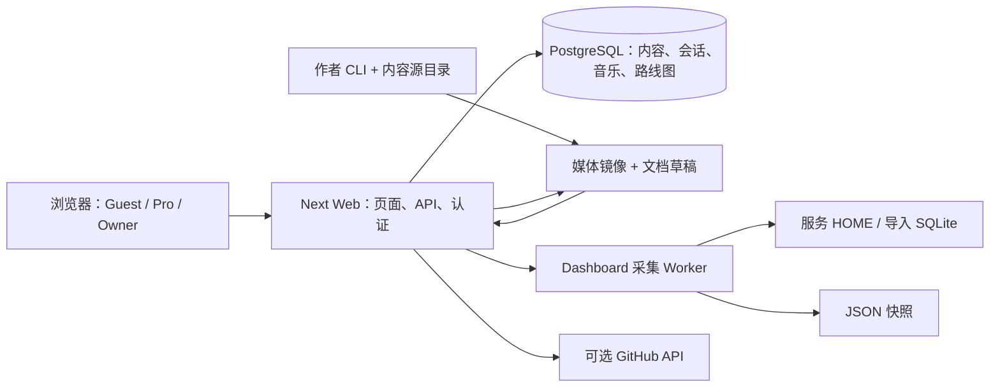
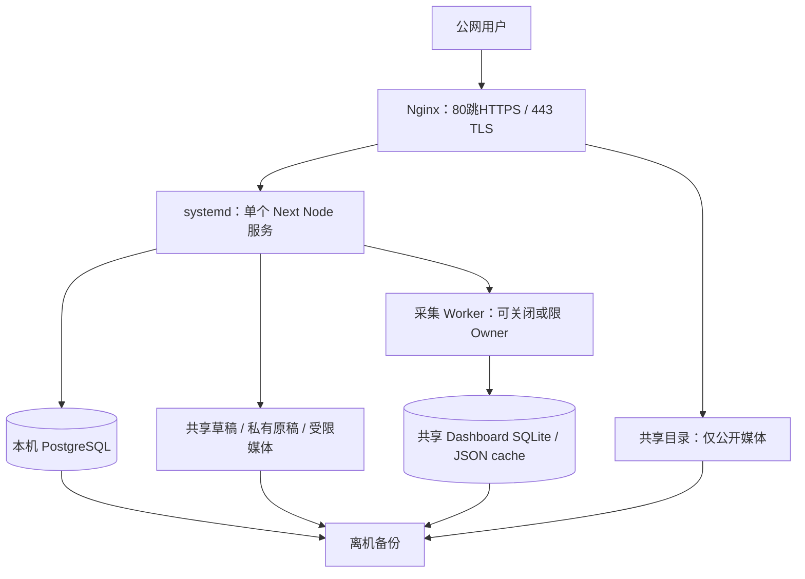

# 项目生产环境上线就绪评估报告

审查日期：2026-10-13（Asia/Singapore）\
审查对象：`D:/Desktop/code/code/Incept`，`main`，提交 `b623e13eaa1b09d1d20fb30eef832db06f9f47f6`。\
标准：单台 Linux 云服务器、真实域名与 HTTPS、持续运行的小规模首个生产版本。\
范围：审查与规划。未整改、安装或升级依赖、迁移数据库、提交、推送或部署。

## 1. 执行摘要

**结论：NO-GO。当前有可以构建、启动并连接现有本地数据库的产品基础，但不能直接按现状公开发布。**

项目无需重构为微服务。主要工作是封住公开数据边界、处理受影响的依赖、把运行时内容从发布目录中可靠保存和提供服务，并建立最小部署、备份和验收流程。不能以本机 Build/Test 通过代替 Linux、HTTPS、真实用户流程或恢复能力验收。

本轮实际结果：

| 检查 | 结果 | 判断边界 |
|---|---|---|
| 工作区类型检查 | 通过 | Web、Music、DB、Roadmap、Dashboard、scripts |
| 默认自动化测试 | **449 项通过** | Dashboard 89、Roadmap 67、Music Vitest 189、Music core 73、Web 31；DB 写入和真实浏览器流程未因此获得验证 |
| 生产构建 | 通过，含文件追踪警告 | Windows、已有 node_modules 与生成的 Prisma Client；不是干净 Linux 构建 |
| Prisma schema validate | 通过，含 Prisma 配置弃用警告 | 未执行任何 migration |
| Lint | **失败** | ESLint 9 缺少 flat config |
| 生产模式匿名用量 API | **200，可强制刷新** | 使用隔离的空数据目录，未采集或发布用户真实用量 |
| 生产模式匿名文档媒体 | **200** | 验证媒体不受文章访问角色保护；未确认被测文件属于私密文章 |
| 启动后新增 public 文件 | **磁盘存在但 HTTP 404** | 临时哨兵复现，文件已删除 |
| 生产依赖漏洞扫描 | **未通过** | 返回 46 条记录：3 critical、22 high、17 moderate、4 low；数量不能等同于 46 个可利用业务漏洞 |

最值得先处理的五组事项：

1. **依赖安全门禁**：Next 16.2.0、sharp 0.34.5 等命中公告；逐条确认可达条件后更新或关闭受影响的功能，并重新验证。
2. **用量公开边界**：匿名页面/API 使用同一份含会话标题、工作区路径、设备及项目信息的数据；应提供明确裁剪后的公开数据，原始详情和强制采集限 Owner。
3. **受限文档媒体**：`pro/private` 文章的本地图片也会落入 `public/_docs-media`；如果首发提供受限媒体，必须先补媒体鉴权。也可先限定首发只包含公开媒体。
4. **生产媒体和数据生命周期**：运行时新增媒体、跨版本更新、数据库与文件备份、恢复及回滚须形成闭环。
5. **发布质量与核心操作**：修复路线图 GET 同源检查、单篇文档部分提交反馈、Lint，以及主页死链和公开导航的 Owner 页面。

**推荐策略**：保留 Next + PostgreSQL 单体；Nginx 终止 HTTPS；单个非 root Node 服务由 systemd 管理；PostgreSQL 放同机但不开放公网；运行内容存共享持久目录；先发布 Docs/Notes/公开 Roadmap 和经审核的公开音乐，用量面板先限 Owner 或只发布脱敏汇总。完成第 4 节前置任务并通过第 7 节验收后，再转为 CONDITIONAL GO/GO。

“现在买一台全新云服务器能否顺利部署”：代码具备可部署的基础，**仓库尚未提供可照抄完成的安全生产流程**。新机器仍需要明确 Node 版本、Linux Prisma 生成、内容搬迁、数据库初始化、域名代理、进程守护与恢复方案；不能照搬开发 Compose 和 Windows .env 示例就上线。

## 2. 当前架构与部署现状

### 2.1 实际技术栈与数据流

| 组成 | 实际实现 | 入口与依赖 |
|---|---|---|
| Workspace | pnpm 10.30.3，单一 lockfile | [package.json:4](D:/Desktop/code/code/Incept/package.json:4)、[pnpm-workspace.yaml](D:/Desktop/code/code/Incept/pnpm-workspace.yaml) |
| 唯一 Web 应用 | Next 16.2.0 App Router、React 19.2.4、TypeScript、next-intl、Tailwind、Shiki | [apps/web/package.json:17](D:/Desktop/code/code/Incept/apps/web/package.json:17)；`pnpm build`、`pnpm --filter web start` |
| 主数据库 | PostgreSQL；Prisma lockfile 实际 6.19.3 | [packages/db/prisma/schema.prisma:1](D:/Desktop/code/code/Incept/packages/db/prisma/schema.prisma:1)；[packages/db/src/client.ts:16](D:/Desktop/code/code/Incept/packages/db/src/client.ts:16) |
| Docs/Notes | CLI 解析 .docs.md → 本地媒体镜像 → JSON 草稿 → Owner 网页确认 → PostgreSQL → Server Component 阅读 | [scripts/docs-import.mjs](D:/Desktop/code/code/Incept/scripts/docs-import.mjs)、[apps/web/src/features/docs/importer/paths.ts:37](D:/Desktop/code/code/Incept/apps/web/src/features/docs/importer/paths.ts:37)、[apps/web/src/app/[locale]/docs/import-preview/[draftId]/confirm/route.ts:51](D:/Desktop/code/code/Incept/apps/web/src/app/[locale]/docs/import-preview/[draftId]/confirm/route.ts:51) |
| 认证 | 单站 Owner secret；邀请/共享码为 Pro；随机会话令牌只存 hash，身份与文档访问角色分离 | [apps/web/src/server/auth/viewer.ts](D:/Desktop/code/code/Incept/apps/web/src/server/auth/viewer.ts)、[packages/db/src/access/index.ts](D:/Desktop/code/code/Incept/packages/db/src/access/index.ts) |
| Music | Owner 上传或 CLI 导入；音频镜像、曲库、曲目存 PostgreSQL；公共 catalog、网页播放器 | [apps/web/src/server/music/assembly.ts:20](D:/Desktop/code/code/Incept/apps/web/src/server/music/assembly.ts:20)、[packages/music/src/next/music-tracks.ts:125](D:/Desktop/code/code/Incept/packages/music/src/next/music-tracks.ts:125) |
| Roadmap | PostgreSQL 多项目/看板；公共阅读；Owner 内部 CRUD/import | [apps/web/src/server/roadmap/assembly.ts](D:/Desktop/code/code/Incept/apps/web/src/server/roadmap/assembly.ts)、[packages/roadmap/src/next/roadmap-routes.ts](D:/Desktop/code/code/Incept/packages/roadmap/src/next/roadmap-routes.ts) |
| Dashboard | 本地采集器读取服务进程 HOME 下 AI 工具日志/数据库；worker_threads 采集；JSON 快照；跨设备导入用 SQLite WAL | [packages/dashboard/src/adapters/runtime/worker-client.ts:27](D:/Desktop/code/code/Incept/packages/dashboard/src/adapters/runtime/worker-client.ts:27)、[packages/dashboard/src/adapters/local/imports/store.ts:23](D:/Desktop/code/code/Incept/packages/dashboard/src/adapters/local/imports/store.ts:23) |
| 外部服务 | 可选 GitHub REST/GraphQL 活动 API；可选文章外链图片 | [apps/web/src/server/activity/github.ts:19](D:/Desktop/code/code/Incept/apps/web/src/server/activity/github.ts:19)；未发现运行时依赖 Redis、队列、邮件或对象存储 |

Worker 是同一 Node 进程创建的线程，**无需单独常驻服务**。没有发现必须启动独立业务 Worker 或缓存服务器的实现。

### 2.2 已有能力

- 锁文件与构建、启动、类型检查、测试脚本均存在。
- 有顺序 migration 与 `db:deploy`；seed 只创建/更新 system 内容用户，不创建 Owner、不发布真实内容。
- Owner 认证 secret 最短 32 字符，随机 32-byte token，hash 入库；Cookie 有 HttpOnly、SameSite=Lax、生产 Secure；Owner 会话 30 天。
- Pro 身份查询校验 session、grant、principal 是否有效；撤销能力由 CLI 提供。400 天 Cookie 不意味着数据库授权永远有效。
- 文章/合集/Notes 在服务端检查访问角色；Studio、预览、Style Lab 有服务端 Owner 门禁；Music/Roadmap 写 API 有身份和同源检查。
- 音乐文件有 128 MiB 大小上限、MP3/WAV/FLAC 真实格式校验和 hash 去重；本地内容解析检查 realpath 以防符号链接越界。
- Music 导入/上传和 Roadmap 若干写入使用事务；合集目录导入使用整体事务；Dashboard 导入使用 SQLite 事务、预览过期与重复识别。
- Dashboard 有 15 秒缓存、同窗口请求合并、90 秒采集边界和空闲退出；快照采用临时文件改名。

### 2.3 未完成或不能确认

- Compose 只描述 PostgreSQL，并明确服务于本地开发；没有发现 Web Dockerfile、生产代理配置、systemd unit、生产 CI 发布流程或完整生产 runbook。
- 没有在审查范围内发现明确的应用健康检查、日志关联/轮转/告警、离机备份和恢复/回滚演练实现。**外部基础设施是否已经具备这些能力待确认。**
- Linux 干净安装、迁移从零执行、生产 HTTPS Cookie/Origin、Owner/Pro 端到端流程、真实数据恢复、浏览器布局及容量均未验收。
- 路径总体使用 Node path API，并非业务代码硬编码 Windows；但内容根目录、HOME、仓库根定位、Prisma 本机引擎和 ccusage 可用性都是新机器必须重建的依赖。
- 不能使用静态导出替代当前服务：会话、数据库、写 API、worker 和文件导入都要求 Node 服务。

## 3. 风险清单

状态定义：**确认**为代码或运行结果已支持；**潜在**为实现支持的触发风险但未复现实际损害；**待确认**为外部环境/数据/意图证据缺失。同一项可同时有已确认机制与待确认影响。P0 条件项可通过明确缩小首发范围关闭，不要求引入无关功能。

| ID | 等级 | 所属模块 | 问题描述 | 影响与后果 | 证据位置 | 建议措施 |
|---|---|---|---|---|---|---|
| R01 | P0 | 依赖安全 | **确认** Next 16.2.0、sharp 0.34.5 命中已披露漏洞；**潜在**利用，未攻击复现 | 公网资源耗尽；特定图片处理条件下可能 RCE | [apps/web/package.json:21](D:/Desktop/code/code/Incept/apps/web/package.json:21)、[pnpm-lock.yaml:31](D:/Desktop/code/code/Incept/pnpm-lock.yaml:31)、[output/production-readiness-2026-10-13/dependency-audit.json](D:/Desktop/code/code/Incept/output/production-readiness-2026-10-13/dependency-audit.json) | 完成适用性审查、修补受影响依赖或移除暴露入口；验证锁文件与 Linux 原生库 |
| R02 | P0 | Dashboard | **确认**匿名读取原始用量结构并强制刷新；**待确认**这些元数据是否获准公开 | 会话标题、路径、项目、设备及费用泄露；匿名触发采集耗资源 | [apps/web/src/app/api/dashboard/usage/route.ts:1](D:/Desktop/code/code/Incept/apps/web/src/app/api/dashboard/usage/route.ts:1)、[packages/dashboard/src/next/usage-route.ts:5](D:/Desktop/code/code/Incept/packages/dashboard/src/next/usage-route.ts:5)、[packages/dashboard/src/adapters/local/aggregation/summarize.ts:140](D:/Desktop/code/code/Incept/packages/dashboard/src/adapters/local/aggregation/summarize.ts:140) | 原始数据/刷新限 Owner；公开接口仅返回审核后的汇总 |
| R03 | P0（条件） | 文档媒体 | **确认**所有本地图发布到公开静态目录，无角色鉴权；**潜在**受限内容泄露 | 已知 URL 可跨身份读取；文章设 private/撤销 Pro 不会撤回文件 | [apps/web/src/features/docs/importer/media/local-store.ts:21](D:/Desktop/code/code/Incept/apps/web/src/features/docs/importer/media/local-store.ts:21)、[apps/web/src/proxy.ts:7](D:/Desktop/code/code/Incept/apps/web/src/proxy.ts:7)、[output/production-readiness-2026-10-13/smoke-extra.json](D:/Desktop/code/code/Incept/output/production-readiness-2026-10-13/smoke-extra.json) | 受限媒体走鉴权路由/映射；或首发禁止任何受限媒体及已公开缓存残留 |
| R04 | P1 | 生产部署/DB | **确认**只有开发 DB Compose，默认 postgres 密码、宿主全接口端口映射 | 若照搬且安全组允许 5432，数据库暴露且凭证弱；未证明现有云端暴露 | [docker-compose.yml:9](D:/Desktop/code/code/Incept/docker-compose.yml:9)、[.env.docker.example](D:/Desktop/code/code/Incept/.env.docker.example) | 生产配置拒绝默认密码；DB 绑定 loopback/内部网络；最小权限账号 |
| R05 | P1 | 媒体提供服务 | **确认**服务启动后新增 public 文件 404 | Owner 上传/发布数据库成功，用户仍无法播放/看图，直到重启扫描 | [packages/music/src/next/music-tracks.ts:169](D:/Desktop/code/code/Incept/packages/music/src/next/music-tracks.ts:169)、[apps/web/src/features/docs/importer/media/local-store.ts:21](D:/Desktop/code/code/Incept/apps/web/src/features/docs/importer/media/local-store.ts:21)、[output/production-readiness-2026-10-13/runtime-public-file.json](D:/Desktop/code/code/Incept/output/production-readiness-2026-10-13/runtime-public-file.json) | 持久目录由代理提供公开文件；受限文件走鉴权；验收运行中新增媒体 |
| R06 | P1 | 持久化/恢复 | **确认**重要内容在 Git 忽略的镜像、草稿、HOME SQLite 中；仓库未提供完整备份方案；**待确认**外部备份 | 重建/换版本丢文件；磁盘故障或误删后不可恢复 | [.gitignore:27](D:/Desktop/code/code/Incept/.gitignore:27)、[apps/web/src/features/docs/importer/paths.ts:37](D:/Desktop/code/code/Incept/apps/web/src/features/docs/importer/paths.ts:37)、[packages/dashboard/src/adapters/local/imports/store.ts:15](D:/Desktop/code/code/Incept/packages/dashboard/src/adapters/local/imports/store.ts:15) | 数据移到共享持久目录；PG+文件+SQLite 同批离机备份、实际还原 |
| R07 | P1 | Roadmap 管理 | **确认**GET 也必须 Origin；**潜在**普通浏览器 Owner 刷新失败 | POST 已落库但 refresh 404，错误反馈可能促使用户重复操作 | [apps/web/src/server/roadmap/assembly.ts:49](D:/Desktop/code/code/Incept/apps/web/src/server/roadmap/assembly.ts:49)、[apps/web/src/server/auth/request-origin.ts:6](D:/Desktop/code/code/Incept/apps/web/src/server/auth/request-origin.ts:6)、[packages/roadmap/src/react/admin/roadmap-admin-panel.tsx:331](D:/Desktop/code/code/Incept/packages/roadmap/src/react/admin/roadmap-admin-panel.tsx:331) | 读操作验证 Owner；仅状态变更要求同源；refresh 检查 response.ok |
| R08 | P1 | Docs 发布一致性 | **确认**单篇正文写入和发布事件分开提交；成功后还删除文件草稿；**潜在**部分成功却报失败 | 内容已覆盖但界面报错，重复提交冲突/重复记录；无历史正文恢复 | [packages/db/src/docs/import.ts:535](D:/Desktop/code/code/Incept/packages/db/src/docs/import.ts:535)、[packages/db/src/docs/import.ts:587](D:/Desktop/code/code/Incept/packages/db/src/docs/import.ts:587)、[apps/web/src/app/[locale]/docs/import-preview/[draftId]/confirm/route.ts:63](D:/Desktop/code/code/Incept/apps/web/src/app/[locale]/docs/import-preview/[draftId]/confirm/route.ts:63) | 单篇相关 DB 写入事务；提交状态/幂等确认；草稿清理失败不能抹掉成功事实 |
| R09 | P1 | 滥用与资源 | **确认**未发现登录/兑换/采集限流；有大小上限但缺并发/超时统一策略 | 公开大请求、共享码兑换造行、强制扫描；Owner NCM 128 MiB 内存复制使小机器 OOM | [apps/web/src/app/api/auth/owner/login/route.ts:31](D:/Desktop/code/code/Incept/apps/web/src/app/api/auth/owner/login/route.ts:31)、[packages/dashboard/src/next/usage-route.ts:12](D:/Desktop/code/code/Incept/packages/dashboard/src/next/usage-route.ts:12)、[packages/music/src/adapters/media-store.ts:314](D:/Desktop/code/code/Incept/packages/music/src/adapters/media-store.ts:314) | 代理分路由 body/速率/超时；强制刷新 Owner + 冷却；上传/大导入限并发 |
| R10 | P1 | 公开产品入口 | **确认**首页四条 /test 死链；公开 About 导航指向 Owner-only 页 | 首访承诺的流程无法完成；流式返回 200 也会显示 not-found | [apps/web/src/features/home/index.tsx:50](D:/Desktop/code/code/Incept/apps/web/src/features/home/index.tsx:50)、[apps/web/src/components/layouts/site-navigation.ts:72](D:/Desktop/code/code/Incept/apps/web/src/components/layouts/site-navigation.ts:72)、[apps/web/src/app/[locale]/about/page.tsx:13](D:/Desktop/code/code/Incept/apps/web/src/app/[locale]/about/page.tsx:13) | 最小真实首页或跳转 Docs；About 公开内容单独审核，或从 Guest 导航移除 |
| R11 | P1 | 发布检查 | **确认**pnpm lint 无配置而退出 2 | 质量门禁无法执行，当前未审查的 lint 问题被掩盖 | [apps/web/package.json:11](D:/Desktop/code/code/Incept/apps/web/package.json:11)、[output/production-readiness-2026-10-13/lint.log](D:/Desktop/code/code/Incept/output/production-readiness-2026-10-13/lint.log) | 补 ESLint 9 配置，处理实际输出，统一首发检查 |
| R12 | P1 | 运行时契约 | **确认**无项目 Node engines/version 文件；Dashboard import 要求 node:sqlite | 按 @types/node 20 或 Next 最低版本安装会缺功能，构建通过不等于能导入 | [packages/dashboard/src/adapters/local/imports/store.ts:22](D:/Desktop/code/code/Incept/packages/dashboard/src/adapters/local/imports/store.ts:22)、[package.json:1](D:/Desktop/code/code/Incept/package.json:1) | 明确 Node 24 LTS 具体补丁、pnpm 10.30.3；生成目标 Linux Prisma Client |
| R13 | P1 | 运维 | **确认**未发现最小应用探活、结构化诊断和故障操作手册；**待确认**平台监控 | 宕机/DB失联/磁盘满后发现与定位慢；持续服务无验收依据 | [packages/db/src/client.ts:19](D:/Desktop/code/code/Incept/packages/db/src/client.ts:19)、[packages/dashboard/src/next/usage-route.ts:16](D:/Desktop/code/code/Incept/packages/dashboard/src/next/usage-route.ts:16)、[apps/web/src/server/activity/github.ts](D:/Desktop/code/code/Incept/apps/web/src/server/activity/github.ts) | systemd 自动恢复；轻量 readiness/liveness；脱敏请求/错误日志、轮转与基础告警 |
| R14 | P1（运维条件） | 清理脚本 | **确认**“test data”以 documentKey=null 与固定合集 slug 识别，且修改固定文章角色 | 若对含合法旧文章的生产库 --confirm，会永久误删或改权限；没有自动执行证据 | [packages/db/src/docs/cleanup.ts:62](D:/Desktop/code/code/Incept/packages/db/src/docs/cleanup.ts:62)、[packages/db/src/docs/cleanup.ts:148](D:/Desktop/code/code/Incept/packages/db/src/docs/cleanup.ts:148) | 不列入生产初始化；显式样本标记/ID、环境门禁、备份和再次校验 |
| R15 | P2 | 文件一致性 | **确认**Docs 写文件非原子且已有文件只 access；Music 发布先 unlink 后 rename；**潜在**崩溃窗口 | 部分图片被当作可复用；并发/中断音频暂缺；有源/备份可重建 | [apps/web/src/features/docs/importer/media/local-store.ts:26](D:/Desktop/code/code/Incept/apps/web/src/features/docs/importer/media/local-store.ts:26)、[packages/music/src/adapters/media-store.ts:42](D:/Desktop/code/code/Incept/packages/music/src/adapters/media-store.ts:42) | 临时文件+校验+原子替换；内容完整性巡检；回收先停写并预览 |
| R16 | P2 | 数据规模/性能 | **确认**首页、曲目、路线图及上传去重多为全量读取；用量包含全窗口 sessions | 数据增长后 DB、JSON、浏览器渲染/内存上升；无测量结果 | [packages/db/src/docs/queries/home.ts:78](D:/Desktop/code/code/Incept/packages/db/src/docs/queries/home.ts:78)、[packages/music/src/adapters/prisma/upload.ts:58](D:/Desktop/code/code/Incept/packages/music/src/adapters/prisma/upload.ts:58)、[packages/dashboard/src/adapters/local/aggregation/summarize.ts:161](D:/Desktop/code/code/Incept/packages/dashboard/src/adapters/local/aggregation/summarize.ts:161) | 首发给内容/导入规模上限并压测；增长后分页、过滤、按 hash 查询 |
| R17 | P2 | 外部 API | **确认**GitHub fetch 无显式 abort 超时、commit 页数无上限；异常只 unavailable | Owner 活动请求等待过长，故障原因不可见；6h 缓存有缓解 | [apps/web/src/server/activity/github-api.ts:98](D:/Desktop/code/code/Incept/apps/web/src/server/activity/github-api.ts:98)、[apps/web/src/server/activity/github-api.ts:176](D:/Desktop/code/code/Incept/apps/web/src/server/activity/github-api.ts:176) | 超时/分页预算、保留上次数据、脱敏诊断；可先不配 GitHub |
| R18 | P2 | 打包 | **确认**Build 报 whole-project tracing 警告；nft 含未跟踪媒体 | 精简包范围难保证；遗漏依赖或额外携带内容；未发现 trace 包含 .env | [apps/web/next.config.ts:6](D:/Desktop/code/code/Incept/apps/web/next.config.ts:6)、[output/production-readiness-2026-10-13/build.log](D:/Desktop/code/code/Incept/output/production-readiness-2026-10-13/build.log)、[output/production-readiness-2026-10-13/tracing-summary.json](D:/Desktop/code/code/Incept/output/production-readiness-2026-10-13/tracing-summary.json) | 先用完整 Linux workspace 发布；精简/standalone 前核对 trace 和运行依赖 |
| R19 | P2 | Session/邀请 | **确认**邀请通过 GET URL 兑换；Pro 依 grant/principal 长期授权，未发现常规清理 | URL 在代理日志/历史中留 bearer；过期会话累积；转发带来共享身份 | [apps/web/src/app/[locale]/settings/access/[credential]/route.ts:42](D:/Desktop/code/code/Incept/apps/web/src/app/[locale]/settings/access/[credential]/route.ts:42)、[apps/web/src/server/auth/session-cookie.ts:9](D:/Desktop/code/code/Incept/apps/web/src/server/auth/session-cookie.ts:9) | 日志脱敏该路径；邀请短期/可撤销；维护数据保留和会话清理策略 |
| R20 | P2 | 次要页面/设置 | **确认**resources/create 返回 null；通用 button/input 的动作占位 | 非核心操作看似可用；潜在误导，但无证据承诺成功入库 | [apps/web/src/app/[locale]/resources/page.tsx:1](D:/Desktop/code/code/Incept/apps/web/src/app/[locale]/resources/page.tsx:1)、[apps/web/src/features/settings/shared/settings-renderer.tsx:94](D:/Desktop/code/code/Incept/apps/web/src/features/settings/shared/settings-renderer.tsx:94) | 隐藏/禁用/明确说明未开放；不要求首发实现全套 AI 设置 |
| R21 | P2 | 交付自动化 | **确认**未发现 CI 配置与浏览器/真实 DB 核心回归；已有单元测试扎实 | 更新容易遗漏部署或鉴权回归；可靠手动流程可缓解 | [package.json:9](D:/Desktop/code/code/Incept/package.json:9)、[apps/web/vitest.config.mts](D:/Desktop/code/code/Incept/apps/web/vitest.config.mts)、本轮 Git 跟踪文件检查 | 先规定人工发布门禁；再加入 Linux CI 与关键端到端测试 |
| R22 | P3 | 扩展 | **潜在**本地盘/JSON cache、单实例采集和进程内缓存限制多实例 | 日后水平扩展需重新设计存储和任务归属；当前不阻碍单机 MVP | [packages/dashboard/src/adapters/runtime/snapshot-store.ts:10](D:/Desktop/code/code/Incept/packages/dashboard/src/adapters/runtime/snapshot-store.ts:10) | 到达容量或可用性需求后再考虑对象存储、独立采集/共享缓存 |

### 3.1 依赖公告适用性：不能照抄扫描严重级别

扫描原始结果保留在 [output/production-readiness-2026-10-13/dependency-audit.json](D:/Desktop/code/code/Incept/output/production-readiness-2026-10-13/dependency-audit.json)。本次查询的关键区分：

| 公告 | 代码/部署适用性 | 处置与验证 |
|---|---|---|
| [Next RSC CPU DoS](https://github.com/vercel/next.js/security/advisories/GHSA-8h8q-6873-q5fj) | Next 16.2.0 命中；项目使用 App Router；公告涉及 Server Function 反序列化。未复现，未证明每个页面均可触发 | 查实际暴露路径并修补；速率限制不能替代框架补丁 |
| [Next AVIF 图片优化 RCE](https://github.com/vercel/next.js/security/advisories/GHSA-2xp9-vwfh-vxw4) | 命中版本；优化 API 未关闭；Docs 接受 AVIF。本项目图片来源主要由 Owner 控制，未证明攻击者可提供优化输入 | 更新 Next/实际 sharp 原生依赖，或禁用受影响优化入口；验证 AVIF、图片路由和目标 Linux |
| [sharp libheif](https://github.com/advisories/GHSA-rgj7-g3m4-5g8c) | lockfile 0.34.5 命中；公告区分 Linux、libheif 和输入条件 | 不仅更新 package 声明；核对新 lockfile、实际 binary/libvips、构建和媒体回归 |
| [Windows 服务 RCE](https://github.com/vercel/next.js/security/advisories/GHSA-p293-qw3h-jr36) | **计划中的 Linux 首发不适用**；不能据此宣称 Linux 站点已可被 RCE | 不把本机 Windows 开发服务公开；保留适用性结论 |
| [next/og ImageResponse RCE](https://github.com/vercel/next.js/security/advisories/GHSA-vcvr-r3jv-pc5j) | 未发现 next/og 或 ImageResponse 使用；公告要求不可信 SVG 参数 | 当前未发现业务触发路径；依赖升级一并覆盖 |
| [图片优化 SSRF](https://github.com/vercel/next.js/security/advisories/GHSA-cjq9-62q9-8jv4) | 未配置 remotePatterns；按公告 workaround 当前不满足该触发条件 | 不随意放宽远程图片白名单 |
| [music-metadata MP4 回归](https://github.com/advisories/GHSA-f94x-6692-553q) | 扫描命中 11.15.0；公告文字含“未发行回归”的历史描述。Web 先 sniff 并指定 MP3/WAV/FLAC MIME，不接受 MP4/EBML | 属待核实适用性，不能标成匿名上传已可打挂；CLI parseFile 更宽，仍应处理版本告警 |
| 其余 PostCSS/Babel/Browserslist/Prisma config 等 | 很多路径主要在构建/CLI 阶段；扫描 `--prod` 并不保证都是公网运行入口 | 按依赖路径与输入来源审查，避免为了清零数字盲目大版本重构 |

当前扫描中 Next 公告的最高已列修复下界为 16.3.8；sharp 列到 0.35.5，music-metadata 列到 11.16.0。**这些是本次返回的下界，不是对未来最新安全版本的承诺**。整改时重新查询官方公告，选择兼容且全部适用问题已关闭的版本。本轮未升级任何依赖。

### 3.2 公开数据与媒体边界

R02 已确认的不是“会话密钥直接泄露”，而是 **API 没有身份检查且返回工作区路径、标题、会话/设备/项目及费用元数据**。本机复现使用空 HOME，拿到 200 与新 checkedAt；真实云端有哪些数据仍未知。若站点有意公开使用量，也应把“公开汇总”和“原始会话明细”的发布授权区分清楚。仅隐藏导入按钮无法限制 GET API。

R03 的文件名使用 hash，有降低随机猜中概率的效果；它不构成可撤销的身份鉴权。链接转发、旧缓存或曾获授权的读者获得 URL 后，仍可匿名读取。未确认现有图片里有私密信息，因此不宣称发生过隐私事故。**首发继续承诺受限媒体时，该问题为 P0；明确仅发布公开媒体并排查残留可关闭这一条件。**

### 3.3 数据完整性与不可恢复损失

R07 的浏览器请求条件参考 [MDN Origin 官方说明](https://developer.mozilla.org/en-US/docs/Web/HTTP/Reference/Headers/Origin)：通常同源 GET/HEAD 不附带 Origin，而宿主 authorizeOwner 在缺该头时直接拒绝。现有测试 mock 了 hasSameOrigin，不能覆盖真实头部行为。应在后续测试库的 Owner 浏览器会话中完成一次新增/编辑后刷新，核对请求头、返回状态及实际落库状态。

| 场景 | 性质 | 是否可能不可恢复 |
|---|---|---|
| DB/网络短暂不可用 | 服务可用性故障 | 通常可重启/恢复连接；本身不证明数据已丢失 |
| 单篇内容已写入、publication event 或草稿删除失败 | 部分提交和用户反馈不一致 | 正文可能已经替换；没有版本历史/源文件时旧正文难恢复 |
| 新 release 没保留 public 镜像、草稿或 HOME SQLite | 部署造成文件/记录缺失 | 若这些是网页上传/跨设备导入的唯一副本且无备份，会不可恢复 |
| `docker compose down -v`、磁盘丢失、错误 cleanup | 持久数据永久删除 | 无离机且验证过的备份时不可恢复 |
| Music API 永久删除行、后续 cleanup 删除镜像 | 预期的永久删除操作 | 需要备份才能纠正误操作；API 当前保留镜像是有益缓解 |
| 文件写入中断或复用坏文件 | 文件完整性故障 | 有原内容源可重建；仅有镜像时必须依赖备份 |

单篇 Prisma 的 nested write 本身有原子性；问题是**多条独立调用之间没有整体事务**。合集目录使用整体事务，不能把 R08 扩大为“所有 Docs 写入都没有事务”。当前 replace 缺少预览基线版本条件，两个 Owner 页面编辑同一对象时存在后写覆盖；小型单 Owner 首发可用单写者操作规程缓解。

## 4. 上线前必须完成的事项

S/M/L 是相对工作量，不是日程承诺。每项必须有验收记录；“配置已写”不等于“验收已通过”。

| 任务 | 要完成什么/为什么 | 相关代码或配置 | 前置依赖与实施方式 | 完成标准/验证方法 | 工作量 |
|---|---|---|---|---|---|
| T01 安全依赖基线 | 关闭 R01 中所有可达严重问题 | Web/各包 package、lockfile、next.config、图片相关原生依赖 | 先做公告适用性清单；后续独立整改任务中定向升级；不同时做架构重构 | 新 lockfile audit 分类清楚；Linux typecheck/lint/test/build；图片与 RSC 回归 | M |
| T02 数据公开边界 | 处理 R02，保证公共访问不带私人元数据且不触发不受控采集 | Dashboard Web page/usage route、summarize、refresh | 先确定首发公开字段；最小路径为 Owner-only；公开汇总须另建裁剪模型 | Guest/Pro/Owner 三身份直接调用 API；公开响应中无私密路径/标题/标识；Guest refresh 拒绝 | M |
| T03 受限媒体决策与实现 | 关闭 R03 条件；让页面与文件权限一致 | Docs importer/media、数据映射、媒体路由/代理 | 依赖首发内容盘点；可先只准公开媒体，否则建立文件与文章授权映射 | 公开/Pro/private URL 逐身份测试；撤销、文章改私密、已知旧 URL、缓存也符合预期 | M；完整方案 L |
| T04 可重复 Linux 发布 | 明确 Node/pnpm、安装/生成/构建顺序和目录布局 | package scripts、schema、next.config、生产 runbook、systemd/代理配置 | 依赖 T01；目标环境使用 Node 24 LTS 固定补丁和 pnpm 10.30.3；全 workspace 发布，原生模块在 Linux 安装 | 全新 Linux checkout + frozen lockfile 成功；生成 Linux Prisma；仅带指定文件可 start；无个人机器 CLI 依赖 | M |
| T05 DB 安全初始化 | 用强密码、隔离网络、应用/迁移账号和正确 schema | 生产 Compose 或 PostgreSQL 配置、DATABASE_URL、migrations、seed | 依赖 T04 的目标环境；从空库 migrate deploy；有旧数据时先备份并迁移演练；不得拿 migrate dev/reset 当生产流程 | 空库全部 migration 成功；seed 幂等；真实内容导入；公网无法访问 5432；应用非 superuser | M |
| T06 持久目录与运行媒体 | 处理 R05/R06，使更新或重启保留内容并立即可访问 | public 镜像路径、草稿路径、Dashboard HOME/import/cache、代理 | 依赖 T03/T04；共享目录与 release 分离，当前代码可用 symlink 适配公开镜像/草稿；受限媒体不得直接 alias | 运行中新增音频/图片立即可读；Range 206；重启、换 release、回退均不缺数据；源目录不公开 | M |
| T07 核心写入与反馈 | 处理 R07/R08；防止已经成功却诱发重复提交 | request-origin、Roadmap refresh、Docs import/confirm | 保留写方法 CSRF 门禁；GET 只鉴权；单篇事务；发布提交状态可查询，草稿清理后置 | 真浏览器 GET 无 Origin 正常；错误 Origin 写拒绝；注入事件/清理失败不产生模糊成功；重复确认无额外副作用 | M |
| T08 备份恢复与回滚 | 处理 R06/R14，不可恢复损失有防线 | PG dump、SQLite backup、共享内容/原稿、备份与回滚 runbook | 依赖 T05/T06；暂停 Owner 写入取得关联快照；离机存储；明确禁止生产 test cleanup/down -v | 在另一临时 DB/目录实际还原并读/播；核对计数与 hash；演练前一 release 回退和 schema 兼容 | M |
| T09 代理与资源边界 | 强制 HTTPS、安全 Cookie、限制滥用/OOM | Nginx、systemd、安全组、防火墙、各 body/refresh/upload 入口 | 依赖 T02/T04；只开放 80/443，SSH 限制来源；精确 Host/forwarded proto；按路由设限 | HTTPS Owner 登录可用；无/错误 Origin POST 拒绝；超限 413/429；并发上传/refresh 不拖垮阅读页 | M |
| T10 最小诊断与守护 | 关闭 R13，保障持续服务 | 探活路由、DB/worker 错误日志、journald/logrotate、timer/告警 | 依赖 T04/T05/T09；脱敏且避免直接回传 Prisma/文件路径；liveness 与 readiness 分开 | 杀进程/重启机器自动恢复；DB断连可识别；失败采集可定位；磁盘/备份失败有可达告警 | M |
| T11 首发产品收口 | 处理 R10 和对用户暴露的 R20 | 首页、导航、About、空页、设置占位 | 内容范围决定后做最小整改；不要求额外造新功能 | Guest 首访/每个公开导航目标都可完成；无 /test 死链、假动作或未经审核内容；双语言和空数据验收 | S–M |
| T12 发布验收门禁 | 修复 R11，补足关键真实流程与容量证据 | ESLint config、检查脚本、浏览器回归、发布记录 | 依赖 T01–T11；先可靠手工门禁，CI 可随后建立 | 第 7 节必需项全部关闭；保存命令、版本、测试结果、恢复记录及剩余风险接受理由 | M |

推荐顺序：**T01/T02/T03 → T04 → T05/T06 → T07/T09/T10/T11 → T08 → T12**。T07、T11 可在部署环境准备期间推进。备份设计在 T05 前确定，实际恢复演练在持久目录确定后做。

## 5. 推荐的最低可行部署架构

### 5.1 假设与拓扑

尚未提供云厂商、机房地域、域名、服务器规格、预算、已有备份资源、音乐/文档量、用户峰值。以下都是推荐假设，不是现有资产：

- 单台 Ubuntu 24.04 LTS 或同级受支持 Linux，初步验证起点为 **2 vCPU / 4 GiB RAM / 40 GiB SSD**。磁盘按媒体+数据库+构建+本地备份暂存+至少 30% 余量重算；音频多时 40 GiB 不足。
- 小规模阅读站，Owner 偶尔写入；构建和大导入安排在维护窗口。若同机构建或 NCM/大用量导入出现内存压力，改为同架构 Linux 独立构建或提升到 4 vCPU/8 GiB；这不是已测出的容量结论。
- 保持**一个 Node 实例**；不要先用多实例 PM2 cluster。同机 PostgreSQL 和用量 worker 与 app 共享 CPU/内存，需合并测量。
- Nginx :443 → Node `127.0.0.1:3000` → PostgreSQL loopback :5432；公开音乐/公开 Docs 媒体可由 Nginx 读共享目录；受限媒体由鉴权处理。
- systemd 守护应用，`Restart=on-failure`、合理重启间隔、非 root 账号、SIGTERM 优雅关闭时间、受限工作目录。明确 WorkingDirectory 指向保留根 package.json 的当前 workspace。
- DB 可继续使用 Docker 的命名 volume，但生产端口应只绑定 `127.0.0.1`；也可用发行版 PostgreSQL 服务。二者选一种写清手册即可。
- 不需要 Redis、消息队列、Kubernetes 或独立 Worker 服务器。

[Next 官方自托管说明](https://nextjs.org/docs/app/guides/self-hosting)建议在 Node 服务前设置反向代理，以承接请求大小、速率及连接保护。本报告推荐 Nginx 是为了这些具体职责。

### 5.2 持久存储与目录

建议布局为 `/srv/incept/releases/<revision>`、`/srv/incept/current`、`/srv/incept/shared`。不要把 release 目录当数据库或唯一内容存储。

| 数据 | 是否必须持久 | 初步办法 |
|---|---|---|
| PostgreSQL | 必须 | 持久卷/专用数据目录，定期逻辑备份，独立迁移账号 |
| 文档 .docs.md 原稿/本地媒体 | 必须 | shared/content/docs，DOCS_CONTENT_ROOT 指向绝对路径 |
| Web 上传的 Music 镜像 | 必须 | shared/media/music；不要以为 MUSIC_CONTENT_ROOT 已有这些上传文件 |
| CLI Music 原件/music.json | 必须（如使用） | shared/content/music；保持清单与网页编辑冲突规程 |
| Docs 媒体镜像 | 必须，或有验证过的源重建流程 | shared/media/docs；公开/受限内容按 T03 分离 |
| Docs 草稿 | 发布流程使用期间必须 | shared/docs-import-drafts；当前固定路径可先 symlink，权限 0700/最小需要 |
| Dashboard SQLite + WAL | 若保留导入历史则必须 | shared/dashboard，显式 INCEPT_DASHBOARD_IMPORTS_FILE；SQLite 在线备份/停写快照，不能只复制正在写的 .db |
| Dashboard JSON 快照 | 可重建缓存 | 显式 CACHE_FILE，允许丢失后重新计算；源数据不可丢 |
| .next 构建、node_modules | 可重建 | 按 release 生成/交付；不复制 Windows 原生二进制到 Linux |

静态公开目录必须关闭目录列表、拒绝 `.tmp` 等临时文件、只允许预期文件类型，使用正确 MIME、nosniff 和 Range。**不能为解决 R05 而把全部私密原稿/图片 alias 到公网。**

代码当前依赖仓库根和相对结构，首发应保留 workspace 布局。未来要用 standalone，需要重新验证 Prisma 引擎、Dashboard worker、ccusage、public 和动态路径的打包；不建议本轮只审查时顺手改变打包模式。

### 5.3 配置、端口与 DNS/HTTPS

- 固定 Node 24 LTS 的具体补丁，pnpm 10.30.3；代码引用 node:sqlite，不能从 @types/node 20 推断运行时版本。
- Web 与 Prisma CLI 使用同一生产库配置，但凭证按 app/migration 权限分离；不要让 apps/web .env.local 与 packages/db .env 指向不同库。
- 必需：DATABASE_URL、生产 Owner secret、NODE_ENV=production；写 Docs/Music CLI 时才要求对应 CONTENT_ROOT；公开只读运行不应强求作者原稿。
- Dashboard 若保留：HOME/cache/import/overrides/worker 路径显式配置到专用服务目录。**新云机不会自动拥有个人电脑的 AI 日志**；用现有跨设备导入即可，无需复制个人 HOME。
- GitHub 配置可不填；不影响 Docs/Notes 主流程。若使用，PAT 在服务端，权限最小化，确认外网连通和超时。
- 安全组对公网只开 80/443；SSH 只允许必要来源。3000、5432、Prisma Studio 不公开。
- DNS A/AAAA 指向真实地址；只有 IPv6 可达时才发布 AAAA；单一 canonical host；未知 Host 拒绝；HTTP 跳 HTTPS。
- 证书 ACME 自动续期并验证续期任务。代理转发 Host 与 X-Forwarded-Proto，必须用真实域名测试 `request.url` 与浏览器 Origin 一致；不能靠伪造“同源”固定头绕过检查。
- 日志避免记录 credential URL、Cookie、Authorization、Owner secret、Token 和导入正文。安全响应头由应用/代理统一设置；HSTS 在 HTTPS 稳定后启用；CSP 先兼容验证，强制完整 CSP 可作为 P2。

### 5.4 更新、恢复与维护成本

建议人工发布流程足够支持 MVP：固定 revision → Linux 干净安装/生成/检查/构建 → 发布前备份与兼容性检查 → 维护窗口迁移 → 新目录健康检查 → 切换 current/重启 → 冒烟；失败时切回已验证兼容的上一目录。

本报告列出的 `pnpm install --frozen-lockfile`、`db:deploy` 等是**后续环境建立任务**，本轮未执行安装或数据库写入。安装应具备 dev/build 工具；不能先 production-only 安装后又期望 CLI Prisma/tsx/esbuild 都可用。

代码回滚与数据库回滚是两件事。旧版本兼容新 schema 时可回退代码；不兼容时需要维护窗口及备份恢复/前向修复，不能默认 Prisma 自动有 down migration。媒体和 HOME 目录必须跨 release 保留。

初步建议备份目标 **RPO ≤24h、RTO ≤2h**，重要发布/删除前另做备份；需要用户接受并通过演练才可标达成。暂停 Owner 写入的短窗口内获取 PG、SQLite 和文件关联快照；离机加密备份与保留策略明确，本地同盘副本不能抵御云盘丢失。

持续成本主要是云机与磁盘、音频公网出流量、离机备份存储/传输、域名和维护时间。未给出云商/地域，**不虚构价格**。当前未发现网站运行必须调用付费 AI API；用量面板记录的费用并不等于服务器新增服务成本。上线后每日看备份/探活、每周看资源和日志、定期安全补丁与恢复抽查；内容越多，带宽和备份量越明显。

## 6. 分阶段实施计划

| 阶段 | 推荐顺序与依赖 | 完成条件 |
|---|---|---|
| Phase 1 消除阻断 | T01 → T02/T03；同步处理 T07 与公开入口 T11，补 T12 的 Lint | 适用严重漏洞关闭；公开数据范围明确；private/pro 媒体无绕过或明确排除；核心写操作反馈可判定 |
| Phase 2 最小生产环境 | T04 → T05/T06 → T09/T10；T08 的备份配置随持久目录建立 | 干净 Linux 构建/迁移/启动；仅80/443公网；域名 HTTPS/安全 Cookie 正常；持久目录明确；服务自恢复 |
| Phase 3 上线前验收 | T07 完整浏览器回归 → T08 恢复/回滚 → T12 容量与清单；依赖 Phase1/2 | Guest/Pro/Owner、发布/上传、撤销、故障、恢复、回退全部留证；P1延期有具体缓解、期限和接受理由 |
| Phase 4 正式发布 | 只在 Phase3 通过后实施：固定构建、最终备份、迁移、切换、DNS验证、外部冒烟 | 两种网络访问域名成功；数据不泄露；新媒体可用；错误率/磁盘/备份状态正常；保留可用旧release |
| Phase 5 持续完善 | R15–R21 按真实资源与故障反馈推进，R22按容量需求启动 | 改善完整性巡检、分页、日志细节和CI；不把HA/微服务当作首发补票 |

Phase 4 是后续独立部署任务，本轮没有执行。不得在 Phase 1 安全阻断未消除时为了拿到域名演示先开放公网。

### 首发容量验证方案（尚未执行）

以最终候选实例和数据量执行，不用本机秒数推导云机能力：

1. 数据集：预计首发量与 5 倍首发量各一组，覆盖双语言、长文章、代码块、合集、音乐与历史用量；都使用测试数据或脱敏副本。
2. 用 k6/同类工具从另一机器测匿名阅读、页面RSC、Docs列表、Roadmap、音乐catalog；逐步 1/5/10 并发，每档 10 分钟，观察 5xx、p95、CPU、RSS、PG连接/查询等待。
3. 同时一项 Owner 工作：小/接近上限音频上传、NCM 解码、64 MiB 用量预览；强制刷新先串行，再少量并发；验证公开页仍能服务。
4. 文件验证：首次播放、Range跳播、长播放、断网重连；以音频码率×听众估算出流量并对照真实带宽额度。
5. 运行 1–2 小时 soak，并测试重启、DB短暂中断、worker失败、近满磁盘与备份失败的反应；近满磁盘用隔离环境，不损坏生产卷。
6. 初步验收预算可设：普通 API p95 <1s、阅读请求错误率 <1%、无 OOM、连接不过池、内存不持续增长、磁盘留 ≥30% 余量。**这是建议门槛，非本项目测得指标**；以真实使用范围调整，CPU/磁盘越线时先限任务/缩范围，再升级配置。

## 7. 生产上线验收清单

符号与状态：勾选只用于本轮有相应证据的通过项；代码检查通过不代表完整生产验收通过。

### 已验证通过（限定于本轮证据）

- [x] 默认工作区类型检查通过。
- [x] 默认测试 449 项通过；范围为单元/模拟组件/临时存储。
- [x] 当前 Windows + 已安装依赖能完成生产构建。
- [x] Prisma schema 校验通过。
- [x] `next start` 可在 127.0.0.1:3307 启动；HTTP匿名 Docs/Notes/Roadmap/music catalog 可响应。
- [x] 抽查匿名 dashboard imports、internal roadmap GET、writing activity GET 返回 404。
- [x] Cookie 安全属性、会话随机令牌/hash、服务端文章角色控制存在（静态验证）。
- [x] 本轮浏览器构建产物扫描未命中当前 OWNER_ACCESS_SECRET/GITHUB_ACTIVITY_TOKEN/DATABASE_URL 的字面值；当前跟踪文件常见私钥/ghp/AKIA 模式扫描无命中。**不涵盖 Git 历史或全部秘密类型。**
- [x] 首次检查已跟踪文件无差异；结束前构建自动生成的 next-env.d.ts 已恢复，临时 public 哨兵已删除，本机服务已停止。

### 已确认不通过

- [ ] Lint：缺少 ESLint 9 配置。
- [ ] 生产依赖安全门禁：有未关闭的公告记录。
- [ ] Dashboard 原始明细/强制刷新身份边界：匿名可调用。
- [ ] 文档媒体访问控制：已知静态 URL 可匿名读取；私密媒体首发条件未关闭。
- [ ] 运行中新增 public 媒体立即可读：本轮哨兵 404。
- [ ] 首页写作链接有效：/zh/test 返回 404。
- [ ] Guest About 导航形成可用页面：源代码 Owner-only；匿名响应含 not-found digest，即使流式 HTTP 是 200。
- [ ] 仓库提供完整生产配置/部署/恢复流程：本轮未找到，现有手册为开发用途。

### 尚未验证（必需或按范围执行）

- [ ] 全新 Linux frozen-lockfile 安装、Prisma generate、typecheck/lint/test/build/start。
- [ ] 空生产库全部迁移、seed 幂等、现有库数据/约束升级兼容。
- [ ] 生产应用账号最小权限；公网无法直连 DB/Node/Studio。
- [ ] 真实域名 HTTPS、续期、Host/forwarded proto、登录 Secure Cookie 与重启后会话。
- [ ] Guest/Pro/Owner 直接读受限页面/媒体、过期/撤销、重新登录、多端访问。
- [ ] Roadmap Owner GET 无 Origin正常；CRUD后刷新成功，失败反馈不促使重复写入。
- [ ] Docs首次发布/replace/合集目录导入、异常回滚、并发或重复确认。
- [ ] Music上传/去重/改库/删除、新文件即刻播放、Range/刷新后状态。
- [ ] Dashboard跨设备导入、映射预览、幂等提交、回滚与数据公开裁剪。
- [ ] 更新后PG、媒体、草稿和SQLite保留；备份关联一致、离机可取得。
- [ ] 实际恢复、上一版本代码回退和不兼容schema恢复演练。
- [ ] systemd crash/主机重启恢复；DB/worker/磁盘故障日志、轮转和告警。
- [ ] 限流、JSON/音频大小/慢连接/并发上限，阅读性能不受后台任务拖累。
- [ ] 目标机容量、长时间内存/磁盘增长、音频出流量预算。
- [ ] 桌面/移动端 Chrome/Safari/Firefox 的主要用户流程、空数据/网络失败、404/500与加载反馈。
- [ ] 公网内容与音乐的发布授权、资源/地域相关上线手续（按选择的地区和资源确认）。
- [ ] Git历史秘密扫描、候选部署产物和运行日志脱敏审核。

### 当前项目不适用 / 无需作为首发前置

- [ ] Kubernetes、服务网格、多区域高可用、复杂监控平台：当前单机MVP不适用。
- [ ] Redis失效与独立消息队列Worker恢复：没有发现这些组件。
- [ ] 多用户租户级隔离：当前为单 Owner 内容站；已有 Pro身份隔离仍需验收。
- [ ] 邮件验证/支付回调/第三方OAuth上线：未发现当前实现，不要求补造。
- [ ] Windows特定RCE作为Linux首发漏洞：不适用；框架其他适用问题仍处理。
- [ ] 未配置的 GitHub 活动实时可用性：可按首发范围排除。

## 8. 审查覆盖范围与局限

### 8.1 覆盖

实际阅读/追踪：根脚本、workspace、lockfile、环境示例、Compose、Git忽略与跟踪状态；Web app/api、locale页面、proxy、导航和设置；server/auth/docs/notes/music/roadmap/activity；Docs importer、草稿、本地媒体、解析/渲染/高亮；DB schema、migration关键DDL、seed、access、Docs查询/导入/cleanup；Music domain/adapters/next/CLI/播放器测试；Roadmap domain/adapters/next/react管理请求；Dashboard local collectors、worker/cache、SQLite imports与公开用量结构；README、READAI、BACKLOG、NEXT、INDEX、架构决策和运行手册。

没有找到适用 AGENTS.md。曾尝试查询环境列出的 Incept-roadmap 工作区，但目录不可用；它未参与此次 Incept 审查，也不作为结论来源。

### 8.2 实际执行证据

本机 Node `v24.14.0`，使用已有缓存中的 pnpm `10.30.3`。普通 `pnpm --version` 最初由 Corepack尝试下载并被本机网络限制阻止；fallback pnpm为11.25.0，仅查看版本，未用来执行项目检查。随后用缓存10.30.3；沙箱内node_modules realpath报EPERM，已按授权用沙箱外执行现有检查。不是仓库“无法构建”的证据。

复核时可用等价命令，原始执行入口为 `node <cached-pnpm-10.30.3>/bin/pnpm.cjs`：

| 命令/检查 | 实际结果 | 输出 |
|---|---|---|
| git status/branch/rev-parse、git ls-files、rg文件搜索 | 初始main与上述HEAD；源文件最终无修改；Git偶发fsmonitor IPC警告 | 本轮工具结果；不是应用运行故障 |
| pnpm run typecheck | exit 0 | [output/production-readiness-2026-10-13/typecheck.log](D:/Desktop/code/code/Incept/output/production-readiness-2026-10-13/typecheck.log) |
| pnpm run lint | exit 2，缺配置 | [output/production-readiness-2026-10-13/lint.log](D:/Desktop/code/code/Incept/output/production-readiness-2026-10-13/lint.log) |
| pnpm run test | exit 0，449项通过 | [output/production-readiness-2026-10-13/test.log](D:/Desktop/code/code/Incept/output/production-readiness-2026-10-13/test.log) |
| pnpm run build | exit 0；Turbopack NFT范围警告 | [output/production-readiness-2026-10-13/build.log](D:/Desktop/code/code/Incept/output/production-readiness-2026-10-13/build.log) |
| pnpm --filter @incept/db exec prisma validate | exit 0；package.json#prisma弃用警告 | [output/production-readiness-2026-10-13/prisma-validate.log](D:/Desktop/code/code/Incept/output/production-readiness-2026-10-13/prisma-validate.log) |
| pnpm audit --prod --json | exit 1；46条记录 | [output/production-readiness-2026-10-13/dependency-audit.json](D:/Desktop/code/code/Incept/output/production-readiness-2026-10-13/dependency-audit.json) |
| pnpm --filter web start --hostname 127.0.0.1 --port 3307 + 匿名GET | start就绪；路由状态和公开API见输出 | [output/production-readiness-2026-10-13/smoke.json](D:/Desktop/code/code/Incept/output/production-readiness-2026-10-13/smoke.json)、[output/production-readiness-2026-10-13/smoke-extra.json](D:/Desktop/code/code/Incept/output/production-readiness-2026-10-13/smoke-extra.json) |
| 启动后创建public哨兵、GET、删除 | 存在但404；清理后不存在 | [output/production-readiness-2026-10-13/runtime-public-file.json](D:/Desktop/code/code/Incept/output/production-readiness-2026-10-13/runtime-public-file.json) |
| 解析nft与当前秘密字面值搜索 | 部分trace包含媒体/worker，未命中.env；浏览器产物4次相关secret扫描均0 | [output/production-readiness-2026-10-13/tracing-summary.json](D:/Desktop/code/code/Incept/output/production-readiness-2026-10-13/tracing-summary.json)；秘密本身未输出 |
| 常见私钥/GitHub/AWS凭证模式、跟踪env检查 | 模式无命中；仅env示例受跟踪 | 本轮静态检查；未扫完整Git历史 |

所有会写业务数据的 migrate/seed/import/cleanup/grant/login 均未执行；匿名页面读取了现有本地库。Dashboard refresh写入的是明确隔离的审查目录，并非用户HOME。测试使用临时目录与模拟数据库；没有将其宣称为真实PG事务验证。Music默认脚本排除CLI smoke测试；额外Docs importer检查脚本、本轮真实CLI内容导入未执行。

审查产生报告、日志、来源行索引和隔离缓存；允许的构建产物/.tsbuildinfo/worker dist有更新。Next自动改写的跟踪next-env.d.ts已恢复为审查前文本。没有业务代码修改、Git提交或运行中公网服务。

### 8.3 证据局限

- 不是Linux现场部署、负载测试或完整渗透测试；未使用攻击载荷触发已披露漏洞。
- 未创建真实Owner/Pro会话，没有浏览器登录、可视布局或服务端写入端到端验收；R07保留为代码与浏览器规则支持的风险，不宣称Owner流程已现场复现。
- 既有本地DB能被匿名只读页查询，不能证明空库首次迁移成功或现有生产数据升级安全。
- HTTP200可能是流式not-found壳，不能凭状态认定权限已绕过或页面功能正常；About已据body digest确认这一边界。
- 公共媒体200验证了无鉴权机制；未关联现有文章accessRole，因此没有宣称已有私密资料泄露。
- current-secret子串扫描只是有限检查；不涵盖历史泄漏、日志、加密变体、远端备份或所有打包路径。
- 外部安全组、备份、TLS、域名、运行地区、内容授权未知；缺仓库配置不等于外部一定没有。
- 依赖扫描数据库和公告会更新，部分文字存在历史描述/范围差异；整改时要重新获取，并记录实际版本、输入路径与缓解依据。
- 审查是围绕首发边界做的模块覆盖，不是对每条解析规则、每个UI组件或每行历史文档逐行证明正确。

**进入正式发布的判定条件**：关闭适用P0；T04–T12相关首发必需验收通过；P1仅在有具体缓解、期限、负责人及接受依据时延期；P2/P3按真实运行反馈推进。

## 2026-10-14 本地材料迁移说明

原 output 下的审查/复现证据、普通日志、截图、测试夹具及备份已迁入私有 .scratch；最终发布包仍保留 output/final-caddy-readiness-2026-10-14/release。历史证据路径原文保留，当前定位与清理范围见 [本地材料规则](../runbooks/zh/local-artifacts.md) 及 [整理记录](2026-10-14-local-artifacts-and-final-commit.md)。被替代的中间构建记录不再作为最终验收依据。
