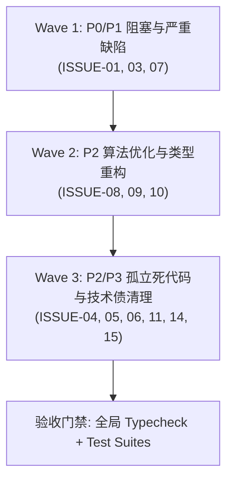

# Incept 核心代码缺陷接手执行交接文档 (AI Agent 专资执行版)

> **交接发起方**：Antigravity Agent (本轮已完成 DOC-01 ~ DOC-12 全量文档/注释治理)  
> **接收方**：后续接手执行的 Autonomous Coding Agent / 系统工程师  
> **交接时间**：2026-10-16  
> **工作区路径**：`d:/Desktop/code/code/Incept`  
> **当前工程基线**：全 Monorepo `pnpm typecheck` 0 错误；`pnpm test:ops` 3/3 通过；`music:core` 73/73 通过。

---

## 一、交接背景与任务总览

在上一阶段中，本仓库已完成 **全量文档体系治理与源码注释重构（DOC-01 至 DOC-12 全部验收完成）**：
1. 已清理 `README.md` 与决策文档中的幽灵路由；
2. 已将 `docs/current-task/` 中积压的 34 篇历史任务移至 `docs/finish-task/`；
3. 已修复 `INDEX.md`、`NEXT.md`、`READAI.md` 的索引真实性；
4. 已修正 `music-player-floating.tsx` 中脱节的 `seekRequested` TODO 以及 4 处类型定义的 Tag 占位注释；
5. 已折叠 `import.ts:1100` 的伪三元逻辑。

**本轮交接任务**：执行剩余 **12 项核心系统架构、App Router 路由、破损测试与孤立死代码修复**（对应 `docs/audit_15_issues_report.md` 中的表一）。

---

## 二、执行波次与依赖顺序建议

接手 Agent 请按以下 **3 个波次** 顺序执行，以确保高危阻塞问题优先排除、避免修改相互干扰：



| 波次 | 目标任务 | 严重级别 | 核心目标 |
| :--- | :--- | :---: | :--- |
| **Wave 1** | **ISSUE-01** (中间件), **ISSUE-03** (破损测试), **ISSUE-07** (Gemini异常吞噬) | 🔴 P0 / 🟠 P1 | 修复根路由 404 挂死、修补破损脚本、打通异常诊断链路 |
| **Wave 2** | **ISSUE-08** (定价别名), **ISSUE-09** (Prisma类型复用), **ISSUE-10** (分词正则) | 🟡 P2 | 去除硬编码特例、提升类型安全、解决跨句跨词伪相关度 |
| **Wave 3** | **ISSUE-04** (桩脚本), **ISSUE-05** (夹具), **ISSUE-06** (空hook), **ISSUE-11** (绝对路径), **ISSUE-14** (switch浅拷贝), **ISSUE-15** (User模型) | 🟡 P2 / 🟢 P3 | 彻底清理 ~40KB 孤立死代码、去除本地环境写死路径、解耦废弃模型 |

---

## 三、逐项执行规范与代码修复对照

### Wave 1: 阻塞与严重缺陷修复

#### 任务 1: ISSUE-01 (P0) —— 修复 Next.js 中间件命名错误消除根路由 404
- **涉及文件**：`apps/web/src/proxy.ts` $\to$ 重命名为 `apps/web/src/middleware.ts`
- **问题根因**：Next.js 规范要求全局中间件必须命名为 `middleware.ts`（位于 `src/` 或根目录下）。原文件被命名为 `proxy.ts`，Next.js 构建引擎完全忽略它（`middleware-manifest.json` 为空）。由于 `apps/web/src/app` 无根级 `page.tsx`，用户直接访问 `http://localhost:3000/` 会直接返回 404。
- **执行动作**：
  ```powershell
  git mv apps/web/src/proxy.ts apps/web/src/middleware.ts
  ```
- **验证代码确保**：
  ```typescript
  // apps/web/src/middleware.ts
  import createMiddleware from 'next-intl/middleware';
  import { routing } from '@/i18n/config/routing';

  export default createMiddleware(routing);

  export const config = {
    matcher: ['/((?!api|_next|_vercel|.*\\..*).*)'],
  };
  ```
- **验证方式**：启动 `pnpm dev`，访问 `curl -I http://localhost:3000/`，应返回 `307 Temporary Redirect` 跳转至 `Location: /zh`。

---

#### 任务 2: ISSUE-03 (P1) —— 修复 `package.json` 中崩溃的 `music:check-adapter` 脚本
- **涉及文件**：`package.json:25`
- **问题根因**：脚本配置为 `"music:check-adapter": "vitest run src/features/music-player/adapter/__tests__/music-source.test.ts"`。由于音乐模块早已迁移至 `packages/music`，该路径不存在，执行 `pnpm music:check-adapter` 直接崩溃退出（code 1）。
- **执行动作**：
  在根目录 `package.json` 中，将该命令重定向到 music 包内的测试指令，或直接移除：
  ```json
  // package.json
  - "music:check-adapter": "vitest run src/features/music-player/adapter/__tests__/music-source.test.ts",
  + "music:check-adapter": "pnpm --filter @incept/music test:core",
  ```
- **验证方式**：在根目录运行 `pnpm music:check-adapter`，应执行通过（73 tests passed）。

---

#### 任务 3: ISSUE-07 (P1) —— 修复 Gemini 采集器吞噬异常与缺少 errors 契约
- **涉及文件**：
  - `packages/dashboard/src/adapters/local/collectors/gemini.ts:93-98`
  - `packages/dashboard/src/adapters/local/collectors/agents.ts:32`
- **问题根因**：`gemini.ts` 内部空 `catch { // ignore }` 吞噬异常，且其返回契约缺少 `errors: string[]`；上游 `agents.ts` 聚合错误时未将 `gemini.errors` 纳入。
- **执行动作**：
  1. 在 `gemini.ts` 中引入 `const errors: string[] = [];`；
  2. 在 `catch (error)` 中将错误原因追加到 `errors`：`errors.push(`Failed to parse Gemini session at ${file}: ${error instanceof Error ? error.message : String(error)}`);`；
  3. 返回对象包含 `errors`：`return { events, errors, latestMtimeMs, parsedFiles };`；
  4. 在 `agents.ts:32` 聚合错误时追加 `...gemini.errors`：
     ```typescript
     // packages/dashboard/src/adapters/local/collectors/agents.ts
     errors: [
       ...indexed.errors,
       ...codex.errors,
       ...gemini.errors,
       ...native.flatMap(result => result.errors),
     ],
     ```
- **验证方式**：运行 `pnpm --filter @incept/dashboard test`，确保测试全部通过。

---

### Wave 2: 算法优化与代码重构

#### 任务 4: ISSUE-08 (P2) —— 消除 `pricing.ts` 中 Gemini 3.8 实验模型硬编码 Set
- **涉及文件**：`packages/dashboard/src/adapters/local/pricing.ts:11-15, 110-114`
- **问题根因**：硬编码了 `GEMINI_FLASH_PRICING_VARIANTS` Set 并在 `lookupPricing` 底层强制劫持，破坏了既有的 `overrides.aliases` 统一别名映射架构。
- **执行动作**：
  1. 移除文件顶部的 `GEMINI_FLASH_PRICING_VARIANTS` 常量；
  2. 移除 `lookupPricing` 底部的特例 `if (GEMINI_FLASH_PRICING_VARIANTS.has(shortName))` 分支；
  3. 在 `readLocalOverrides()` 或默认别名表（`DEFAULT_MODEL_ALIASES`）中将以下 3 个变体规范注册为别名：
     - `'gemini-3.8-flash-exp-a' -> 'gemini-3.8-flash'`
     - `'gemini-3.8-flash-n' -> 'gemini-3.8-flash'`
     - `'gemini-3.8-flash-tiered' -> 'gemini-3.8-flash'`
- **验证方式**：运行 `pnpm --filter @incept/dashboard test`，确保模型计费与价格覆盖率测试全部通过。

---

#### 任务 5: ISSUE-09 (P2) —— `RoadmapWriter` 复用 Prisma 官方事务类型
- **涉及文件**：`packages/roadmap/src/adapters/prisma/roadmap-writer.ts:28-125`
- **问题根因**：手写了近 100 行 `RoadmapPrismaTx` 接口，重复定义数十个 Prisma 模型的查询和操作方法，既脆弱又臃肿。
- **执行动作**：
  删除 28-125 行的手工类型定义，直接从 `@prisma/client` 导入生成类型：
  ```typescript
  // packages/roadmap/src/adapters/prisma/roadmap-writer.ts
  import type { Prisma } from '@prisma/client';

  export type RoadmapPrismaTx = Prisma.TransactionClient;
  ```
- **验证方式**：运行 `pnpm --filter @incept/roadmap typecheck && pnpm --filter @incept/roadmap test`，确认编译通过且 63 个测试全部 PASS。

---

#### 任务 6: ISSUE-10 (P2) —— 修复相似度分词中文正则连续字块阻断跨界拼词
- **涉及文件**：`packages/roadmap/src/domain/similar.ts:78-91`
- **问题根因**：`text.match(/[\u4e00-\u9fa5]/g)` 把整篇文本的所有汉字抽成单字列表，剥离了全部标点和英文，导致上一句末字与下一句首字拼接成荒谬的二元词组。
- **执行动作**：
  使用连续汉字块匹配 `text.match(/[\u4e00-\u9fa5]+/g)`，仅在自然连续的中文块内部生成 n-gram：
  ```typescript
  // packages/roadmap/src/domain/similar.ts
  const cjkBlocks = text.match(/[\u4e00-\u9fa5]+/g);
  if (cjkBlocks) {
    for (const block of cjkBlocks) {
      if (block.length >= 2) {
        for (let i = 0; i < block.length - 1; i++) {
          const biGram = block.slice(i, i + 2);
          tokens.push(biGram);
        }
      }
    }
  }
  ```
- **验证方式**：运行 `pnpm --filter @incept/roadmap test`，确保现有卡片相似度与排序测试通过。

---

### Wave 3: 孤立文件、环境硬编码与冗余清理

#### 任务 7: ISSUE-04 (P2) —— 物理删除破损的孤立桩脚本
- **执行动作**：
  ```powershell
  git rm scripts/test-dashboard-loader.mjs
  ```
- **原因**：文件静态引用不存在的 `.js` 路径，运行直接报错，且除 `console.log` 外无任何逻辑。

---

#### 任务 8: ISSUE-05 (P2) —— 物理删除 38.5KB 孤立 Style Lab 测试夹具
- **执行动作**：
  ```powershell
  git rm -r apps/web/src/features/docs/block-system/__fixtures__
  ```
- **原因**：style-lab 页面已物理下线，自身 README 明确写明不导出也不注册路由，全局零引用，白白增加类型检查 AST 解析负担。

---

#### 任务 9: ISSUE-06 (P3) —— 物理删除单行空壳 `use-breakpoint.ts`
- **执行动作**：
  ```powershell
  git rm apps/web/src/hooks/use-breakpoint.ts
  ```
- **原因**：自初始提交起仅包含一行注释 `// Global breakpoint hook placeholder.`，无函数无导出，无引用。

---

#### 任务 10: ISSUE-11 (P2) —— 清理 `scripts/` 中包含本地 Windows 绝对路径的单次脚本
- **涉及文件**：
  - `scripts/search-cli.mjs`（写死 `C:/nvm4w/...`）
  - `scripts/inspect-sample.mjs`（写死 `C:/Users/86139/...`）
  - `scripts/check-other-projects.mjs`（写死调试日期）
  - `scripts/audit-commandcode-usage.mjs`
- **执行动作**：
  将上述单次排查脚本从 Git 版本库中移除（若开发者仍需保留作为调试留底，移入已被 `.gitignore` 忽略的 `.scratch/` 目录下）：
  ```powershell
  git rm scripts/search-cli.mjs scripts/inspect-sample.mjs scripts/check-other-projects.mjs scripts/audit-commandcode-usage.mjs
  ```

---

#### 任务 11: ISSUE-14 (P3) —— 精简 `single-article.ts` 中 70 行 switch 逐字段原样浅拷贝
- **涉及文件**：`apps/web/src/features/docs/importer/parsers/markdown-like/conversion/single-article.ts:31-105`
- **执行动作**：
  重构 `toDocsContentBlock` 函数。对同名同构 block（`heading`, `quote`, `image`, `divider`, `code` 等）避免机械解构拷贝，统一通过透传或轻量辅助函数处理，仅对需要递归处理的复杂节点做专门映射。
- **验证方式**：运行 `pnpm --filter web typecheck && pnpm test`。

---

#### 任务 12: ISSUE-15 (P2) —— 解耦已被淘汰的废弃 User 模型与 seed 脚本
- **涉及文件**：
  - `packages/db/prisma/schema.prisma:59-69`
  - `packages/db/prisma/seed.ts:4-11`
- **执行动作**：
  1. 在 `seed.ts` 中清理向废弃 `prisma.user.upsert` 插入伪 `system` 账号的死逻辑；
  2. 在 `schema.prisma` 中为 `model User` 添加 `@deprecated` 注释，或在向下兼容迁移方案中逐步解除硬关联，对齐当前 `OwnerAccount` / `AccessPrincipal` 双轨安全模型。
- **验证方式**：运行 `pnpm db:generate && pnpm --filter @incept/db typecheck`。

---

## 四、最终自动化验收门禁检查单 (Acceptance Gates)

完成全部修复后，接手 Agent 必须运行以下命令，确保所有指标全绿：

```powershell
# 1. 全 Monorepo 类型检查 (必须 0 错误)
pnpm typecheck

# 2. 核心运维与端到端测试 (必须 3/3 通过)
pnpm test:ops

# 3. 音乐包核心状态机测试 (必须 73/73 通过)
pnpm --filter @incept/music test:core

# 4. 仪表盘测试套件 (必须 184/184 通过)
pnpm --filter @incept/dashboard test

# 5. 路线图测试套件 (必须 63/63 通过)
pnpm --filter @incept/roadmap test

# 6. Web 端集成校验与路由测试
pnpm test

# 7. Git 状态干净度检查 (确认无未跟踪的死代码或破损临时文件)
git status
```

---
*本交接文档完结。接手 Agent 可直接读取本指南，按 Wave 1 -> Wave 2 -> Wave 3 顺序执行。*

---

## 五、2026-10-16 分批执行与验收结果

**状态：12 项已结项（11 项完成修复或清理，ISSUE-01 经版本核对与 HTTP 实测确认现状正确）。**

执行基线：`codex/production-readiness`，起点 `88966bc`，起始工作区干净。按 Wave 1 → Wave 2 → Wave 3 顺序实施，并完成最终全仓门禁。当前变更保留在该分支工作区，尚未提交。

### 逐项结果

| 波次 | 事项 | 结果 |
| --- | --- | --- |
| 1 | ISSUE-01 | 核对安装的 Next.js **16.4.0** 随包文档：`proxy.ts` 是当前约定，`middleware.ts` 已弃用。保留原文件；启动 `pnpm dev` 后实测 `/` 返回 **307**、`Location: /zh`，纠正本交接原文对文件命名的误诊。 |
| 1 | ISSUE-03 | `music:check-adapter` 改为 `pnpm --filter @incept/music test:core`，命令通过 73 项测试。 |
| 1 | ISSUE-07 | Gemini 采集结果新增 `errors`，附会话文件路径和异常原因，上游 agent 采集合并这些错误。补测损坏 JSON、有效会话共存、缺失来源和错误上报。 |
| 2 | ISSUE-08 | 删除 Gemini 专用 Set 和模型专用查询分支，在 `overrides.ts` 的 `DEFAULT_PRICING_ALIASES` 注册三种变体，复用通用别名解析。定价别名只影响费率；模型原名、会话和汇总身份保留，显式变体价格优先。 |
| 2 | ISSUE-09 | 使用 `Prisma.TransactionClient` 替代手写事务接口。仓库配置了自定义生成目录，故从 `@incept/db` 导出生成类型，声明 Roadmap 工作区依赖并同步锁文件。Web 装配直接传入 Prisma 客户端，移除重复包装与事务强制转换；测试替身复用生成参数类型。 |
| 2 | ISSUE-10 | 在连续汉字块内部生成二元、三元词，保留停用词规则。新增标点、空格、换行、英文、数字边界、孤立单字及伪相关卡片回归测试。 |
| 3 | ISSUE-04 | 删除孤立桩脚本 `scripts/test-dashboard-loader.mjs`。 |
| 3 | ISSUE-05 | 删除 Style Lab 的 3 个无引用夹具文件（`block-system/__fixtures__`）。 |
| 3 | ISSUE-06 | 删除无导出、无引用的空壳 `use-breakpoint.ts`。 |
| 3 | ISSUE-11 | 删除 `search-cli.mjs`、`inspect-sample.mjs`、`check-other-projects.mjs`、`audit-commandcode-usage.mjs` 四个一次性排查脚本。 |
| 3 | ISSUE-14 | 将逐类型逐字段 switch 简化为去除解析专用 `line` 后的统一浅拷贝，编译器直接检查块联合类型，移除多余断言和内联恒等映射。 |
| 3 | ISSUE-15 | 移除 seed 对 `system` 用户的 upsert；`User` 标记 `@deprecated` 并注明保留现有内容归属关联。文档导入器仍按需维护内容归属用户，身份认证继续使用 OwnerAccount / AccessPrincipal。 |

### 与交接原文的适配

- ISSUE-01 以已安装版本的 `apps/web/node_modules/next/dist/docs/01-app/01-getting-started/16-proxy.md` 和 `03-api-reference/03-file-conventions/middleware.md` 为依据，配合实际 HTTP 响应验收。
- ISSUE-08 的默认别名用于定价查询，保持原有“共用费率、独立模型身份”行为；本地 `modelAliases` 仍控制显式身份别名。
- ISSUE-09 使用本 schema 生成的类型。直接从默认 `@prisma/client` 导入与当前自定义生成路径不匹配。
- 第三批额外运行 Markdown 导入夹具，发现原清单漏记 `Nested detail` / `Fine detail` 及其段落，且四级标题断言误用于集合文章。已按源夹具修正预期，并补充导出块移除解析行号的断言。
- 本机 Corepack 缓存需显式设置 `COREPACK_HOME=C:\Users\86139\AppData\Local\node\corepack`。工作区依赖安装经 `pnpm install --frozen-lockfile --ignore-scripts --prefer-offline` 完成；锁文件仅新增 Roadmap → DB 的本地依赖。

### 最终验收

| 命令 / 检查 | 结果 |
| --- | --- |
| `pnpm typecheck` | 通过，全部 5 个包及 scripts，0 错误 |
| `pnpm test:ops` | 3 / 3 通过 |
| `pnpm --filter @incept/music test:core` | 73 / 73 通过 |
| `pnpm --filter @incept/dashboard test` | 187 / 187 通过（原 184，加 3 项回归） |
| `pnpm --filter @incept/roadmap test` | 71 / 71 通过（原 63，加 8 项回归） |
| `pnpm test` | 通过：Dashboard 187、Roadmap 71、音乐 Vitest 195 + 核心 73、Web 109；共 635 项通过 |
| Web 真实 PostgreSQL 测试 | 28 项按既有环境门禁跳过：未设置 `INCEPT_AUTH_TEST_DATABASE_URL` |
| `pnpm db:generate` + `pnpm --filter @incept/db typecheck` | Prisma Client 6.19.3 生成成功，DB 类型检查通过 |
| `pnpm docs:check-markdown-like` | 全部合法及非法夹具通过 |
| 改动的 Web 文件 ESLint | 通过，无输出 |
| `curl.exe --noproxy '*' -I http://localhost:3000/` | 307，`Location: /zh`；验证后已停止本次启动的服务 |
| `git diff --check`、删除文件引用检查、`git status` | 通过；无新增未跟踪死代码或临时文件，变更均为本次任务范围 |

本地完整日志保存在已忽略目录 `.scratch/handover-2026-10-16/`。`docs/NEXT.md` 已移除此项活跃待办。

提交建议：`fix: complete remaining core defect remediation`。
