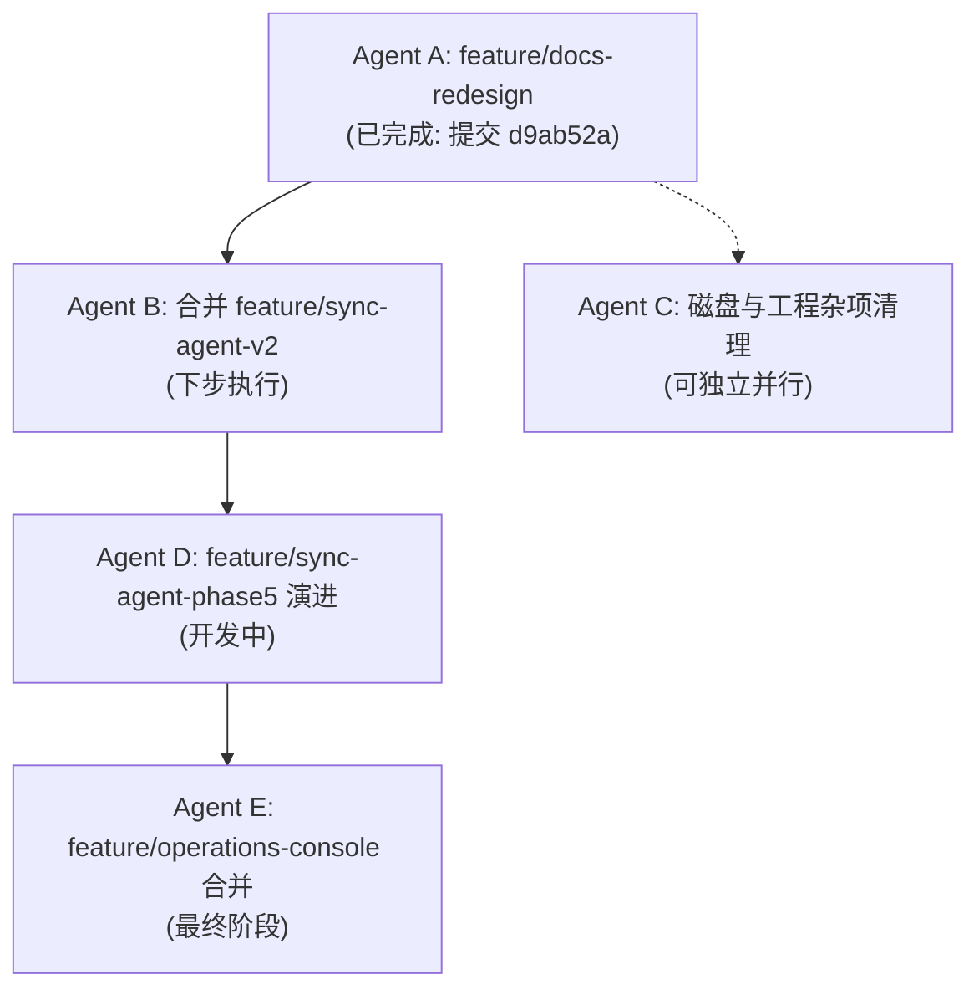

# Incept 文档中心重构与多 Agent 分支拆分交接文档

> - **交接发起方**：Agent A（已完成 `feature/docs-redesign` 深度对标与主干合入）
> - **接收方**：后续执行 Agent（Agent B ~ Agent E）及系统维护者
> - **交接时间**：2026-10-17
> - **代码基线**：`codex/production-readiness` @ `d9ab52a`
> - **工作区状态**：全 Monorepo `typecheck` 0 错误；Web 单元测试 114/114 通过；Dashboard 测试 187/187 通过。

---

## 一、本轮进度与交付总览 (Agent A 已完成)

本轮工作聚焦于 **文档中心首页（Docs Home）对齐 DeepWiki 设计规范重构** 与 **`feature/docs-redesign` 顺利并入基线**：

1. **分支合并完成**：
   - 认领并执行交接单中的 **Agent A** 任务，将 `feature/docs-redesign`（HEAD `ebd9700`）通过 `--no-ff` 安全合入主干 `codex/production-readiness`。
   - 生成合并提交：`d9ab52a` (`merge: docs home and dashboard style redesign`)。
   - 变动规模：**27 个文件，+1157 / -152**，无冲突一次性合入。

2. **文档首页视觉与交互重塑（对标 DeepWiki 原版规范）**：
   * **快捷创建卡片（`DocsHomeAddCard`）**：
     * **色调精细校准**：精准像素采样冷钢青灰到暖银灰微渐变（`#c6ced8` $\to$ `#cad2dc` $\to$ `#d4d4d9`，深色模式 `#1e232b` $\to$ `#23252a`），彻底去除早期实验性的高饱和浅紫/洋红色。
     * **去除视觉杂质**：去掉包裹 `+` 号的外围方框徽标，改为直接落在左上角的裸 Plus 图标；移除多余的副标题段落文本，重现轻盈呼吸感。
     * **尺寸与基线对齐**：强制固定高度 `h-[116px] w-full`，统一内边距 `p-3.5`，底部右下角浅灰圆底箭头（`#d5d5d9`）增加 `pt-1` 基线，与右侧所有文章卡片严格水平对齐。
   * **文章卡片（`DocsHomeCard`）**：
     * 移除覆盖在全卡上的刺眼彩虹霓虹渐变蒙版。
     * 还原克制高级的微灰底色悬停效果（`hover:bg-black/[0.055]`）与极轻微浅灰边框过渡，杜绝生硬黑边框。
   * **搜索栏与布局**：搜索框居中对齐，留出垂直空白提升质感。
   * **国际化适配**：补全 `messages/zh/docs.json` 与 `messages/en/docs.json` 的 `addDoc` 对应条目。

3. **数据库连接高可用优化**：
   * 针对 Windows + Docker Desktop（WSL2）在空闲或瞬时重连时端口转发偶尔导致的 `PrismaClientKnownRequestError: Can't reach database server at 127.0.0.1:5432`，在 `.env.local` 与 `packages/db/.env` 的 `DATABASE_URL` 中补充了 `&connect_timeout=15&pool_timeout=15`，提高握手容错窗口，保障本地开发服务持续稳定。

---

## 二、验收门槛通过凭证

已执行全局门禁验收，全部绿灯通过：

| 门槛项 | 命令 | 实际结果 | 状态 |
| :--- | :--- | :--- | :---: |
| **Dashboard 全量测试** | `pnpm --filter @incept/dashboard run test` | 25 文件 / 187 用例通过 (100%) | ✅ PASS |
| **Web 核心测试** | `pnpm --filter web run test` | 24 文件通过 / 114 用例通过（28 个 PostgreSQL 真实环境用例按设计跳过） | ✅ PASS |
| **Web 类型检查** | `pnpm --filter web run typecheck` | exit 0，无任何 TypeScript 类型错误 | ✅ PASS |
| **Web 静态检查** | `pnpm --filter web run lint` | 0 errors, 12 warnings（均为历史警告） | ✅ PASS |
| **在线服务实测** | `curl.exe -i http://localhost:3004/zh/docs` | HTTP 200 OK，页面正常水合渲染 | ✅ PASS |

---

## 三、接下来的计划与协作路线图

依据 `.scratch/handoff-2026-10-17-branch-split.md`，后续阶段路线图与依赖关系如下：

### 1. 下一阶段：Agent B 执行要点（合并 `feature/sync-agent-v2`）
* **分支目标**：将 `feature/sync-agent-v2`（HEAD `834f8a9`）合入 `codex/production-readiness`。
* **预期冲突与解决原则**（共 3 个文件）：
  1. `packages/dashboard/src/messages/en.json` & `zh.json`：取并集。保留 docs-redesign 的现有词条与 docs 新增词条，同时引入 sync 的 `remote.*` 命名空间。
  2. `packages/dashboard/src/react/components/dashboard-toolbar.tsx`：保留 docs-redesign 的新工具栏结构，将 sync 所需的 5 个 props（`remoteInfo`, `remoteDevice`, `setRemoteDevice`, `remoteState`, `refreshInterval`）以及设备 `<select>` 下拉框移植合并进去。
* **依赖安装**：合并后必须执行 `pnpm install` 激活新工作区包 `apps/sync-agent` 与 `apps/sync-gateway`。

### 2. 并行阶段：Agent C 执行要点（工程清理）
* 回收无效 worktree：`.worktrees/arch-evolution`、`.worktrees/roadmap`。
* 压缩并优化超过 1.7MB 的 `sync-agent-phase2e-benchmark.json`。
* 将根目录的 `token-export-*.json` 移出工作区安全归档。

### 3. 架构补充考量（面向 2027 年文档组织演进）
* **现状说明**：目前文档按年份（如 `2026`）动态由数据驱动分组；`Add doc` 绑定在首个组（`groupIndex === 0`）的前端。在进入 2027 年且新增第一篇 2027 年文档时，系统会在最上方生成 `2027` 分组，`Add doc` 也会平滑顺移至 2027 组首位。
* **后续演进建议**：若未来希望完全摆脱年份带来的分组割裂感、百分之百复刻 DeepWiki 的全局扁平流，可安排在后续迭代中将文档流重构为无年份区块的统一流网格（在卡片右下方元数据内展示年份），或将 `Add doc` 独立为全局顶层快速入口卡片。
