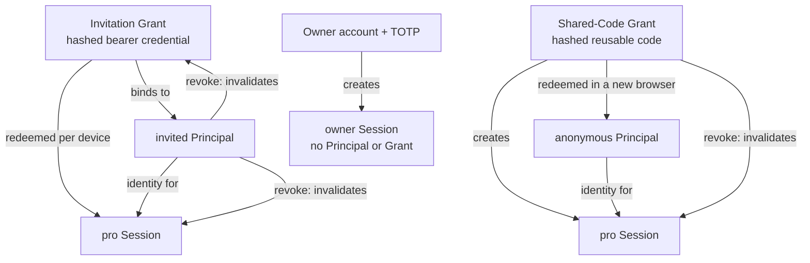

# Account And Access Design

> **Updated 2026-10-27:** the master-secret login described below is historical. Current
> Owner login uses the single Owner account with password + TOTP; `INCEPT_AUTH_ENCRYPTION_KEY`
> is the credential-encryption key. The legacy `OWNER_ACCESS_SECRET` is retired.

## Status

The database model, Principal identity layer, Owner server authentication, pro credential issuance/redemption, and Docs/Notes viewer checks are implemented. Owner login uses the single Owner account with password + TOTP; the settings surface exposes shared-code redemption, current access state, and logout.

## Goal

Turn the current local-first personal blog into a site with a single owner and controlled reader access, while keeping public reading simple.

## Content Access

| Content access | Who can read it | Public list and search |
| --- | --- | --- |
| `guest` | Everyone | Visible |
| `pro` | Valid temporary grant holders and the owner | Hidden from guests |
| `private` | Owner only | Never visible outside owner access |

Viewer identity must remain separate from content access:

```text
guest viewer -> guest content
pro viewer   -> guest and pro content
owner        -> guest, pro, and private content; internal operations
```

`owner` represents the single deployment-controlled site owner, not a multi-person management role. It remains separate from content reading because publishing, archive actions, credential operations, and internal tools require server-side authorization.

## Temporary Access

Two grant types run in parallel. Both create `pro` sessions, but their identities are intentionally different:

1. Individual invitation link: one random bearer link per invited person. It is linked to one persistent `invited` Principal, so the recipient can exchange it on multiple devices. Revoking the Principal invalidates all of that person's sessions and dedicated invitation grants.
2. Shared access code: one long-lived code for a broader trusted group. Each confirmed exchange creates a distinct `anonymous` Principal and session. Revoking the shared grant invalidates every session created from that grant without deleting audit history.

Both grant records must store only token/code hashes. Revoking a grant invalidates all active sessions created from it.

Bearer links cannot prove the real-world identity of the recipient if they are forwarded. The Principal is an access identity rather than a verified user account. This is acceptable for the first personal-blog version.

### Principal, Grant, And Session Relationship



## Security Boundary

Authentication must be enforced server-side, not only through hidden navigation or edge middleware.

Protected owner-only surfaces include:

- `/[locale]/settings` (Owner security and administrative sections)
- `/[locale]/docs/import-preview/**`
- Import preview confirmation and all future write routes

The Owner implementation returns not found or requires authentication for protected internal actions. Owner authentication uses `OwnerAccount` credentials with multi-factor authentication (TOTP/recovery codes), random session tokens stored in the database, and secure HttpOnly cookies. Owner session revocation is available through dedicated admin surfaces and CLI.

## Implemented Data Model

The existing `User` table is content ownership infrastructure because the importer creates a `system` user. It remains separate from authentication.

Owner identity is the single `OwnerAccount` with password + TOTP; `INCEPT_AUTH_ENCRYPTION_KEY` encrypts the Owner credential material. The database also contains `AccessPrincipal`, `AccessGrant`, and `AccessSession` records. A grant is a hashed credential, a Principal is the revocable access identity, and a session is one browser/device binding. Pro sessions stay valid only while both their Principal and Grant remain active.

Docs access uses `guest / pro / private`. Viewer identity and content access are separated in application code: `getCurrentViewer()` resolves the identity, and Docs/Notes loaders enforce the required content access level.

## Deferred Decisions

- Define a browser management surface for grants and Principals if CLI operations are no longer sufficient.
- Define resource-specific `AccessEntitlement` records and `restricted` content access when selective sharing is needed.
