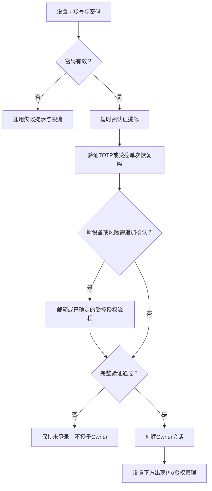

# Owner登录、2FA与临时Pro授权：增量更新规划 v0.1

2026-10-14 / Asia/Singapore。主控规划；基线codex/production-readiness、98b77ff，已有未提交文档保留。当前阶段只规划与启动本地基线，界面样式/功能细节讨论完成后再编码。正式服务器本轮没有修改。

## 本轮范围与发布约束

覆盖AUTH-01/02/03、ACL-01/02/03：单Owner账号密码、初始化/改密/恢复、会话、角色边界、两种Pro临时授权、敏感操作重新验证及脱敏审计。公共About、后台整体重组、自动数据上报等仍在其他待办，本轮不顺带改动。

用户已确定：

- Owner从设置界面登录，取得Owner后，在设置界面下方追加Pro临时授权管理。
- Pro同时保留单次兑换码和可多人兑换的限时共享码；两者都需要清晰的到期/撤销语义。
- 邮件发送服务暂无，需要先讨论接入。
- 先给规划，再讨论具体样式和功能；这一轮全部验收完毕后才增量更新生产。不得把第一阶段密码表单单独上线、随后在公网补齐2FA。

## 已核对的现状

1. Owner API目前校验OWNER_ACCESS_SECRET，账户页没有Owner输入表单。Guest表单只兑换Pro；Owner/Pro只提供退出。
2. 现有AccessSession有tokenHash、expiresAt、revokedAt、lastUsedAt；Owner默认30天。没有已发现的TOTP、可信设备、邮箱挑战或敏感操作审计数据模型。
3. AccessGrant/AccessPrincipal已有邀请与共享码，CLI可创建/列出/撤销/轮换；撤销能同步使关联会话失效。现有invitation兑换不是严格单次，当前expiresAt也不能直接表达“兑换窗口”和“兑换后持续时间”这两个概念。
4. User表用于文档/集合作者，虽有username，但没有密码/2FA字段；不能直接把作者身份等同于新的Owner认证账号。
5. requireOwner当前对非Owner调用notFound；页面与后台API错误语义需要分别审查。退出UI目前未检查服务端返回是否成功。
6. 本地开发服务已启动于127.0.0.1:3000，账户页HTTP200；目前展示旧基线，不是新界面的已实现预览。

主要位置：[账户面板](../../apps/web/src/features/settings/account/account-settings-panel.tsx)、[会话与授权存储](../../packages/db/src/access/index.ts)、[数据库schema](../../packages/db/prisma/schema.prisma)、[现有登录](../../apps/web/src/app/api/auth/owner/login/route.ts)、[Pro兑换](../../apps/web/src/app/api/access/shared-code/redeem/route.ts)、[授权CLI](../../scripts/auth-grant.mjs)、[会话撤销CLI](../../scripts/auth-revoke-owner-sessions.mjs)。

## 推荐认证方案（待确认）

单Owner账号＋密码，以TOTP验证器作为主要第二因子；新设备/首次登录/确切风险变化再追加核验。邮箱验证码可作为额外风险确认和通知，不成为绕过TOTP的自动降级入口。IP/地理位置只是风险信号；VPN、移动网络或IP变化不能单独被判定为盗号。NIST不将邮箱列为合格的带外认证因子；因此本方案不宣称“密码＋邮箱”就是强2FA或已达到某个AAL认证。参考 [NIST带外认证](https://pages.nist.gov/800-63-4/sp800-63b.html#out-of-band-devices)、[OWASP多因子与风险信号](https://cheatsheetseries.owasp.org/cheatsheets/Multifactor_Authentication_Cheat_Sheet.html)。

流程草案：

密码通过只建立短时challenge，不创建Owner AccessSession；未完成挑战的浏览器仍是Guest/既有Pro。验证码绑定账号、挑战、用途和浏览器；过期、次数耗尽、并发重复提交、已消费验证码均拒绝。TOTP防重放不能只比较当前数字，需原子记录已消费的时间步。

### 首次设置与未知登录

| 情况 | 推荐流程 | 待讨论点 |
| --- | --- | --- |
| 新系统首次初始化 | SSH受控创建唯一账号，使用短时一次性设置许可绑定TOTP、确认邮箱、保存恢复码；完成后才可取得完整Owner权限 | 是否强制完成邮箱绑定后启用账号 |
| 已知设备重新登录 | 账号密码＋TOTP | 是否每次都要求TOTP；推荐要求 |
| 新设备/首次浏览器 | 密码＋TOTP后追加已验证邮箱确认 | 邮件提供方、有效期和重发限制 |
| IP变化、VPN、移动网络 | 展示/记录风险变化，结合设备与其他信号判断 | 不建议IP一变就锁定整个账号 |
| 异地/异常地点 | 需可信IP地理数据源，确认精度后才可追加风险判定；无法判断时如实标注未知 | 国家/地区粒度、数据源和隐私留存 |
| 丢失验证器 | 密码＋单次恢复码；无恢复材料时走SSH受控恢复 | 恢复后撤销旧会话/可信设备并重新绑定 |
| 邮件发送失败 | 显示无法完成当前挑战，允许受限重试；不自动发Owner Cookie | 是否允许已经保存的恢复码替代额外邮箱挑战，需显式决定 |

可信设备必须是独立、随机、可撤销的凭据；浏览器名称/UA或某个IP都不能冒充设备证据。信任设备只减少按策略要求的额外验证，不直接获得Owner或绕过密码/TOTP。

### 邮件接入的约束

候选路径：已有邮箱服务的专用SMTP授权，或带已验证发信身份的托管邮件API；不在2GB应用服务器自建邮件服务器。先选择实际可用服务，再定义环境变量、发信限制和真实送达验收。

网站的sslip.io临时域名不等于可自主配置发信DNS的域名。需要自有域名验证的供应商，必须有可管理SPF/DKIM等记录的域名；已有邮箱SMTP使用该邮箱自身的发信身份。此时不指定供应商或费用，接入前核对其限制。相关域名验证机制可参考 [邮件服务域名说明](https://resend.com/docs/dashboard/domains/introduction)，不是选定该供应商。

邮件只发送给预先确认的Owner邮箱，不能允许登录者随意指定地址；只有凭据步骤通过后才申请追加邮件挑战。每账号/IP限速、发送冷却、失败次数上限、一次性消费和期限独立控制；邮件不含密码、会话或长期master secret。真实送达与过期/重试/并发/重放是本轮验收项，mock发送通过不代表完成真实邮件功能。

## 设置页功能草案（样式待讨论）

延续现有设置页的侧栏、宽度、字体、主题和移动端纵向布局；不先做另一套大型后台。以下只是信息结构，不是最终视觉设计。

### Guest / Pro

账户状态 → Owner登录区域（账号、密码、下一步）→ 验证步骤 → Pro访问码兑换区域。Owner登录与Pro兑换必须清楚区分；已有Pro用户也能进入Owner登录，不必先猜隐藏URL。

登录区域支持密码管理器的username/current-password、TOTP一次性码填写/粘贴、提交中禁重复、阶段性错误、取消和重试。验证步骤内不重复展示密码。返回路径只接受站内允许地址，不带凭据，成功后刷新服务端角色；退出成功后明确回到Guest，失败时显示未成功退出。

### Owner

账户摘要（Owner标识、账号、邮箱遮罩）→ 安全设置（改密、TOTP/恢复码、可信设备）→ 当前及其他会话/退出 → **下方追加Pro临时授权管理**。

Pro授权区草案：

- 创建：用途标签、单次/共享类型、可兑换截止、授予Pro的到期策略；共享模式可按选择增加兑换人数上限。
- 生成结果：只在成功生成时显示完整码一次，可复制；关闭后列表只显示标签、状态和尾部掩码，不提供“找回原码”。
- 列表：类型、兑换状态/人数、有效期、最近使用、撤销；共享码轮换需清楚提示旧授权关联会话将失效。
- 高风险操作进入最近认证/TOTP确认；生成和撤销结果明确，失败不伪装成功；换设备或权限失效后不保留可用的管理表单数据。

仍需讨论：Owner登录默认展开还是按钮展开；验证用内嵌步骤还是弹层；Pro授权列表的桌面/手机布局；字段文案、有效期选项、复制确认；敏感操作确认的视觉位置。本轮先不制作最终组件或伪装成已完成界面的截图。

## Pro两种模式与时间语义

| 项目 | 单次兑换码 | 多人共享码 |
| --- | --- | --- |
| 使用次数 | 全局仅一次原子兑换；并发只能一个成功 | 可多次兑换；人数上限若启用需原子计数 |
| 可兑换期限 | 过期后不能兑换 | 过期后不能继续新增兑换 |
| Pro权限期限 | 按成功兑换时间＋指定时长，或指定绝对到期 | 明确选择每次兑换后时长或共享绝对到期，不能含糊 |
| 到期/撤销 | Pro会话与授权检查立即生效 | 到期/撤销影响相应访问；轮换旧码的影响必须提示 |
| 识别 | 对应独立授权主体/兑换设备 | 每次兑换仍对应独立主体，避免所有访客混成一个身份 |
| 权限 | 仅Pro阅读，不授予Owner、设备上报或后台操作 | 同左 |

推荐待确认的起点：单次码30分钟可兑换、兑换后24小时Pro；共享码由Owner选择绝对到期，默认7天，是否允许不限人数另行确定。这些数值尚未定案，不硬编码实现。

现有旧Pro共享码按当前有效期/撤销规则保留，不能因新增“临时”模式擅自清除；新字段需兼容旧数据。严格区分redeem期限与entitlement期限，否则容易在“兑换窗口过期”时错误提前撤回已发出的24小时权限。

## 初始化、存储与恢复

推荐新增唯一Owner认证实体，与既有内容作者User解耦；关联规则在设计冻结时确认。复用AccessSession/AccessGrant/AccessPrincipal，增加挑战、可信设备、单次使用和审计所必需的数据，不另建身份服务。

- Owner账号：规范化账号名、专用密码哈希/参数、已验证邮箱、加密TOTP种子、凭据版本/安全变更时间。密码哈希算法和并发需在768MiB应用容器预算内实测，先限流再执行昂贵校验。参考 [OWASP密码存储](https://cheatsheetseries.owasp.org/cheatsheets/Password_Storage_Cheat_Sheet.html)。
- 挑战/恢复码：只存验证码哈希、用途、期限、失败次数与已消费状态；恢复码一次展示、单次使用、可重发整组使旧组失效。
- 加密密钥：与数据库分离，权限受控，需要独立备份和恢复验收；不能只恢复PG而丢失解密TOTP所需密钥。
- 会话：增加认证阶段/时间、凭据版本及设备管理所需字段；敏感操作要求近期再认证，不依赖客户端role字段。
- 审计：操作者、事件、对象ID、时间、结果、风险类别；成功事件与关键业务事务一致，失败记录脱敏。密码、OTP、Cookie、完整授权码、邮箱验证票据不进入审计。

SSH工具应能受控初始化唯一账号、改密/恢复、撤销全部Owner会话，重复创建明确拒绝；密码通过TTY/标准输入，不进入命令参数或shell历史。恢复的授权基础是SSH管理权限，不能让公开网页通过“未初始化”状态自行夺取Owner。

旧master secret退出：候选版本明确拒绝旧secret作为普通登录输入；发布维护窗口通过受控CLI初始化账号，再完成TOTP/必要邮箱设置并验收。旧Owner会话撤销；旧Pro授权保持既有规则。回退到旧应用是操作员执行的版本回退，不在新版本提供隐式master secret旁路。

## 会话与敏感操作草案

推荐Owner绝对期限12小时、空闲30分钟，可信设备期限30天但不等于30天Owner会话；这些数值待讨论。到期可保留当前表单并引导重新登录，不能静默延长绝对期限。

改密、邮箱变更、TOTP重绑/关闭、恢复码重发、全部退出、授权创建/撤销/轮换，要求例如5分钟内的近期密码＋TOTP验证；一次确认能授权的动作/期限需绑定范围，不能变成永久万能票据。文档发布/删除等操作追加确认与审计，界面主体沿用现有实现，整体后台整理不在本轮。

账号恢复、改密或2FA变更撤销旧Owner会话与可信设备；普通单设备退出只影响该会话；全部退出影响所有Owner会话。后台列表不返回会话原token。依赖其他设备的写操作需重新校验凭据版本，处理“校验后并发重置”的竞态。

## 角色边界

| 场景 | Guest | Pro | 完整Owner | 预认证挑战/设备上报凭据 |
| --- | --- | --- | --- | --- |
| 设置基础偏好/登录/Pro兑换 | 允许相应公共入口 | 允许 | 允许 | 不因此获得管理身份 |
| Pro受控文档与媒体 | 拒绝 | 有效授权内允许 | 允许 | 拒绝 |
| 临时Pro码生成/查看管理/撤销 | 拒绝 | 拒绝 | 近期认证后允许 | 拒绝 |
| 改密/2FA/会话/原始用量/后台写入 | 拒绝 | 拒绝 | 按具体操作授权 | 拒绝 |
| 密码通过但TOTP/追加验证未完成 | 仍未获Owner | 既有Pro不提升 | 不生成新的Owner会话 | 保持预认证状态 |

私有页面继续404以隐藏入口/资源；明确的登录页公开，新增管理API非Owner返回脱敏JSON403。资源不存在可404。现有API若调整404/403，需要同步对应客户端和回归，不误把旧404当成认证成功。媒体、server loader与直接API均验，不以按钮隐藏代替权限。

## 实施阶段与交付

| 阶段 | 交付 | 进入下一阶段的条件 |
| --- | --- | --- |
| 0 讨论冻结 | 设置页信息结构、MFA/邮件策略、会话与Pro期限、邮箱服务、恢复方式 | 用户确认交互和功能，不仅确认颜色 |
| 1 数据与认证基础 | 增量migration、账号哈希、挑战、TOTP/恢复、受控CLI、会话版本 | 独立测试库迁移及认证/并发回归通过 |
| 2 设置界面 | 登录多步骤、账户安全/退出、Owner下方两种Pro授权 | 桌面/手机操作闭环、状态/错误反馈通过 |
| 3 权限与审计 | AUTH-03及ACL-01/02/03，跨模块直接API/媒体/loader回归 | 各角色与重放/撤销/敏感操作测试通过 |
| 4 整轮验收 | 本地人工确认＋隔离Linux/amd64生产镜像＋真实邮件送达＋恢复演练 | 六项各自验收全部通过，缺邮件目标不冒充完成 |
| 5 一次增量发布 | 确切提交/镜像/运维包/备份/兼容性说明 | 审阅通过后维护窗口更新，服务器不构建 |

采用新增表/字段的可回退迁移，保留旧版本和发布前一致备份；不在生产运行migrate dev/reset或seed。测试角色/码/邮件夹具用独立库；本地真实库不擅自升级或写入演示Owner，生产PG volume及持久目录覆盖继续保留。

若旧版本与新schema不兼容，回退需要新空目标恢复发布前备份，不直接降镜像。账号凭据/2FA密钥、加密密钥、既有Pro授权和审计均纳入恢复核查。

## 本轮必须验收的清单

- [ ] 新浏览器在设置页完成账号密码＋已确定的验证步骤，密码管理器和手机可用。
- [ ] 错误账号/密码、错误或重放TOTP、过期/重复/跨浏览器challenge、并发提交、限流/重启后计数策略均正确；验证码通过前没有Owner权限。
- [ ] 新设备/首次登录、网络变化/未知地区、邮件失败与重试、一次性码消费和真实收件体验符合确定的策略。
- [ ] 初始化重复拒绝、改密、丢失TOTP/恢复码、SSH恢复均可执行；旧master secret与旧Owner会话按迁移约定失效。
- [ ] 空闲/绝对期限、单设备/全部退出、敏感操作近期认证、凭据版本变化立即生效；退出失败有明确反馈。
- [ ] Owner在设置下方管理单次与共享Pro码；两类时间语义、并发兑换/人数上限、到期、撤销、轮换、一次展示均正确。
- [ ] Guest/Pro直接调用管理API失败，预认证/可信设备/上报凭据不能提升Owner；private/pro媒体与server loader同样受限。
- [ ] 改密/2FA/授权/发布/删除/恢复事件可追溯；日志、前端产物、错误响应不泄露秘密。
- [ ] typecheck/lint/相关测试与整仓必要门禁通过；本机Linux/amd64 build与2GB配置的认证资源峰值测试通过。
- [ ] 增量迁移、真实邮件服务集成、加密2FA材料/账号/Pro/审计备份与空目标恢复通过。
- [ ] 本地界面人工确认后才形成发布候选；全部六项完成才一次更新生产，并复验真实TLS/账号/授权/服务健康。

## 本轮启动记录

本地启动命令使用现有pnpm10.30.3及Node24运行时，仅监听127.0.0.1:3000。`/zh/settings?section=account`已HTTP200，可用于查看当前基线。请求检查显式绕过本机失效代理，不修改全局代理设置。Next dev自动生成apps/web/AGENTS.md，它是开发工具指导文件，未修改认证实现。开发服务保持运行供讨论。

参考入口：[总待办](../current-task/2026-10-14-post-launch-operations-and-admin-todo.md)、[生产部署与持久卷说明](../current-task/2026-10-14-public-production-deployment.md)。规划v0.1的期限数值、验证码界面、风控策略和邮件供应商均待确定，不能按已实现功能验收。

## v0.2 / 2026-10-14：一次性授权码与本地界面预览

用户明确本轮使用一次性授权码替代风险追加邮箱验证，邮箱接入作为后续计划；要求先在本地账户页展示登录和授权区域。以下内容取代v0.1中的邮箱必需步骤、邮件送达发布门禁及“尚未制作组件”的状态；v0.1保留供追溯。认证、数据库和真实授权功能仍须完整实现验收，不把样式预览计为AUTH/ACL完成。

### 验证流程与授权码来源

账号密码 → TOTP → 风险评估 → 必要时Owner一次性授权码 → 创建完整Owner会话。登录页面默认展开，以卡片内步骤呈现，取消回到密码阶段；正式实现提供阶段性提交中、通用认证失败、挑战过期与限流反馈。已知可信设备可以跳过风险授权码，仍需密码与TOTP。IP变化只是信号，未接入可靠位置来源时不显示虚构的异地结论。

Owner一次性授权码由已登录Owner近期再认证后签发，或通过受控SSH工具签发；先由目标浏览器建立登录挑战，再在可信端批准该挑战。码绑定账号、目标挑战/设备、用途和期限，建议最长10分钟、一次原子消费，可撤销；错误次数、过期、并发兑换和重放均必须测试。管理界面只在签发时显示完整码，列表掩码；不得复用原master secret。不能让公开网页自行签发授权。

首次初始化沿用SSH创建唯一Owner及短时一次性设置许可，完成TOTP绑定和恢复码保存；首个浏览器登录的追加确认由SSH批准，不依赖尚不存在的已登录设备。TOTP丢失走独立一次性恢复码/SSH恢复流程；**Owner风险授权码、TOTP恢复码、Pro兑换码**三种用途隔离，不能拿Pro码升Owner，也不能拿风险码同时绕过密码与TOTP。

邮箱验证暂不实现、不是本轮发布依赖；保留未来邮箱预绑定、发送服务、真实送达、失败重试及防降级的计划。未来邮件不替代主要TOTP因子。

### 账户页布局提案

| 状态 | 从上到下的内容 |
| --- | --- |
| Guest / Pro | 实际身份 → Owner登录卡片及内嵌步骤 → 现有Pro兑换/访问状态 |
| Owner | 账户摘要 → 改密、验证器/恢复码、可信设备/会话、签发登录授权码 → 下方临时Pro授权创建 → 掩码授权记录及撤销 |

延续现有设置侧栏、主题、字体及宽度，移动端卡片纵向排列、双字段缩为单列；登录和Pro授权用途明显区分。生产中的Owner区域必须由服务端完整认证后渲染，按钮隐藏不是权限措施。

本地development样式预览可切换“登录界面 / Owner界面”，实际角色始终单独标注；安全按钮暂禁用，生成结果明确为不可兑换示例。预览不发送凭据、不写Cookie/客户端存储、不授予Owner或Pro。开关来自服务端NODE_ENV，正式环境默认展示原实际账户面板，不允许URL/query启用预览。原真实Pro兑换/退出保留在“现有访问功能（实际账户）”中；旧退出失败反馈仍归AUTH-03实现，不借预览宣称修复。

### 明确提出的默认期限（用户可继续调整）

| 项目 | 提案 | 行为边界 |
| --- | --- | --- |
| Owner会话 | 绝对12小时，空闲30分钟 | 服务端执行；活动不延长绝对期限，失效需重新登录 |
| 可信设备 | 30天 | 仅减少风险追加授权；不等于30天登录态，可撤销 |
| 登录/TOTP挑战 | 5分钟 | 不创建Owner会话；风险步骤必要时换发独立短时挑战，不能无限续期 |
| Owner风险授权码 | 最长10分钟、一次 | 实际可用期取码与对应挑战期限的较早者，绑定单次登录 |
| 敏感操作再认证 | 最近5分钟 | 密码＋TOTP并绑定操作范围；改密/恢复撤销旧会话与可信设备 |
| 单次Pro | 生成后30分钟可兑换一次，兑换后24小时阅读 | 两个期限独立；窗口结束不撤回已合法发出的24小时权限 |
| 共享Pro | 生成后7天统一到期，默认最多10名独立访客 | 兑换截止与权限截止同一绝对时间；临近截止兑换不会额外获得7天 |

界面备选：单次窗口10/30/60分钟，阅读1/24/72小时；共享1/3/7天，人数2/5/10/20，不默认不限人数。共享计数按独立授权主体，不按每次刷新/登录累计；必须原子计数及防重放。两类均只授权Pro阅读，Owner撤销立即使关联授权/会话失效。初始化前既有Pro数据继续按原规则兼容。

### 当前交付与完整验收门禁

本阶段仅交付可交互样式和提案，凭据存储、真实TOTP、一次性授权码CLI/API、会话策略、两类Pro授权/并发、权限矩阵与审计尚未接入。下一阶段先冻结体验与策略，再实现数据/认证，之后接通同一界面。

整轮验收清单的邮箱条目改为真实一次性Owner授权码签发、跨设备/首次SSH批准、绑定、撤销、重放与并发验收；备份中包含必要账号/挑战/授权/审计数据，TOTP加密密钥独立恢复。阶段4仍需本地人工确认、隔离Linux/amd64候选及2GB资源验证、空目标恢复。六项AUTH/ACL全部验收完成后才一次增量发布；本阶段不生产构建、不提交演示凭据、不更新线上。

### v0.2样式第二轮 / 2026-10-14

用户认可逻辑，要求界面依次向下优化。本地预览改为纵向设置分区：当前登录步骤下展开表单，完成/后续步骤上下排列；Owner安全功能逐行显示；Pro模式、标签、期限和生成依次单列排列，桌面/手机采用相同阅读顺序。移除大面积卡片边框，用分隔线/留白区分区域。验证逻辑和期限保持上一节约定；具体交付与检查见 [样式预览记录](../current-task/2026-10-14-owner-account-ui-preview.md)。实际认证与整轮发布验收状态没有改变。

### 2026-10-14 期限语义修正（取代v0.2的Pro期限）

用户指出点对点单次邀请应长期可控，团队/公开范围分享应短期，确认采用以下规则：单次1/7/30天或永久（默认7天），范围分享1/6/24小时（默认6小时）。邀请码和已兑换权限从签发时刻计算同一绝对截止；永久单次无自动截止，依赖Owner手动撤销，仍只能兑换一次。取消单次独立兑换窗口与兑换后阅读时长；范围分享原数量限制不变。既有授权保持原期限与行为，通过新迁移兼容，不自动延长或缩短。实施及验证见 [期限修正记录](../current-task/2026-10-14-pro-grant-lifetime-correction.md)，仅本地更新，不构建或部署。

### 2026-10-14 Owner会话策略修正（取代12小时/空闲30分钟方案）

用户要求普通Owner登录按session有效期使用，取消空闲超时。新会话及Cookie有效7天，以expiresAt为服务端唯一时间截止，访问和再认证不自动续期；退出、撤销、改密或恢复仍能提前失效。敏感操作独立要求5分钟内密码＋TOTP验证，验证过期不注销登录，仅触发提权弹窗。现有已签发会话保留截止时间，重新登录后采用7天。实施和验收见 [会话策略修正记录](../current-task/2026-10-14-owner-session-policy-correction.md)。
