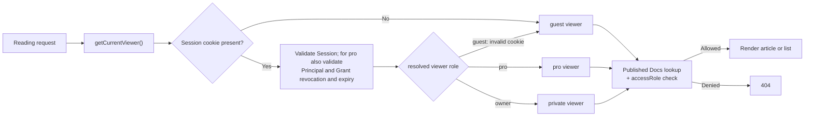
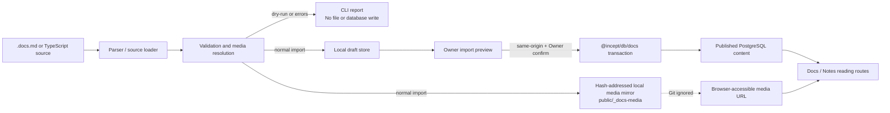

# Docs Module Architecture

## Purpose

Docs is the site's structured content publishing module. Articles are imported from Markdown-like or TypeScript sources, first become local drafts, and are written to PostgreSQL only after an Owner confirms the browser preview. Reading routes only load published content and filter it by the current viewer's access level.

This document describes implemented boundaries. It does not present a future editor, object storage, or version rollback as existing capability.

## Routes

| Route | Status | Purpose |
| --- | --- | --- |
| `/{locale}/docs` | Implemented | Docs home, grouped by year with accessible standalone articles and collections. |
| `/{locale}/docs/{slug}` | Implemented | Published standalone `article` or `reference`. |
| `/{locale}/docs/series/{collectionSlug}/{articleSlug}` | Implemented | Article inside a collection. |
| `/{locale}/notes` | Implemented | Separate home for `kind: note`. |
| `/{locale}/notes/{slug}` | Implemented | Published note detail. |
| `/{locale}/docs/import-preview/{draftId}` | Owner-only | Import draft, media, and validation preview. |
| `/{locale}/studio/docs/library` | Owner-only | Published content library and route inspection. |
| `/{locale}/docs/reference` | Legacy compatibility route | Currently redirects to an early `document-shells` route; not a canonical route for new content. |
| `/{locale}/docs/archive` | Placeholder | Route and shell remain, but formal archive browsing is not implemented. |
| `/{locale}/docs/style-lab` | Owner-only test surface | Retained block regression page; not exposed in public navigation. |

Internal content can use `isListed: false`, such as the Docs-backed About body. It is not exposed through public Docs listings or slug routes; a dedicated Owner page loads it by `documentKey`.

## Content And Data Model

### Identity and locale

- `DocsDocument` is the cross-locale article identity.
- `documentKey` is an optional but recommended stable key for new authored content; `en` and `zh` locale rows sharing it belong to one article.
- `DocsDocumentLocale` stores locale-specific slugs, title, summary, publication date, SEO, and `bodyJson`.
- `DocsCollection` and `DocsCollectionLocale` use the same pattern for collections; `collectionKey` is the cross-locale collection identity.
- `DocsCollectionItem` is a collection navigation node: an `article` node mounts one cross-locale `DocsDocument`, while a `folder` node provides grouping without body content.
- `DocsCollectionItem.parentId` and `position` form the navigation tree; sibling nodes sort by `position`, and migrated legacy articles remain top-level `article` nodes.
- `DocsCollectionItemLocale` stores folder labels per locale.

### Publication history

- `DocsPublicationEvent` is an immutable event table.
- Initial publication writes `published`; a same-locale `replace` writes `replaced`.
- Events store occurrence time, triggering locale, and a `writingUnits` snapshot for article "last updated" metadata and About writing activity.
- Events are not body-version snapshots. They cannot currently show historic body content, diffs, or rollback.

### Visibility and access

Content access has three levels: `guest`, `pro`, and `private`.

- An unauthenticated viewer is `guest`.
- Redeemed invitations and shared codes create `pro` access.
- An Owner session maps to `private` access inside Docs.
- Home hides inaccessible entries; direct access to an inaccessible detail route returns 404.
- Collection detail checks both collection and current-article access, and filters collection items individually.
- A collection and all of its articles must use the same `accessRole`.
- A collection directory supports at most three folder levels; article URLs remain `series/{collectionSlug}/{articleSlug}` and do not encode folder depth.

The `users` table is content ownership metadata, not a public user-account system.

### Reading Authorization Flow



## Body Contract

The database `bodyJson` root shape is:

```json
{
  "sections": [
    {
      "id": "overview",
      "title": "Overview",
      "blocks": []
    }
  ]
}
```

Current block types:

- `paragraph`: text, link, mark, delete, and inlineCode.
- `heading`: body hierarchy at levels 2-4.
- `list` and `checklist`.
- `callout`, `quote`, and `divider`.
- `code`: language, caption, and `block` / `compact` variants.
- `image`: URL, alt text, and optional caption.

The right `On this page` rail uses sections as top-level nodes and nests body headings from `##` through `####`; every node reuses the stable body anchor ID. For long articles, the rail title remains fixed above the list. The list is limited to about 40% of the viewport, remains scrollable with its native scrollbar hidden, and uses a page-background fade to indicate additional items until the reader reaches the end. When reading enters a section outside the visible list, the outline scrolls smoothly to return the active item to view.

## Import And Publication

### Input boundary

- The normal authoring format is `.docs.md` inside `DOCS_CONTENT_ROOT`.
- TypeScript `DocsImportArticleSource` remains supported for advanced or programmatic imports.
- Local images must stay inside the content root. The importer validates, hashes, and writes Git-ignored local mirrors under `public/_docs-media`.
- External `http` / `https` images retain their original URL.

### Publication flow



- `pnpm docs:import --file <path> --dry-run` validates only and writes neither files nor database rows.
- A normal import publishes local preview mirrors and writes a draft.
- The confirm route validates same-origin requests and Owner session; a draft with errors cannot be confirmed.
- `--replace` is only for intentionally overwriting an existing locale article.
- `pnpm docs:import --dir <path> --dry-run` recursively reads numbered directories and `.docs.md` files, then prints the inferred folder/article tree.
- A normal directory import first creates a batch draft; an Owner must still confirm it before publication.

The complete writing contract lives in `apps/web/src/features/docs/importer/docs-push/README.md`.

## Runtime Boundaries

```text
packages/db
  Prisma schema, migrations, Docs queries, import writes, publication events

apps/web/src/server/docs
  viewer role mapping, access checks, DB record -> page model mapping

apps/web/src/features/docs
  reading UI, block renderer, home, import preview, Studio library

apps/web/src/app/[locale]
  thin route entrypoints and 404 / redirect behavior
```

Browser components do not access Prisma directly. Routes resolve the viewer first, then call server Docs loaders. `@incept/db/docs` does not depend on Next routes or page components.

## Current Deferred Boundaries

- Body version snapshots, diffs, and rollback.
- New body blocks such as table, video, and embed.
- Formal Archive browsing, search, and topic filtering.
- Object storage/CDN media publishing and safe media cleanup.
- A browser Docs editor; publication currently uses external source files and preview/confirm.
- Cross-locale folder-label overrides and stronger batch atomicity checks remain to be verified.
