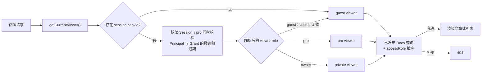
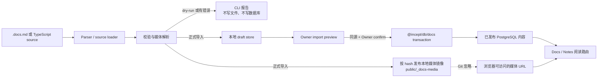

# Docs 模块架构

## 定位

Docs 是站点的结构化内容发布模块。文章通过 Markdown-like 或 TypeScript source 导入，先生成本地 draft，由 Owner 在预览页确认后写入 PostgreSQL；阅读页只读取已发布内容，并按当前 viewer 权限过滤。

这份文档描述当前已实现的边界，不把未来 editor、对象存储或版本回滚当作现有能力。

## 路由

| 路由 | 状态 | 职责 |
| --- | --- | --- |
| `/{locale}/docs` | 已实现 | Docs 首页，按年份展示可访问的单篇文章与合集。 |
| `/{locale}/docs/{slug}` | 已实现 | 已发布的单篇 `article` 或 `reference`。 |
| `/{locale}/docs/series/{collectionSlug}/{articleSlug}` | 已实现 | 合集内文章。 |
| `/{locale}/notes` | 已实现 | `kind: note` 的独立阅读入口。 |
| `/{locale}/notes/{slug}` | 已实现 | 已发布随笔详情。 |
| `/{locale}/docs/import-preview/{draftId}` | Owner-only | 导入 draft 的正文、媒体和校验预览。 |
| `/{locale}/studio/docs/library` | Owner-only | 已发布内容库与路由检查。 |
| `/{locale}/docs/reference` | 遗留兼容入口 | 当前重定向到早期 `document-shells` 路由；不是新内容的规范入口。 |
| `/{locale}/docs/archive` | 占位入口 | 保留路由和界面壳，尚未实现正式归档浏览。 |
| `/{locale}/docs/style-lab` | Owner-only 测试面 | 保留的 block 回归实验页，不进入公开导航。 |

内部内容可使用 `isListed: false`，例如 About 的 Docs-backed 正文；此类内容不通过公开 Docs 列表或 slug 路由暴露，而由专用 Owner 页面按 `documentKey` 读取。

## 内容与数据模型

### 身份与 locale

- `DocsDocument` 是跨语言文章身份。
- `documentKey` 是可选但推荐的新文章稳定 key；同一 key 的 `en` / `zh` locale 行属于同一文章。
- `DocsDocumentLocale` 保存 locale 专属 slug、标题、摘要、发布时间、SEO 和 `bodyJson`。
- `DocsCollection` 与 `DocsCollectionLocale` 对合集采用相同模式；`collectionKey` 是跨语言合集身份。
- `DocsCollectionItem` 将一个跨语言 `DocsDocument` 以全局 `position` 挂载到一个合集。

### 发布历史

- `DocsPublicationEvent` 是不可变事件表。
- 首次发布写入 `published`；同 locale `replace` 写入 `replaced`。
- 事件保存发生时间、触发 locale 与 `writingUnits` 快照，用于文章页“最后更新”与 About 写作活动。
- 当前事件不是正文版本快照：不能据此查看旧正文、diff 或回滚。

### 可见性与权限

内容权限只有三档：`guest`、`pro`、`private`。

- 未登录 viewer 是 `guest`。
- 兑换 invitation 或 shared code 后是 `pro`。
- Owner session 在 Docs 中映射为 `private`。
- 首页不显示无权限条目；直接访问无权限详情返回 404。
- 合集详情同时检查合集和当前文章权限，合集内条目也逐篇过滤。
- 合集及其文章必须使用一致的 `accessRole`。

`users` 表只承载内容系统所有权元数据，不是公开用户账户系统。

### 阅读授权流程



## 正文合同

数据库中的 `bodyJson` 顶层结构：

```json
{
  "sections": [
    {
      "id": "overview",
      "title": "Overview",
      "blocks": []
    }
  ]
}
```

当前 block 类型：

- `paragraph`：text、link、mark、delete、inlineCode。
- `heading`：level 2-4 的正文层级。
- `list`、`checklist`。
- `callout`、`quote`、`divider`。
- `code`：语言、caption、`block` / `compact` 变体。
- `image`：URL、alt 与可选 caption。

页面右侧 `On this page` 当前只由 section 生成。`##` 到 `####` 已渲染为正文 heading；把它们加入嵌套目录是 backlog B-03，不改变当前写作语法。

## 导入与发布

### 输入边界

- 常规写作格式是位于 `DOCS_CONTENT_ROOT` 内的 `.docs.md`。
- TypeScript `DocsImportArticleSource` 仍支持高级或程序化导入。
- 本地图片必须位于内容根目录内；导入器校验、hash 并写入 Git 忽略的 `public/_docs-media` 本地镜像。
- 外部 `http` / `https` 图片保持原 URL。

### 发布流程



- CLI `pnpm docs:import --file <path> --dry-run` 只验证，不写文件或数据库。
- 非 dry-run 会发布本地媒体镜像并写入 draft。
- confirm route 校验同源请求和 Owner session；含 error 的 draft 不能确认。
- `--replace` 仅用于有意覆盖既有 locale 内容。

完整写作合同见 `apps/web/src/features/docs/importer/docs-push/README.md`。

## 运行时边界

```text
packages/db
  Prisma schema, migrations, Docs queries, import writes, publication events

apps/web/src/server/docs
  viewer role mapping, access checks, DB record -> page model mapping

apps/web/src/features/docs
  reading UI, block renderer, home, import preview, Studio library

apps/web/src/app/[locale]
  thin route entrypoints and 404 / redirect behavior
```

浏览器组件不直接访问 Prisma；路由先解析 viewer，再调用 server Docs loader。`@incept/db/docs` 不依赖 Next 路由或页面组件。

## 当前未实现边界

- 文章正文版本快照、diff 与回滚。
- 嵌套 heading 的右侧目录。
- table、video、embed 等新的正文 block。
- Archive 的正式浏览、搜索与主题筛选。
- 对象存储/CDN 媒体发布适配器和安全媒体清理。
- 浏览器中的 Docs 创建/编辑器；当前发布入口仍是外部源文件与 preview/confirm。
