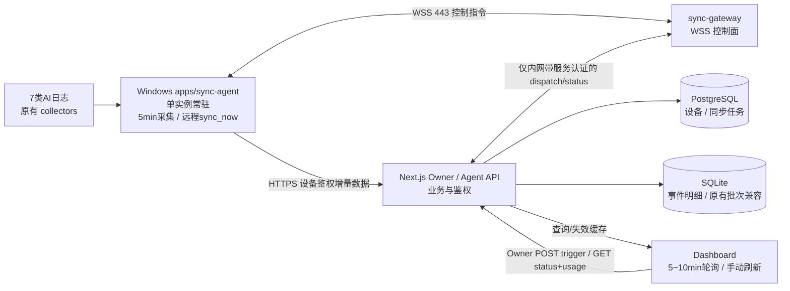

# Incept Sync Agent：分阶段可执行工程计划

> 状态：待实施（架构规划稿，依据 2026-10-16 Readiness Audit v1.0.0）  
> 调查基线：Incept Monorepo `aef64f4`；**执行前先以当前工作树复核**  
> 配套调查：`docs/research/incept-sync-agent-readiness-audit.md`  
> 产品取舍：**Token 5 分钟自动上报 + 远程 Refresh now 触发实际采集**；Docs 只手动/AI 发布；Music 只网页手动上传或主动曲库同步。后两者不在本次开发范围。  
> 上线约束：原有 Owner 认证、TOTP 和人工 Import 行为必须保留；不得暴露本机入站端口；不得开放新的公网服务端口；生产环境约 2 vCPU / 2 GB，Next.js App 容器约 768 MB。  
> 凡提到具体函数、文件路径，均据审计报告提供；执行者需通过本地代码再次核对。审计报告中的性能数值和某些环境判断仅为估计。

## 0. 架构决策与成功标准

### 0.1 最终拓扑



- **控制面：** Caddy → 独立轻量 `sync-gateway` → Windows Agent WSS，传输 `sync_now`、ACK、在线心跳。Gateway 仅维护连接/分发，不解析 Token 数据、不访问云端 Token SQLite。
- **数据面：** Windows Agent → HTTPS `POST /api/dashboard/sync/upload` → Next.js 校验设备身份、幂等接收 → SQLite，成功后发送可验证回执。
- **设备与命令管理：** PostgreSQL 保存 `AgentDevice`、`AgentSyncJob`（可按既有 Prisma 风格命名）；Next.js 负责 Owner 授权和业务状态；Gateway 通过受保护的内网接口向 Next.js 请求凭据校验/回报命令状态，避免新增独立数据库连接池。
- **Agent 启动：** Windows 任务计划程序“用户登录时运行”一个常驻进程，运行期间每 300 秒触发采集；异常退出由任务配置/自恢复机制处理。任务计划程序不需要再每 5 分钟启动新进程。
- **数据方向：** 一期仅 Windows → 云端。网页查询云端聚合；不把云端历史 Token 数据回灌到本机，也不触碰 Docs/Music 同步逻辑。

### 0.2 不可妥协的验收标准

1. Windows 用户登录后 Agent 启动，空闲保持 WSS 在线；正常每 5 分钟执行一次同步，即使网页关闭也继续运行。
2. 在电脑/手机浏览器点击 `Refresh now`：若在线，触发**实际本地采集 + 云端成功入库 + 数据可查询**；若离线，显示明确状态并仍可查看云端历史统计。
3. 同一批次传输重试、Agent 崩溃恢复、同时发生定时与远程采集，均不产生重复 Token、双重费用或数据丢失。
4. 已有人工 Import、Preview、Commit、TOTP 门禁继续工作；既有历史数据与自动上报数据不会重叠计数。
5. 任何设备凭据均无法使用 Owner 管理接口；服务端只允许固定命令 `sync_now`；所有上报、触发和内部转发均限权、校验、限流、可撤销、可审计。
6. Caddy 仍只公开 80/443（SSH 22 维持现状），容器内部接口不公开；服务重启、断网、电脑睡眠/唤醒能自动恢复。
7. 2GB 主机在持续运行和上传时内存、查询延迟、SQLite 大小保持在可测定可接受范围；以基准测试为准，拒绝未经实测的“单次 200ms”或“仅占 35MB”承诺。

## 1. 对调查报告的必要修正（开发前务必阅读）

审计对现有代码路径、`TransferBundle`、WAL、前端和部署给出了足够好的起点，但以下建议**不能原样编码**。

### R1. 不得只用 `event.timestamp > lastSyncTime - 15min` 做增量

历史对话可能晚写入、日志追加或修正较早时间的事件，成本和模型映射也可能变化。简单按事件时间过滤会永久漏报，15 分钟窗口无法从根本上解决。

**第一版推荐：** 继续复用现有 collectors 取得标准化事件；每次扫描后按**稳定身份 + 内容指纹**与 Agent 本地持久清单比较，只上传新增和变更事件。允许初版每 5 分钟本机全量扫描，但必须用基准测试验证开销，并设置串行执行、防抖和最大工作时长。后续按源引入文件 mtime/size/offset/SQLite watermark 等性能优化；索引失效时可重建。记录采集器版本与设备标识。

**必须验证：** 追加旧时间事件、改写已有事件、改动模型/成本、日志轮转、弱身份冲突、多来源重复采集；不能把 `canonicalTransferId` 等同于绝对稳定身份。

### R2. 不能采用简单 `INSERT OR REPLACE` 或不加区别的“精确一次”口号

传输语义选 **at-least-once + 幂等入库**。存储必须区分 `inserted / unchanged / updated / conflict / rejected`，明确旧记录何时可更新、变更前后成本及聚合如何修正。使用受控 `ON CONFLICT DO UPDATE` 并保护审计字段；禁止按无条件 REPLACE 悄悄覆盖其他设备/历史来源的记录。

### R3. 不能只用内存重试队列

进程意外退出或 Windows 重启会丢失待上传数据。Agent 采用本地**持久化 outbox**（推荐 `node:sqlite` 独立 DB）：先写待发送批次，再尝试网络；收到**服务端事务提交成功的回执**后，原子标记已确认并推进同步状态。失败保留并指数退避；断网重连首先补发积压。回执丢失时重传同一 `batchId`。

### R4. 避免 15 秒长 HTTP 挂起等待完整同步

`POST /api/dashboard/sync/trigger` 返回 `202 {jobId,status}`；浏览器短轮询 `GET /api/dashboard/sync/jobs/:id`（或者复用 SSE，但一期不必新增 SSE）。Web/Agent/上传三方用 `jobId/requestId/batchId` 关联。只有**服务器已提交且 Dashboard 查询可见**，才能在界面显示“最新数据已同步”。浏览器等待超时不等于 Agent 任务失败：服务端可继续执行并供之后查询结果。

### R5. 先设计人工历史 Import 与增量明细表的兼容策略

当前 `/data/dashboard/imports.db` 的 `batches` 仍可能包含原先人工导入的全量快照。新 `imported_events` 若与既有批次同时参与汇总，初次 Agent 上报会导致严重重复。**实施前做实际匿名化 fixture + 统计对照**，明确如何进行一次性回填、统一事件视图、跨存储去重，及新旧导入共存期间的读取规则。不要直接删旧 `batches`，不要直接停用 Preview/Commit，也不要贸然替换当前生产数据库。

### R6. 调查中的环境、时间、性能数字需要现场核实

审计称 Next.js 16、60 秒前端轮询（与口头估计两分钟有差异）；以当前源码为准。审计头部出现 Debian Bookworm，而其他环境说明曾出现 Debian 13，需通过只读 `os-release` 等证实。Caddy WebSocket 超时、Gateway 35MB/64MB、单次采集 200~800ms、3~5 秒刷新等均须实测。Node 自带 WebSocket Client 是否支持所需自定义 Authorization 头也要先验证，必要时采用 `ws` 客户端或连接后限时鉴权，**不得把长效 Token 放进 URL/query string**。

## 2. 建议契约（具体字段按现有 domain/schema 对齐）

### 2.1 增量批次协议（新增版本，不破坏 TransferBundle v1）

概念字段：

```ts
interface AgentSyncBatchV2 {
  schemaVersion: 2;
  deviceId: string;      // 服务端通过凭据解析身份，并与请求值比对
  batchId: string;       // 每次创建一次，重试沿用
  agentVersion: string;
  createdAt: string;
  records: Array<{
    eventIdentity: string; // 稳定键，结合现有 identity / matching 规则
    recordHash: string;    // 内容版本，供变更检测
    event: unknown;        // 实际复用现有 TransferEvent 类型及 validator
  }>;
}
```

此段是**设计示意**，不是现存字段声明；开发者应与 `domain/imports.ts` 的 TransferEvent、费用字段、模型映射和旧数据 ID 兼容。批次加大小/记录数上限并分页，审计报告提示 Caddy 默认请求体限制可能是 1MB；修改精准路由规则并验证，不放宽全站限制。

服务端回执：`batchId, accepted, inserted, unchanged, updated, conflicted, rejected, committedAt, dataRevision`；业务拒绝与瞬时故障区分，明确哪些可重试。重复 `batchId` 返回原始成功回执。不要在设备端按全量原始数据直接清空服务器历史。

### 2.2 远程刷新任务

```text
POST /api/dashboard/sync/trigger     [Owner + CSRF/Origin + 限流]
  input:  deviceId (一期可为默认绑定设备)
  output: 202 { jobId, status:"queued"|"running" } / 409 offline / 429 too-many

GET  /api/dashboard/sync/jobs/:id     [Owner]
  output: { jobId, deviceId, status, startedAt, completedAt,
            committedAt?, dataRevision?, counters?, errorCode? }

GET  /api/dashboard/sync/status       [Owner]
  output: { online, lastSeenAt, lastCollectedAt, lastReportAt,
            lastSuccessfulSyncAt, syncLag, lastErrorCode? }
```

状态枚举：`queued → dispatched → collecting → uploading → committed → completed`，失败/离线/超时以清晰终态处理。对于重复点击同一设备的触发请求，**合并到同一个活跃任务**，不并发触发重复采集。

Gateway 接受的消息最小白名单：`auth/hello`（或在 WSS Upgrade 阶段鉴权）、`heartbeat`、`sync_now(jobId)`、`sync_ack(jobId,accepted|failed)`、`state(jobId,collecting|uploading)`。**ACK 只能代表命令/阶段，真正成功依据服务端已提交的 batch receipt 与 dataRevision。**

### 2.3 数据库存储角色

- PostgreSQL：`AgentDevice`（设备名、tokenHash、状态、创建/撤销时间、最近活动）、`AgentSyncJob`（jobId/deviceId/state/触发者/时间/错误摘要）。优先索引身份与未完成任务；控制最近任务保留期。
- SQLite：既有人工 `batches`/`previews` 保持兼容；新增或迁移至紧凑的事件明细存储及批次回执记录。主键和索引必须经过冲突语义测试，再落实 SQL。
- Windows Agent 本地 SQLite：设备运行状态、事件指纹索引、持久 outbox、已经确认的批次。设备 Token 用当前用户受保护的秘密存储（优先 DPAPI / Windows Credential Manager；若只能使用文件，需核实目录 ACL 并避免日志输出）。
- `lastSeenAt` 与 WSS 在线态区分：在线由 Gateway 当前连接判定，数据库只保留最近活动时间；心跳无需每 30 秒写一次 PostgreSQL。

## 3. 分阶段落地任务与验收门槛

每阶段完成后提交实现差异、运行测试、风险与回滚说明；**上一阶段未验收，不进入下一阶段**。始终先开发环境，生产部署须单独取得用户明确许可。

### Phase 0 — 基线、真实数据语义与性能验证（先做，阻断 P1）

**目标：** 发现会导致错账/不可回滚的约束。

执行任务：

1. 读取调查报告索引中的真实源码；核实当前工作树、版本、`pnpm` 命令及测试配置。核实本地/生产数据库与 Caddy 的实际运行边界（生产仅只读检查）。
2. 为 `exportTokenData`、`loadImportedEvents`、`canonicalTransferId`、`identityIndex`、`readActiveBatches` 制作精确调用关系图与样例事件 Schema，列出弱身份、事件修订、删除/重命名的规则。
3. 用**脱敏 fixtures** 构造 7 来源：相同日志再次采集、晚到旧事件、原事件修正、同一事件跨来源索引、重复人工导入、Token 成本校正、同批次重试；记录正确聚合期望值。
4. 本地只读 benchmark：典型/最大历史数据全量采集的 wall time、CPU 峰值、RSS、输出记录数和总包大小，记录 5 分钟频率的预计负载。测试服务器 `readActiveBatches` 的大包增长复杂度可在隔离测试 DB 中完成，不触碰生产写入。
5. 设计与旧人工批次的去重、迁移/兼容方案，并记录上线前后可核对的统计口径（tokens in/out/cache、sessions、cost、7d/30d/all）。

**交付：** `docs/research/sync-agent-phase0-decisions.md`（事实、基准、冲突矩阵）、自动化 fixtures/tests；发现与报告相反的事实时立即修订本计划的相关阶段。

**验收：** 明确事件级主键与更正语义；已有人工批次如何处理有可运行测试；能够指出统计不重复的依据；本机 5 分钟扫描开销有测量数据。

### Phase 1 — 增量存储与入库兼容层（先保证“上传不会错账”）

**涉及：** `packages/dashboard/src/adapters/local/imports/{identity,matching,store,layer,service}.ts`、`packages/dashboard/src/domain/imports.ts` 及新增迁移/测试。

1. 保留 TransferBundle v1 手工导入路径；新增独立版本化增量协议和 schema validator，限制单批记录/体积。
2. 实现事件明细或经 Phase 0 证明等价的 compacted store。导入事务完成、唯一键/upsert 冲突检查、批次回执保存必须是原子操作；具备 SQLite busy timeout 与有限重试。
3. 实现**旧批次兼容/一次性回填**及源身份桥接；保证新上传事件与历史人工全量数据不会双计。迁移要可重入，不能直接丢弃历史批次。
4. 将 Dashboard 聚合数据读取改为有界 SQL 查询或兼容混合读取，避免每次解析无限增长的批次 JSON；按 `dataRevision` 失效快照、避免旧快照显示为同步成功。
5. 将冲突类型纳入回执和审计：含校正计价、弱身份冲突、多源合并、设备重复、手动与 Agent 重合。

**验收：** 与当前原有统计在相同 fixture 上 totals 一致；重复相同 batch 100 次统计不变化；相同事件修正后只计最新版本；模拟批量并发读写无重复/锁死；人工 Import 回归通过。

### Phase 2 — 设备身份、安全上报 API（先让数据面上线可测）

**涉及：** `packages/db/prisma/schema.prisma`、`apps/web/src/server/auth/*`、Next.js API routes、Owner 设置 UI。

1. Prisma 增加 `AgentDevice`（以及 Phase 4 用的 `AgentSyncJob` 可先定义），提供 Owner 注册/列表/吊销的管理入口；一次性显示随机高熵密钥，服务端只持久化不可逆哈希，不在日志展示。
2. `/api/dashboard/sync/upload` 只接受设备专用身份，鉴权只赋予该设备自己的 Token 数据上报权限；核实 `deviceId` 与凭据身份一致；大小限制、Schema、速率限制及批次重复校验。
3. **不修改**原 `withSensitiveOwnerAction` 的 Owner 导入防护：设备上报走新专用授权机制，而非复用 Owner Session/TOTP，也不是全站取消二次验证。
4. 上传返回事务回执；数据版本和快照失效机制在服务端落实；撤销 Token 后所有新上传请求被拒绝。
5. 服务端只保留安全所需日志（batch/job ID、deviceId、耗时、数量、错误码），禁止输出原始会话内容、完整 Token 或个人目录内容。

**验收：** 无 Token、伪造 Token、吊销 Token、跨设备伪造、超大请求、重复 batch、坏签名/坏 Schema、源冲突均有自动化用例；合法设备成功并可查询；Owner 原有导入与 TOTP 用例通过。

### Phase 3 — Windows Agent：可靠的五分钟无人值守上传

**涉及：** 新增 `apps/sync-agent`（`pnpm-workspace.yaml` 已含 `apps/*`）、原 `packages/dashboard` collectors/exporter、便携构建脚本、新增本地状态与 Windows 安装脚本。

1. Agent 单进程复用 7 来源采集器与原有转换逻辑；与 Web-specific `server-only` 依赖安全解耦（优先明确 Node-only 导出，必要时复用已验证的 esbuild 处理方式）。
2. 实现 `run-once`、`daemon`、`status`、`install-startup`、`uninstall-startup` 等命令接口（名称可根据仓库风格调整），输出结构化结果与机器可读退出码。
3. 本地独立 SQLite 管理事件指纹清单和 durable outbox；同步引擎持有单飞锁，远程请求与定时任务可合并；每轮完成后为下一轮计时，异常不能造成紧密死循环。
4. 每 300 秒**扫描并对比变更**、拆小批上传；断网/5xx/429 退避，4xx 非可重试错误独立报告；回执落盘后再移除 outbox，批次 ID 重试不变。
5. 容忍休眠/唤醒/网络切换与日志正在被写入；采集器对可恢复的文件锁错误实现后续补录；如数据库/索引损坏，能保守恢复或重建，不把空扫描当作删除全部历史。
6. Windows 登录态用户启动常驻 Agent，单实例安全保护，标准输出和滚动日志路径明确，日志轮换/资源上限可配置。提供关闭/卸载及诊断命令。凭据留在操作系统当前用户权限边界中。
7. 显式区分 `lastCollectedAt`（实际扫描完成）、`lastReportAt`（成功上报）、`lastSuccessfulSyncAt`（数据已确认）和 `lastErrorAt`。

**验收：** `run-once` 对现有所有采集器有效；正常 5 分钟自动上报；网页关闭时继续同步；断网 30 分钟/重启后补报；重试不会双计；重复启动仅一个 Agent；电脑睡眠/唤醒后可继续；资源 benchmark 达标（阈值基于 Phase 0）。

### Phase 4 — WSS Gateway、远程命令及持久 Job

**涉及：** 新增 `apps/sync-gateway`（或同等服务目录）、`deployment/compose.production.yml`、`deployment/Caddyfile`、Next.js Owner trigger/status/jobs API、Agent WSS 客户端。

1. 独立 WebSocket Gateway 单个轻量容器，不修改既有 Next.js `next start` 运行模式；Caddy 443 `/api/sync/ws` 定向反代，其余原业务路由不变。
2. Agent 连接时校验设备凭据；使用 WSS 和短鉴权超时、心跳/重连退避；不使用 URL 查询参数携带长效 Token。断开/吊销后 Gateway 撤销在线态和相应未完成调度。
3. Gateway 对 Next.js 提供**只在内部网络可访问、且带服务间认证**的 dispatch/status/revoke 接口。任何公网请求、普通设备或普通用户均不得直接发指令。Gateway 只接受枚举化 `sync_now`，拒绝命令内容、文件路径或任意 Shell 参数。
4. Owner API 建立持久 `AgentSyncJob`，`POST /trigger` 快速 202 返回 jobId；同一设备同一时刻最多一个活跃采集，重复点击返回现有 job；`GET /jobs/:id` 展示阶段和服务器真实结果。
5. Agent 收到指令先 ACK/状态，再调用与定时任务同一同步引擎；真正 `completed` 的条件是上传事务完成并且对应 `dataRevision` 对 Dashboard 可见；`sync_ack` 本身不作为成功依据。
6. 同一设备断线时前端状态自动切换；Gateway 重启/服务器重启后重新认证连接，未完成 Job 可超时结束或安全恢复，绝不把未知状态显示为成功。
7. 设定并测试 WSS 心跳（建议 30s），Caddy idle timeout、容器故障重启策略、Gateway RSS/CPU 和 PostgreSQL 连接预算。

**验收：** 电脑和手机浏览器（在线 Agent）触发同步都能收到真实结果；设备离线给出明确响应；并发 10 次触发只做一次采集；中途重连、Gateway 重启、服务端提交成功但 ACK 丢失均不重复/错报；设备吊销可断线且禁止上传。

### Phase 5 — Dashboard UI 联动和体验完成

**涉及：** `packages/dashboard/src/react/hooks/use-dashboard-window.ts`、`dashboard-toolbar.tsx`、`packages/dashboard/src/next/usage-route.ts`、相关客户端数据 hooks。

1. 保留现有页面布局、Overview/Models/Costs/Projects、统计范围和 Import 功能。**本地开发模式沿用原有即时刷新行为**；云端模式 `Refresh now` 改走 Owner-trigger → job poll → usage 重新获取。
2. 将**前端轮询周期**独立配置为云端 5 或 10 分钟（推荐初期 5 分钟），不与 Agent 的 5 分钟采集定时器共享一个含糊的时间戳。审计指出当前 Hook 常量实际为 60 秒，需现场确认。
3. 状态：`online/offline`、`queued/collecting/uploading/completed/failed`，以及 last collected/synced/refreshed 时间；离线仍能本地 UI 读取云端最近已保存快照。
4. 进度条只代表“页面下次自动请求云端”的倒计时，**不要展示为本地采集进度**；手动同步另有 loading 和可追踪状态。浏览器隐藏时暂停轮询，恢复可见时立即拉取状态与 usage。
5. `AbortController` 只取消浏览器等待，不撤销已发出的服务器同步 Job；图表只有拿到与任务回执版本相符的新数据才提示“刷新完成”。离线时可以执行云端数据刷新，但必须写清它是缓存/历史数据。

**验收：** UI 不闪烁；正常定时轮询、远程立即采集、设备离线、网络失败、慢采集、切换时间范围、后台标签切回、手机访问均经过 E2E；原 Import/TOTP/数据图表功能全量回归。

### Phase 6 — 生产上线、灰度、回滚及收尾

1. 本地/隔离 Docker 环境完整联调，自动运行 `pnpm lint`、`pnpm typecheck`、现有仓库对应测试与构建命令（以真实 package scripts 为准）；提交测试证据。
2. 备份生产 SQLite（含 WAL 一致性）和 PostgreSQL，并演练恢复；执行迁移前后 tokens/sessions/cache/cost 对账；确认原人工批次仍可读取。
3. 先发布**兼容的新存储读取/写入和设备认证**，观察人工 Import 正常；再发布 Gateway；最后本地 Agent 配对并启动 5 分钟上报。任何步骤未验收则停止。
4. 初期只让**一台 Windows 设备**上报；保留临时停用开关 `SYNC_AGENT_ENABLED` / `SYNC_UPLOAD_ENABLED` / `SYNC_REMOTE_TRIGGER_ENABLED`（最终名称按代码规范），可逐层关停，历史数据保持可读。
5. 测试生产在线、断线、远程手机触发、逐步滚动发布、凭据撤销及恢复。观测错误率、采集耗时、队列积压、入库/聚合耗时、RSS、CPU、SQLite 大小和日志增长。
6. 回滚至少提供：关闭新上传/触发入口、停止/卸载 Windows 任务、回退 Gateway 路由和容器、恢复原 Dashboard 查询模式；新 SQLite 表先**保留不删除**，避免破坏回滚后的数据审计。
7. 按实测结果确定是否优化逐源文件游标或压实策略、是否把网页轮询从 5 分钟改 10 分钟。最后更新 README / 运维文档、REP 任务状态。

**生产变更闸门：** 开始修改生产 PostgreSQL/SQLite、Caddy、Compose、防火墙、在线镜像部署或 Windows 自启设置之前，必须获得用户明确授权并提供变更清单和回滚路径。

## 4. 端到端回归测试矩阵（至少执行）

| 编号 | 场景 | 期望 |
|---|---|---|
| T01 | 旧人工导入历史数据，然后 Agent 首次上报同一设备 | 统计与原始日志一致，无双计；差异有具体诊断 |
| T02 | 同一 batchId 上传 2 次、100 次 | 回执幂等，费用和 Token 不增长 |
| T03 | 事件时间是上周，但文件今天才追加 | 下一个扫描周期能补录 |
| T04 | 既有会话旧事件模型/Token/录得费用修正 | 单事件最终值正确，聚合被纠正 |
| T05 | 不完整/正在写入的日志、WAL 锁冲突 | 不使 Agent 崩溃；下一轮补录 |
| T06 | 上传成功、回执丢失，Agent 随后重启 | durable outbox 重传，后端幂等 |
| T07 | Windows 连续断网 30 分钟又恢复 | outbox 自动补发，状态时间正确 |
| T08 | 定时同步与多人同时触发 Refresh now | 单设备单任务，结果对所有请求可查询 |
| T09 | 上传期间停止 Gateway 或 Web 容器 | 恢复后 Job 终态一致，数据不双计 |
| T10 | Device Token 吊销、伪造、跨设备上报 | 上传和指令均拒绝，在线态正确 |
| T11 | 非 Owner/CSRF 请求调用 trigger | 拒绝；原 TOTP 策略未退化 |
| T12 | 电脑离线时手机点击刷新 | 展示历史云端数据和离线状态 |
| T13 | Owner 人工 Import 与自动上报并发 | 数据一致、SQLite 操作安全 |
| T14 | Cloud 5 / 10 分钟轮询 + 隐藏标签切回 | 进度条、查询频率、最后刷新时间准确 |
| T15 | 7d / 30d / all 与模型/项目/价格各视图 | 历史基线差异在预期以内且可解释 |
| T16 | 云主机 2GB 容量下进行持续上报和远程触发 | 无 OOM，容器内存有余量，查询响应稳定 |

## 5. 执行记录与开发纪律

- 每阶段先提交修改范围和依赖清单；开发过程中不要顺手重写 Docs、Music 或既有认证体系。
- 新 API、消息、存储、Agent 状态必须有统一的版本/类型约束与自动化测试；避免客户端服务端各自复制不一致的 JSON 类型。
- 首次配对明文 Token 只显示一次；日志、CI、测试快照、Git 历史禁止留下明文凭据。
- 统计正确性优先于快速实现；性能问题用基准证据驱动，不盲目设计高水位时间戳。
- 遇到与调查结论冲突的实际代码证据，写入阶段记录后调整实现，**不要强迫代码符合报告中的猜测**。
- 每阶段交付固定格式：完成内容、改动文件、关键测试结果、性能数字、风险与未决项、回滚方式、下一阶段是否可开始。

## 6. 推荐执行入口

**第一次编码会话只执行 Phase 0 → 若全部门槛通过，再执行 Phase 1。** Phase 2～6 均以此文档为任务依据，但后续涉及生产环境的动作须单独获批。建议阶段间小范围提交，保证可以定位退化点和回滚。
