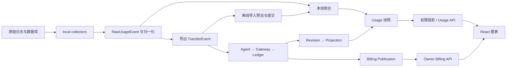

# Dashboard 数据链路与宿主架构

基线 `aefdab427ef90bf53f4f83c3713994735b582488`，以下为当前源码核查，部署中启用的环境开关需另行验证。采集器细节见 [采集器能力](02-collector-capabilities.md)，同步细节见 [同步完整性](06-sync-and-data-integrity.md)，计价见 [身份与计价](04-identity-and-billing.md)。

## 领域和宿主

`TokenDashboardData` 有 `sync`、`collectionIssues`、`updatedAt`、`checkedAt`、`range`、`dateRange`、`totals`、`daily`、`monthly`、`models`、`sources`、`costs`、`projects`、`sessions`，日/月点内含模型拆分与各类 Token。`domain/types.ts:161` 定义响应，`domain/imports.ts:3` 定义跨设备 TransferEvent，`domain/sync.ts:5` 定义 scope、manifest、receipt。各结构用途不同，应逐字段检查对应转换。

## 字段流转与改变

| 边界 | 输入 → 输出及实际处理 | 证据 |
|---|---|---|
| 本地采集 → 聚合前快照 | CommandCode 与其他 agent 事件合并，同文件 CommandCode 重复候选被抑制；丢弃无效及非正时间戳；模型名经本地 aliases 规范化，按时间生成 dateKey/monthKey，Token 与 cost 归非负，非法或负 cost 标记 missingPricing | `adapters/local/loader.ts:26` |
| 导入、回退 → 窗口选择 | 导入事件可替换 indexed 事件；未来事件排除。按 dateKey 限窗口后，ccusage 已覆盖会话对应的 indexed 候选被排除，补入 fallback 并规范化模型名 | `adapters/local/loader.ts:62` |
| 选中事件 → DTO | 应用 CommandCode quota 后 `summarizeUsageEvents` 聚合；按事件分配 native/indexed/imported/ccusage/mixed `collectionMode`，增加 range、checkedAt、去重后的 collectionIssues | `adapters/local/loader.ts:70` |
| Worker → 快照 | worker 消息携带 job id、range、force，成功返回整个 DTO，错误返回固定错误文本；快照按窗口保存 DTO，trusted generation 附 revision、identity、day | `adapters/runtime/worker-entry.ts:5`、`snapshot-store.ts:99` |
| 访问权限 → 输出 | Guest/Pro 白名单保留总量、日月、模型、来源和费用；Guest 将 projects、sessions 置空。Pro 详情保留 ID、标题、项目与活动时间，但丢弃 workspacePath、deviceLabel、importBatchId；Owner 不经此投影 | `domain/public-summary.ts:18`、`:32`、`:62` |
| Billing 预览 → 展示数据 | 仅 ready、范围匹配且有 breakdown 才覆盖展示中的 models、sources、daily 的成本及部分缺价标志；totals、monthly、projects、sessions 未在此函数同步改写。模型的 shareOfCost 按 Billing 估价总额计算 | `react/reconcile-billing-models.ts:137`、`:204`、`:254`、`:285` |

最后一行是客户端展示层派生，原 Usage 和 Billing 响应各自保持独立。模型匹配和聚合拆分见 `reconcile-billing-models.ts:92`、`:116`，按已有成本权重或 Token 分摊可能产生推导值。重构时不应将分配所得模型/日/时段成本当作逐请求计费记录。

`apps/web/src/app/[locale]/dashboard/page.tsx:8` 在宿主取得 viewer，将 Owner 传为 `canImport`，Owner 与 Pro 传为 `canViewDetails`。`packages/dashboard/src/next/dashboard-page.tsx:8` 首次读取 30d 快照，采用非等待新鲜版本的读取策略，缺失则使用空数据。Owner 和客户端角色影响初始快照投影及客户端缓存 scope。

`apps/web/src/app/api/dashboard/usage/route.ts:8` 依据 Owner、Sync 启用、远程模式或 shadow/v2 选择 `syncUsageGet`，其他请求走 `dashboardUsageGet`。后者 `packages/dashboard/src/next/usage-route.ts:8` 验证 all、7d、14d、30d，非 Owner 不得 force，Owner 的 force 在单进程按 session 限制 30 秒。`publicDashboardSummary` 用字段白名单构造响应，Guest 的 projects/sessions 为空，Pro 得到白名单详情，Owner 使用完整响应，见 `domain/public-summary.ts:32`。公开 ETag 在投影之后计算并区分 public/pro，响应 `no-store`、`Vary: Cookie`，见 `next/usage-validator.ts:7`、`next/usage-route.ts:18`。

`apps/web/src/server/sync/usage.ts:8` 的 v1 读旧路径，shadow 同时投影并比较去除 checkedAt/sync 的内容哈希，v2 使用投影；trusted v2 使用已发布快照并在 `minRevision` 大于零时等待新鲜版本。投影失败返回 503。该处的 shadow 对比结果是源码行为，某部署当前使用何模式需读取运行配置。

v1/shadow 先调用 `dashboardUsageGet`，并附 `sync.remote`、`intervalMs`、`readMode`、`shadowEqual`。v2 附远程与轮询元数据并合并投影原有 `sync`，其 revision 用于客户端等待上传可见。`shadowEqual` 比较整份已去除两个易变字段的 DTO 哈希，无法独立定位差异字段。`apps/web/src/server/sync/usage.ts:17`。

## 快照、刷新与故障

非 trusted `adapters/runtime/refresh.ts:16` 以范围和上下文合并并发任务，非强制且 15 秒内、日期一致、导入存储未变时可复用；否则由 worker 采集并保存。trusted 路径只读投影快照。`snapshot-store.ts:99` 先写临时文件再 rename，`snapshot-store.ts:155` 对各窗口校验同 revision、日期和 checkedAt 后发布一代；`snapshot-store.ts:177` 允许旧完整快照即时返回并调度更新。

`react/hooks/use-dashboard-window.ts:8` 默认 60 秒，远程模式 5–10 分钟。隐藏页面暂停轮询，恢复可见时请求，切换窗口先取同 scope 的客户端快照或空数据。手动远程刷新创建任务并轮询，成功时带 `minRevision` 获取数据，状态可为 partial、review、offline 等，见 `hooks/remote-refresh.ts:8`。失败保留已有快照并显示错误；权限降低时清理对应缓存并置空，拒绝窗口错配和较旧 revision，见 `use-dashboard-window.ts:115`、`:143`。`next/usage-route.ts:40` 采集异常返回 503。

## Billing 的独立读取

`apps/web/src/app/api/dashboard/billing/route.ts:9` 需要 `INCEPT_BILLING_READ_MODE=owner`、Owner 与 `requireSyncOwner`，返回发布数据，关闭为 404、无权限 403、发布不可用 503。`next/dashboard-page.tsx:18` 同时要求 billing UI 模式为 owner 才启用预览。`react/token-dashboard-feature.tsx:49` 请求后通过 `reconcileDashboardWithBilling` 构建展示数据，须保留 Usage 与 Billing 各自 revision 和来源语义，参见 [身份与计价](04-identity-and-billing.md)。

`adapters/runtime/billing-publication.ts:17` 验证 publication 版本、审批元数据、catalog/ledger 哈希、所有窗口及 `estimatedTokens + unpricedTokens + excludedTokens = tokens`。普通模式要求当前 ledger revision 和 hash 匹配发布物，输出 range、revision、catalog、asOf、members、估价和覆盖字段，缺少 breakdown。managed 模式允许返回未领先实时 revision 的 checkpoint，同时附 `liveRevision`，当 checkpoint 较旧、缺 breakdown 或距 asOf 超 60 秒时调度刷新；异步刷新合并重复触发，有磁盘和内存余量门槛，worker 最大老生代 128 MiB，失败记日志。证据 `billing-publication.ts:44`、`:101`。这意味着前端需展示 publication revision 与 liveRevision 的新鲜度差异，而 Usage/Billing 完全对账应选用同 revision 和窗口。

`react/hooks/use-billing-preview.ts:7` 的状态为 loading、ready、unavailable，依赖窗口与 refreshCycle 重取并取消旧请求，范围不匹配视为不可用。Billing 错误不应替换 Usage 快照为零。

## 证据和待验证

本节根据源码进行静态追踪，未声称已执行生产核验。`apps/web/src/server/sync/__tests__/usage.test.ts` 覆盖读路径，`fullsite.integration.test.ts:20` 包含合成设备、三窗口、revision 与重启场景，实际运行结果另见总体附录。组件清单见 [UI 清单](appendix-ui-inventory.md)。
