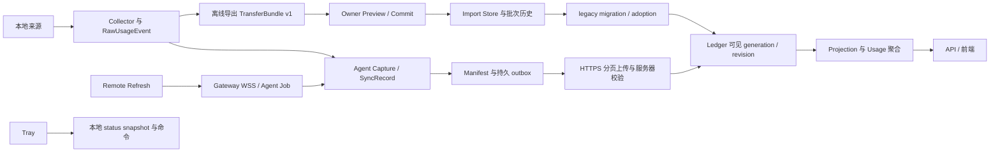

# 同步、导入与数据完整性

审计基线 `aefdab427ef90bf53f4f83c3713994735b582488`。下文为源码核验，测试文件是复现入口，未在本章执行生产操作。文中源码路径均相对仓库根目录，行号对应该 revision。

## 传输路径

离线导出显式构造事件，附带来源、会话、模型、项目、Token、可选 recordedCost 与捕获价格，跳过未来及零使用，冲突或无可靠身份的碰撞中止导出（`packages/dashboard/src/adapters/local/imports/exporter.ts:25`）。导入预览创建有期限的审阅结果，提交重新核对上下文，独立批次写入本地 SQLite，撤销保留历史（`imports/service.ts:10`、`imports/store.ts:17`、`imports/planner.ts:12`）。设备项目默认隔离，映射需要显式选择。导入上限 64 MiB（`imports/validation.ts:5`）。这些路径以 `packages/dashboard/src/adapters/local/` 为前缀。

同步端以 device/source/session 确定 scope，Manifest 标识 reader、collector version、parent、epoch、range 和内容证明，`SyncRecord` 包含事件、envelope 及可选原生键或累计点。定义见 `packages/dashboard/src/domain/sync.ts:1`，散列和校验见 `packages/dashboard/src/adapters/local/imports/sync/contract.ts:11`、`:38`、`:51`。分页最多 500 条及 512 KiB（同文件 `:7`），部署可采用更小 admission 限制。

## 字段传输与兼容性

| 字段 | Raw 到 Transfer | Sync 与存储 | 后果及改造 |
|---|---|---|---|
| timestampMs、modelName、五类 Token、session、project | 导出及 Agent 显式复制 | SyncRecord 包含 TransferEvent，observation 存 record JSON | 现有路径可读取，统计语义仍依来源 |
| timestampPrecision | Raw 与会话聚合支持，TransferEvent 未声明 | 导出和 capture 构造均省略 | 历史导入/同步记录仅有时间值，无法普遍可靠区分 day 和 event；不能将缺失当 event。扩展需版本化及历史 unknown |
| usageInterval | Agent 采集阶段使用，TransferEvent 未声明 | 可用于 Codex capture/recovery 判定，普通传输事件不携带 | 小时归属需要区间及跨桶策略，历史不可强行恢复 |
| nativeKey、pointKey、cumulative | SyncRecord 级证据 | 仅特定 reader 具备；Codex native capture 生成累计点 | 证明/归一化用途，不能直接视为统一请求数 |
| Agent role、request duration、finish reason | TransferEvent 未声明 | 未通过当前标准事件契约 | 需要采集、传输、校验、存储和读取升级 |
| device | TransferBundle.device 或 SyncScope | 读取时注入投影 | 归因按设备及项目映射处理 |
| recordedCost | 有记录且来源非 Codex 时复制 | 导入及 Sync 保留 | 与参考估价分别标记 |

证据为 `packages/dashboard/src/domain/imports.ts:3`、`packages/dashboard/src/adapters/local/imports/exporter.ts:36`、`packages/dashboard/src/agent/capture.ts:135`、`:152`、`:157`、`packages/dashboard/src/adapters/local/imports/sync/read.ts:87`。字段升级必须检视校验、稳定序列化、identity/envelope hash、manifest、去重、legacy 兼容和账本回放。旧记录保留 unknown，部署顺序及回滚需要先在合成数据验证。是否能新增可选字段且不影响既有哈希，须逐个兼容性测试。

## 提交、故障与历史保护

Agent 本地 state 保存 outbox、记录、lineage、回执和远程任务。只有匹配 batch、payload、generation、manifest 与 revision 的 committed receipt 才在同一本地事务中推进 lineage 并清理该批次（`apps/sync-agent/src/state.ts:142`）。不可用或空来源不会建立零基线，旧 scope 消失、无法证实轮转及历史隔离分别进入保护路径（`apps/sync-agent/src/engine.ts:71`、`:93`、`:113`）。采集的不可读文件与旧范围证据按会话隔离（`packages/dashboard/src/agent/capture.ts:100`、`:175`、`:207`）。冲突审阅恢复核对服务器 head 与父版（`apps/sync-agent/src/review.ts:43`）。

服务器 Ledger 保留 observation、generation 与可见版本。读取使用事务固定 data revision，选择可见 generation 与尚未被接管的 legacy membership（`packages/dashboard/src/adapters/local/imports/sync/read.ts:15`、`:43`）。v2 projection 核验 legacy store 的批次 checksum 和状态，陈旧时失败，投影可要求最低 revision。trusted mode 只读取已提交记录，非 trusted mode 也会收集本地 native（`packages/dashboard/src/sync/projection.ts:17`、`:22`、`:30`）。投影标注 `dataRevision`，成功历史不能与未提交新数据混同。

远程刷新通过 Gateway 鉴权在线设备，Agent 将远程 job 写入 SQLite，复用采集并按 TTL / retry 推进（`apps/sync-gateway/src/gateway.ts:13`、`apps/sync-agent/src/remote.ts:29`）。HTTP 429 等退避提示通过 `Retry-After` 限幅处理（`apps/sync-agent/src/transport.ts:24`）。资源 admission 的默认磁盘、水位和内存阈值定义于 `packages/dashboard/src/sync/protocol.ts:17`，具体运行值取决于部署配置。Tray 消费 Agent 的状态投影，状态文件先写临时文件、fsync、再 rename（`apps/sync-agent/src/snapshot.ts:13`、`apps/sync-agent/src/credentials.ts:15`）。此原子写证据针对状态文件，Dashboard 快照实现应单独核查。

## 验证入口与待确认事项

合成和回归测试入口包括 `apps/sync-agent/tests/agent.test.mjs`、`session-integrity.test.mjs`、`verify-lineage.test.mjs`、`apps/sync-gateway/tests/gateway.test.mjs`、`packages/dashboard/src/__tests__/sync-review-acceptance.test.ts` 和 `sync-rebase.test.ts`。单独的隔离 HTTPS/数据库集成入口记录于 `apps/sync-agent/README.md`。生产部署的当前 revision、历史精度覆盖率、断线恢复的真实样本以及真实多设备并发对账仍需对应只读证据；不能从上述测试路径推断本次测试结果。

## 持久层和职责边界

PostgreSQL 通过 Prisma 管理 Owner、设备授权与远程任务。[`AgentDevice`](../../../packages/db/prisma/schema.prisma#L163) 对应 `agent_devices`，[`SyncJob`](../../../packages/db/prisma/schema.prisma#L595) 保存 owner、device、credentialVersion、policyHash、任务状态与起止 revision，按 owner/idempotencyKey 唯一并索引 device/createdAt 和 status/expiresAt。设备与任务迁移分别为 `20261017010000_sync_agent_devices`、`20261017020000_sync_jobs`。用量 ledger 则由独立 SQLite 管理，不位于 Prisma 表中。

[SQLite ledger schema](../../../packages/dashboard/src/adapters/local/imports/sync/store.ts#L9) 的 `sync_meta` 保存单调 revision，`origins/scopes/manifests/generations` 保存来源范围、head、visible generation 与定价映射，`observations/entities/changes/current` 保存记录及当前投影，`staging/stage_pages/stage_records` 保存分片上传，`receipts/receipt_clock` 保存提交回执及时间。review、resolution 和 audit 为审阅及审计，legacy batches/members/prices/projection 与 adoptions 保留旧数据关系。索引包括 generation 的 scope、current 的 observation、observation 的 timestamp、receipt 的 device/time 及 legacy identity/variant。Agent 本地 SQLite 的 outbox、records、lineage、receipts、remote_jobs 与隔离状态见 [AgentState](../../../apps/sync-agent/src/state.ts#L12)。

## 版本、提交和审阅

`generationId` 对 scope、epoch、parent manifest、sequenceHash、basisHash、mappingsHash 求哈希，manifestHash 再覆盖 generation 与其余 manifest 字段。record count 与顺序哈希提交前校验。首次范围必须没有 parent，通常需要非空记录；后续要求相同 scope、reader、collector version 与匹配父版，并验证追加、修订或轮转证明，详见 [makeManifest 和 qualifyRanges](../../../packages/dashboard/src/adapters/local/imports/sync/contract.ts#L38)、[sequence 验证](../../../packages/dashboard/src/adapters/local/imports/sync/service.ts#L8)。generation 是内容版本，`dataRevision` 是 ledger 可见状态变化的全局计数，不能互换。

同一 batch 的 begin、分页 stage 与 commit 在 ledger 事务内执行，失败回滚（[SyncStore](../../../packages/dashboard/src/adapters/local/imports/sync/store.ts#L84)）。commit 的验证通过后更新 current、visible generation 与 receipt，变更时 bump revision。冲突写 review 并返回 review-required，保留旧可见内容（[commit](../../../packages/dashboard/src/adapters/local/imports/sync/store.ts#L158)）。审阅要求 Owner，接受路径还检查代码许可、scope、manifest 和当前 parent，审阅结论与新回执事务提交（[acceptReview](../../../packages/dashboard/src/adapters/local/imports/sync/store.ts#L251)）。审阅准入受 [assertReviewAcceptanceAllowed](../../../packages/dashboard/src/adapters/local/imports/sync/store.ts#L42) 控制，应以当前代码支持的错误类别为准。

Owner 回滚可见 generation 时，重建对应 scope、选定祖先可见版本、标记 fenced 并递增 revision，防止后续沿旧头静默推进。投影 rebuild 是独立 Owner 操作（[rollback/rebuild](../../../packages/dashboard/src/adapters/local/imports/sync/store.ts#L346)）。legacy adoption 和 visible generation 的联读通过 [CURRENT_READ_SQL / LEGACY_READ_SQL](../../../packages/dashboard/src/adapters/local/imports/sync/read.ts#L15) 排除已被可见新范围接管的旧投影。读取开启事务并在事务内获取 revision，确保本次扫描一致。

## 状态、握手和权限

Agent 定时周期为 300 秒，主循环每秒检查待执行命令，显式 sync-now 在暂停自动同步时仍可排队运行（[cli](../../../apps/sync-agent/src/cli.ts#L103)、[循环](../../../apps/sync-agent/src/cli.ts#L152)）。当前源码的采集 worker 截止时间为 300 秒（[engine](../../../apps/sync-agent/src/engine.ts#L29)），README 中 45 秒描述与现实现有差异。上传重试使用指数退避及随机抖动，401、403、429、503 结束本轮后保留待传（[engine](../../../apps/sync-agent/src/engine.ts#L201)）。

Gateway WebSocket 限制消息大小并要求五秒内发送认证消息，验证 device 后替换该设备原连接，默认每 30 秒心跳并再次核查授权。Agent 七秒连接超时、75 秒心跳截止，重连指数退避至 60 秒并带抖动（[gateway](../../../apps/sync-gateway/src/gateway.ts#L27)、[remote](../../../apps/sync-agent/src/remote.ts#L17)）。RPC 走独立签名校验，远程 job 带有效期且持久化去重。Tray 提供同步、暂停/恢复、打开 Dashboard、日志、设置及退出时是否停止 Agent 的选择，见 [TrayContext](../../../apps/sync-tray/src/TrayContext.cs#L316)。

Dashboard Usage 返回角色标识并按 viewer 决定投影；Billing 需要启用 owner 模式及 Owner 授权；导入预览要求 Owner，写入链路还需执行同源及相应授权检查。入口见 [Usage route](../../../apps/web/src/app/api/dashboard/usage/route.ts#L11)、[Billing route](../../../apps/web/src/app/api/dashboard/billing/route.ts#L10)、[Import preview](../../../apps/web/src/app/api/dashboard/imports/preview/route.ts#L6)。设备凭证版本及 policyHash 由 Gateway 和服务共同校验，设备权限与浏览者权限属于不同边界。

## 字段逐阶段核对

| 字段 | Collector / Raw | Export / Transfer | Manifest / Storage | Projection / API | 兼容重点 |
|---|---|---|---|---|---|
| Token、model、timestamp、session、project | 原始字段规范化 | 显式复制 | record JSON、sequence 和 manifest 间接承诺内容 | 转为 Raw，再按窗口聚合 | 保留来源的 token 互斥口径 |
| timestampPrecision | 部分 Collector 提供 | 当前构造省略 | 当前标准 record 未声明 | 传输后不可凭 timestamp 恢复 | 旧值置 unknown |
| usageInterval | 部分 Raw 提供 | 省略 | Agent 用于恢复判断，普通事件不带 | 不能普遍重建跨桶区间 | 加字段时检验 hash 与旧版 |
| cumulative / nativeKey | 某些来源有效 | 普通 Export 无此记录级证明 | SyncRecord 保存，参与识别与校验 | 非通用请求计数字段 | 按 reader 单独解释 |
| device、mapping | Agent 配置或离线 bundle | device、project mapping | scope、origin、basis/mappings | 读路径注入设备与有效项目 | 历史映射需保持稳定 |
| recordedCost | 部分来源提供 | 非 Codex 可选复制 | 随记录保存 | 读取后作为 recorded 来源 | 历史价格不应静默重算 |

逐阶段依据为 [TransferEvent](../../../packages/dashboard/src/domain/imports.ts#L3)、[exporter](../../../packages/dashboard/src/adapters/local/imports/exporter.ts#L36)、[capture](../../../packages/dashboard/src/agent/capture.ts#L152)、[SyncRecord](../../../packages/dashboard/src/domain/sync.ts#L8) 和 [readSyncView](../../../packages/dashboard/src/adapters/local/imports/sync/read.ts#L31)。

## 本次隔离测试结果

2026-11-24 使用 Node 24.21.0 与仓库现有依赖构建 Agent 和 Gateway，临时文件设置到仓库缓存目录。Agent 的 Node 测试共 107 项，通过 104 项，失败 3 项。DPAPI 保护目录测试因测试临时路径位于仓库而触发 `STATE_IN_REPOSITORY`，HTTP 重试测试遇到 `NETWORK_UNAVAILABLE`，Windows 脚本测试遇到 PowerShell `AuthorizationManager` 拒绝。Gateway 两项测试通过一项，另一项连接回环地址时发生 `EACCES`。这些失败项尚需在允许回环访问、可用的仓库外隔离临时目录及正常 Windows 脚本授权环境复验。
