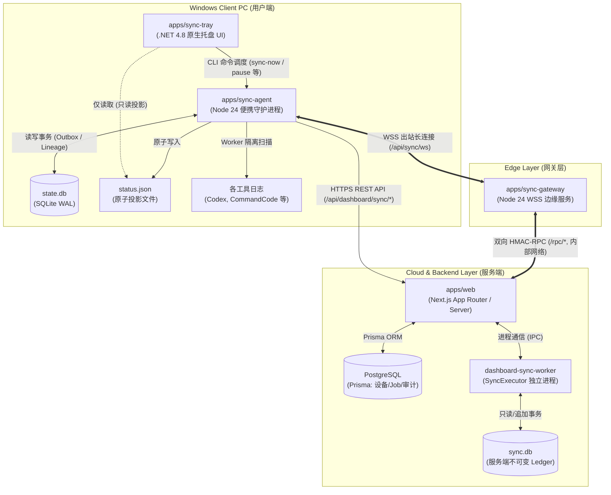
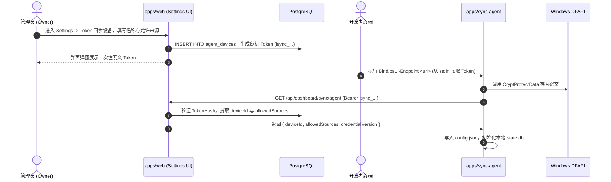
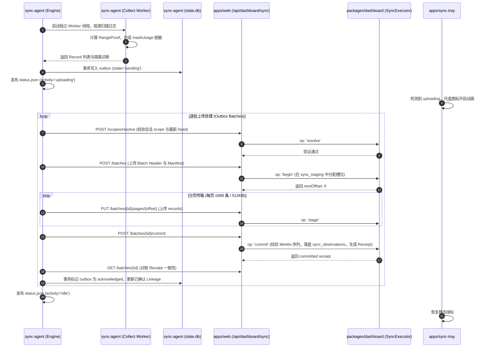
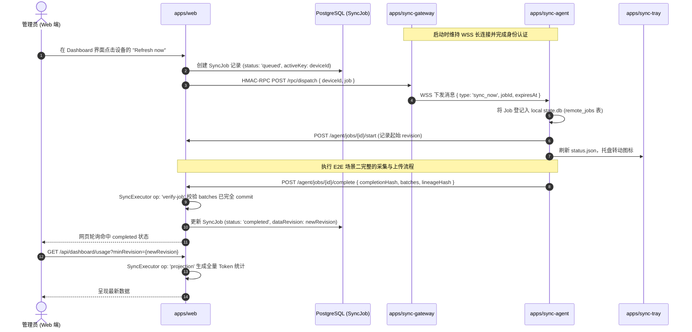

# Incept Dashboard 与三端 Sync 架构及 E2E 业务逻辑调查报告

## 概述

本文档系统性梳理 `@incept/dashboard` 核心包以及 `apps` 下三个同步应用（`sync-agent`、`sync-gateway`、`sync-tray`）的架构设计、数据模型、安全边界与端到端（E2E）业务逻辑。

---

## 一、系统总体拓扑与边界

整体架构由**客户端运行环境（Windows 本机）**、**边缘长连接网关**与**云端 Web 服务/存储层**三层构成：

---

## 二、`packages/dashboard` 核心包解析

`@incept/dashboard` 是 Incept 单机与分布式 Token 统计计算的统一内核，位于 `packages/dashboard`，拥有框架无关领域层、服务端采集聚合适配器与 React 视图层。

### 1. 目录结构与分层职责

| 模块目录 | 核心职责 | 技术与运行环境约束 |
| :--- | :--- | :--- |
| `src/domain/` | 定义纯业务模型（`TokenBreakdown`, `ModelUsageSummary`, `SyncManifest`, `SyncReceipt`, `SyncConflict` 等）。 | 无 Node、无 React、无 Next 依赖，纯 TypeScript 抽象。 |
| `src/adapters/local/` | 本地日志解析、价格目录匹配、时段切分与数据聚合。 | 纯 Node 环境，依赖 `node:sqlite`，严禁浏览器导入。 |
| `src/adapters/runtime/` | 快照持久化（`dashboard-snapshots.json`）、文件排他锁与后台 Worker 调度。 | Node.js Worker 线程隔离，避免大文件扫描阻塞主服务。 |
| `src/agent/` | 客户端日志哈希、敏感内容脱敏掩码（`maskUsage`）、`RangeProof` 生成。 | 客户端离线分析专用，确保原文不脱离本机。 |
| `src/sync/` | 加密连续性账本执行引擎（`SyncExecutor`）、准入控制、容量配额与 v2 读投影（`projection.ts`）。 | 强类型守护进程与工作线程，维护数据强一致性。 |
| `src/react/` | 前端组件库：Overview, Models, Costs, Projects 四大面板、趋势热力图、导入对话框。 | React 19，依赖宿主 `NextIntlClientProvider`。 |
| `src/next/` | 服务端组件 `TokenDashboardPage`、API 路由桥接（`usage-route.ts`, `import-routes.ts`）。 | Next.js App Router 服务端运行时。 |

### 2. 采集器与多源降级体系

本地适配器在 `src/adapters/local/collectors/` 中实现了 8 大开发环境原生日志采集：
1. **`commandcode`**：解析 `.commandcode/projects` 下的 session jsonl。
2. **`codex`**：解析 `.codex/sessions` 与 `archived_sessions`，支持 fork 树形历史去重与累计修订。
3. **`claudeCode`**：解析 `.claude/projects` 消息与会话费用。
4. **`geminiCli`**：解析 `.gemini/tmp` 会话结构与时间戳。
5. **`antigravity`**：解析 `.gemini/{antigravity,antigravity-cli,antigravity-ide}/conversations` SQLite 数据库。
6. **`opencode`**：解析 `.local/share/opencode` 数据记录。
7. **`zcode`**：解析 `.zcode/cli/db` 模型用量。
8. **`deepseekHarness`**：解析 `.dsh/sessions` jsonl.zst 压缩日志。

> [!NOTE]
> **降级策略（Fallback Hierarchy）**：
> 当原生文件缺失或无法读取时，系统按如下优先级回退：
> **原生日志扫描** $\rightarrow$ **离线 `ccusage` 时区感知报表** $\rightarrow$ **历史 `aiusage` SQLite 数据库**。
> 所有展示面板均用 `collectionMode: 'native' | 'ccusage' | 'indexed' | 'imported' | 'mixed'` 清晰标记可信度。

### 3. 隐私保护与零原文外泄（Zero Plaintext Leakage）

在 `packages/dashboard/src/agent/capture.ts` 中：
*   **内容脱敏（Masking）**：在生成 Merkle 验证信封时，`maskUsage()` 将日志中的所有用户提示词、回复文本、私有参数完全剥离，仅保留 Token 统计键；在计算 `envelopes` 时将计数数值置零，仅校验日志结构与 Merkle 证明。
*   **证据链锚定（RangeProof）**：生成包含 `locatorHash`、`identityHash`、`root`、`envelopeRoot` 的结构证明，证明文件存在且属于该会话，而无需向云端传输文件内容。

### 4. 加密连续性账本机制（Lineage Ledger Protocol）

服务端 SQLite（`sync.db`）基于以下核心概念构建了单调递增的因果账本：
*   **`SyncScope`**：`{ deviceId, source, sessionId, originId }`，唯一界定一个会话来源。
*   **`SyncManifest`**：包含版本号（v2）、前驱父代（`parent: { generationId, manifestHash }`）、范围集合（`ranges`）与操作意图（`observe | rebase | reprice`）。
*   **冲突与审阅机制（Review Queue）**：若上报数据出现前缀丢失（`PREFIX_LOST`）、父版不匹配（`PARENT_MISMATCH`）或未知旋转（`ROTATION_UNVERIFIED`），服务端将其打入 `sync_reviews` 隔离队列，旧版数据保持可见，绝不允许静默破坏历史。

---

## 三、`apps` 三个 Sync 应用职责与架构

### 1. `apps/sync-agent`（Node.js 本地守护进程）

*   **定位**：安装在开发者 Windows 本机的便携 Node.js 24 应用。
*   **持久层（`state.db`）**：
    *   启用 SQLite `WAL + FULL` 同步模式。
    *   维护客户端不可变待传批次（`outbox`）、分页分块、计划父版、已确认 Lineage、远程任务（`remote_jobs`）与会话隔离表（`session_isolations`）。
*   **凭据安全（DPAPI）**：
    *   通过 `Bind.ps1` 经子进程 `stdin` 输入 Token（`isync_...`），直接调用 Windows 原生 `CryptProtectData` 加密为密文。
    *   URL、启动参数、配置文件（`config.json`）与日常运行日志均**绝不记录明文 Token**。
*   **单实例与守护机制**：
    *   基于 Windows 命名管道（Named Pipe）实现单实例锁。
    *   `supervise` 模式在 Agent 异常崩溃后以指数退避自动拉起。
*   **状态投射**：
    *   Agent 每次状态变化或每 5 秒心跳，原子覆盖写入 `%LOCALAPPDATA%\Incept\sync-agent\status.json`，供前端托盘读取。

### 2. `apps/sync-gateway`（Node.js WSS 长连接网关）

*   **定位**：独立部署的边缘 WebSocket 网关，专门承载已绑定设备的客户端长连接。
*   **网络拓扑**：
    *   公网仅在反向代理（Nginx/Caddy）暴露 `/api/sync/ws`。
    *   内部 RPC 端口（默认 3101）仅限 Docker 容器网络互相访问，公网直接丢弃。
*   **无状态会话管理**：
    *   内存中管理 `Map<deviceId, Connection>`，只维护当前存活连接，不依赖历史 `lastSeen` 猜测在线状态。
    *   收到 Agent 的 `auth` 帧后，通过内部 HMAC-RPC 请求 Web 服务核实设备有效性与策略哈希（`policyHash`）。
*   **双向 HMAC-RPC 校验（`RpcVerifier` / `rpcCall`）**：
    *   Web 与 Gateway 之间使用共享 32-byte 随机秘钥。
    *   每个 RPC 请求强制绑定 HTTP Method、Path、Body SHA-256 Digest、时间戳（30秒滑动窗口）与随机 Nonce，坚决防御重放攻击。

### 3. `apps/sync-tray`（C# .NET 4.8 原生托盘 UI）

*   **定位**：极轻量的 Windows 桌面托盘应用，提供状态感知与一键控制。
*   **零侵入架构（Strict Zero-Direct-Access）**：
    *   **不读数据库**：绝对不访问 `state.db`，杜绝锁争用与数据库损坏风险。
    *   **不触碰凭证**：不读取、不传递设备 Token。
    *   **仅依赖两样东西**：
        1. 轮询读取 `status.json`（展示连接状态、用量计数、批次进度）。
        2. 以子进程调用 `node agent.mjs <command>`（`sync-now`、`pause`、`resume`、`stop`、`supervise`）。
*   **视觉与交互规范**：
    *   分层窗口（`LayeredCard.cs`）结合 DWM 阴影与暗色模式感知。
    *   图标状态：绿色（正常运行）、黄色 8 帧旋转动画（正在上传/同步中）、黄色（已暂停）、灰色（未运行）、红色角标（需要处理/冲突）。
    *   托盘菜单与卡片自适应多显示器 DPI 与任务栏贴边对齐（`TrayPlacement.cs`）。

---

## 四、端到端（E2E）核心业务闭环

### E2E 场景一：设备注册与绑定（Device Onboarding）

### E2E 场景二：周期性离线采集与分块可靠上传（Scheduled / Local Sync）

每 300 秒、执行 `agent.mjs sync-now` 或托盘点击“立即同步”时触发：

### E2E 场景三：网页“Refresh now”即时刷新调度（Remote Refresh-Now）

---

## 四、核心工程与容灾设计总结

1. **强一致状态机与并发防抖**：
   * 云端 `SyncJob` 表使用 `activeKey = deviceId` 唯一约束，确保同一设备任意时刻仅有一个处于活动状态的任务；
   * 高频点击自动折叠为同一任务，支持最长 180 秒的在途等待。
2. **离线韧性与断点续传**：
   * 即使网络完全中断，Agent 的本地采集先落盘到 `state.db` 的 `outbox` 表；
   * Staging 暂存具备过期重连能力，Receipt 确认机制确保即使 ACK 丢包也不会产生重复数据。
3. **分层安全纵深防御**：
   * **操作系统级**：DPAPI 绑定当前用户账号与硬件密钥；
   * **传输级**：公网强制 TLS/WSS；
   * **网络拓扑级**：内部 RPC 路由（`/rpc/*` 与 `/api/internal/*`）在边界 Nginx 反代层被硬性阻断，杜绝外部越权调用。

---

## 五、后续修改与讨论建议清单

基于当前实现，后续我们开展修改和功能演进时，可优先围绕以下方面：

1. **采集适配器调整**：
   * 是否需要对特定的开发工具日志路径（例如特定版本 Codex 或 Antigravity 路径变更）进行扩展或兼容？
2. **托盘与桌面体验**：
   * 托盘端目前已具备完善的状态展示与命令下发，是否需要增加更细粒度的会话故障排查（如直接唤起审阅报告或会话隔离日志查看器）？
3. **投影与聚合性能**：
   * 大规模数据下的 `SyncExecutor` 内存配额（当前配置为 256MB/1024MB）调优，以及 v2 Projection 快照发布锁竞争策略。
