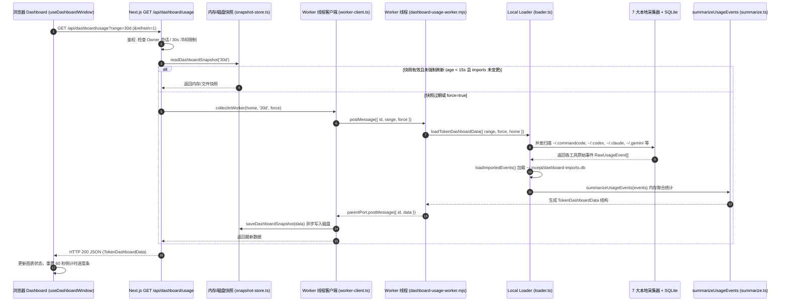
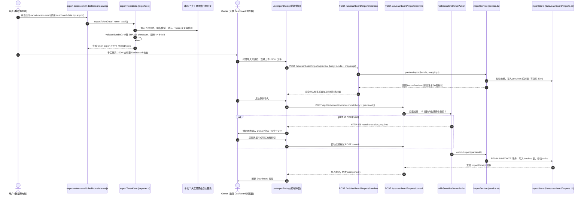
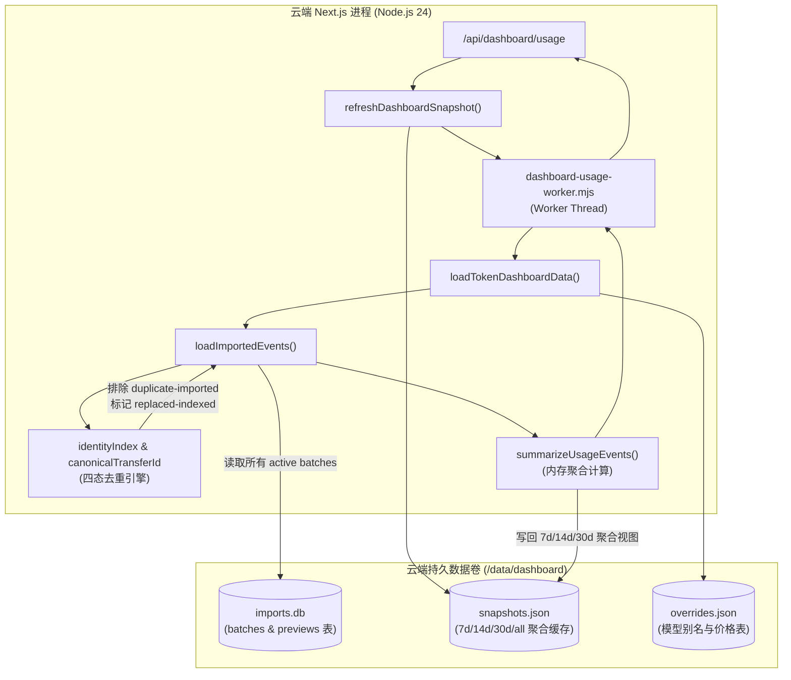
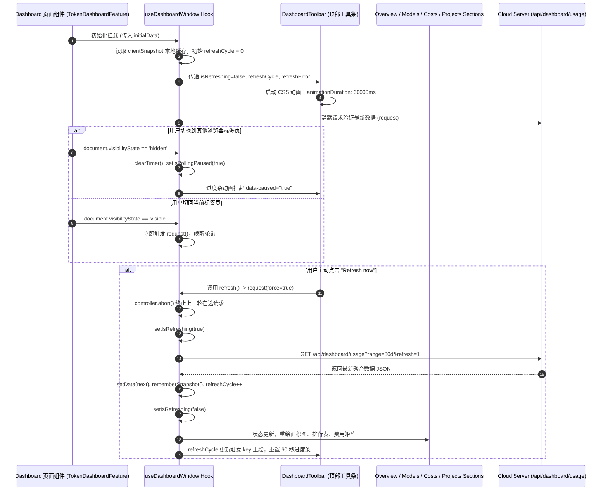
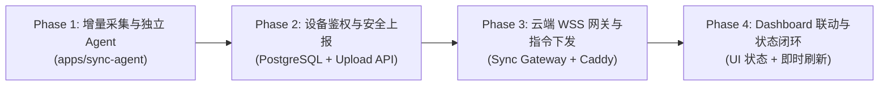

# Incept Sync Agent 实施前技术调查与工程就绪度审计报告

> **报告版本**：1.0.0 (Read-Only Engineering Audit)  
> **调查基线**：Incept Monorepo (`main` 分支最新提交 `aef64f4`)  
> **审计环境**：Windows 11 x64 (本地运行态) / Debian Bookworm x64 (云端容器运行态)  
> **审计 Agent**：Antigravity Architecture & Code Audit Agent  
> **参考规范**：`docs/plans/2026-10-16-post-launch-next-steps-plan.md` (REP-01 ～ REP-04)  
> **交付物目标**：为后续系统架构师与编码 AI 制定正式实施计划提供 100% 具备代码证据支撑的技术事实与决策依据。

---

## 1. Executive Summary

本次调查对 Incept Monorepo 进行了全栈只读代码审计，评估开发 **Windows 本地常驻 Sync Agent + 云端远程同步系统** 的工程就绪度。

### 核心结论与可复用基线
1. **采集能力高度完备**：`packages/dashboard` 内置的 7 大 AI 工具采集器（Codex、CommandCode、Claude Code、Gemini CLI、Antigravity、OpenCode、ZCode）与 `aiusage` 兜底索引均为**纯 TypeScript 库函数**，已完整具备会话抽取、Token 拆分、Recorded Cost 保留与参考费率计算能力，**无需通过子进程调用外部 CLI** 即可作为库直接调用。
2. **传输格式与去重算法已在生产验证**：`TransferBundle` (v1) 与 `ImportStore`（基于 `node:sqlite` WAL 事务）提供了完善的 `canonicalTransferId`、`contentHash` 与 `recordHash` 四态去重分类（`added` / `duplicate-local` / `duplicate-imported` / `conflict`），为数据一致性提供了现成算法。
3. **前端交互与轮询已闭环**：Dashboard 前端已实现基于 `useDashboardWindow` 的 60 秒自动轮询、平滑 CSS 进度条、标签页休眠检测与 `Refresh now` 状态机。

### 缺失的关键组件
1. **缺乏独立的设备身份与机器鉴权体系**：目前云端导入仅支持 Owner 浏览器会话通过 `withSensitiveOwnerAction` 执行，每次提交需密码+TOTP（428 二次认证），缺少设备专用、可撤销的最小权限 Machine Token。
2. **缺乏云端长连接网关与指令下发通道**：云端生产环境运行于 Docker (`node scripts/production-start.mjs` $\to$ Next.js 16 `next start`)，云端 Dashboard 点击 `Refresh now` 仅能触发容器内部自我重算，完全无法向 Windows 本机发起即时采集指令；目前无 WebSocket/SSE 路由。
3. **缺乏增量同步游标机制**：当前 `exportTokenData` 每次执行均为全量快照扫描，云端 `readActiveBatches` 会将所有批次的 JSON payload 全量加载至内存并进行 O(N) 遍历。若 5 分钟定时上传全量包，在 2GB 内存的云服务器上将迅速引发 SQLite 膨胀与 Node.js OOM。

### 最大的三个实施风险
1. **批次膨胀与服务端内存耗尽 (P0)**：若每 5 分钟向现有 `batches` 表追加全量 JSON 快照，日均产生 288 个批次，`readActiveBatches()` 每次页面加载均反序列化全部历史批次，极短时间内将击穿云服务器 768MB 容器内存上限。必须重构为**基于时间戳/文件哈希的高水位游标增量采集**，且服务端需建立单事件级存储或批次定期压实机制。
2. **长连接代理与进程模型失配 (P0)**：Next.js App Router 的 `next start` 模式无法原生承载持久 WebSocket 升级；生产 Caddy / Nginx 存在 100s 超时断连与升级头配置缺失风险。必须明确独立轻量 WebSocket 网关（或 Node 原生 HTTP 升级挂载）的部署边界，并内置 30～45 秒心跳保活。
3. **凭据权限与安全越权风险 (P1)**：若为简化通信而向 Agent 共享 Owner 会话或高特权 API，将破坏当前单 Owner 安全基线。必须设计仅具备 `sync:upload` 与 `sync:listen` 作用域的设备专用凭据，杜绝云端下发任意 Shell 指令。

---

## 2. 已核实的技术事实

| 领域 | 当前实现 | 代码位置 | 调查证据 | 对 Sync Agent 的影响 |
|---|---|---|---|---|
| **Monorepo 结构** | pnpm workspace 结构，包含 `apps/web` 与 `packages/{dashboard,db,music,roadmap}` | [pnpm-workspace.yaml](file:///d:/Desktop/code/code/Incept/pnpm-workspace.yaml#L1-L4) | 声明了 `apps/*` 与 `packages/*` 两大空间 | Sync Agent 最适合作为 `apps/sync-agent` 独立应用建立，隔离 Web 依赖并保持独立打包。 |
| **运行时引擎** | Node.js `>=24.15.0 <25`，pnpm `10.30.3`，TypeScript `5.9.3` | [package.json](file:///d:/Desktop/code/code/Incept/package.json#L4-L5) | 根配置锁定 `pnpm@10.30.3` 与 `node: >=24.15.0`，本地实测 `node v24.21.0` | Agent 可安全使用 Node 24 原生能力（如内置 `node:sqlite`、`fetch`、`crypto.randomUUID` 等），无需外挂 polyfill。 |
| **Web 框架** | Next.js 16.4.0 (App Router), React 19.2.8 | [apps/web/package.json](file:///d:/Desktop/code/code/Incept/apps/web/package.json#L21-L25) | `apps/web` 依赖 Next.js 16.4.0，生产通过 `next start` 运行 | Next.js 16 App Router 不支持原生 WebSocket Route Handler，长连接不能直接写在 App Router 路由内。 |
| **数据采集入口** | 统一导出函数 `exportTokenData({ home, deviceId, label })` | [packages/dashboard/src/adapters/local/imports/exporter.ts](file:///d:/Desktop/code/code/Incept/packages/dashboard/src/adapters/local/imports/exporter.ts#L25-L57) | 纯函数聚合 `commandcode` 与 `agents` 原始记录并执行本地定价映射与校验 | Agent 可直接引入此函数完成单次数据扫描，无需子进程运行 CLI。 |
| **数据采集器实现** | 7 大来源原生解析器 + 1 个 SQLite 历史缓存解析器 | [packages/dashboard/src/adapters/local/collectors/](file:///d:/Desktop/code/code/Incept/packages/dashboard/src/adapters/local/collectors/) | `commandcode.ts`, `codex.ts`, `claude.ts`, `gemini.ts`, `antigravity.ts`, `opencode-usage.ts`, `zcode.ts`, `aiusage.ts` | 全部为纯 TS 实现，无平台相关 C++ 扩展，读取本地目录并计算 Token。 |
| **便携式打包机制** | esbuild 将 CLI 打包为 ESM 单文件，并剥离 `server-only` | [packages/dashboard/tools/build-transfer.mjs](file:///d:/Desktop/code/code/Incept/packages/dashboard/tools/build-transfer.mjs#L8-L15) | 使用 `server-only-marker` 插件将 `server-only` 替换为空模块，输出 `dashboard-data.mjs` 与 `export-tokens.cmd` | Agent 可复用此打包方案，构建出体积 <1MB 的单文件便携脚本，脱离 Monorepo 独立常驻运行。 |
| **导入持久化存储** | 基于 Node.js 原生 `node:sqlite` 的 SQLite WAL 数据库 | [packages/dashboard/src/adapters/local/imports/store.ts](file:///d:/Desktop/code/code/Incept/packages/dashboard/src/adapters/local/imports/store.ts#L21-L28) | `new sqlite.DatabaseSync(path)`，`PRAGMA busy_timeout=5000; PRAGMA journal_mode=WAL;`，表 `batches` 与 `previews` | 服务端与本地均通过 `batches` 表读写。但目前每批次存完整 payload JSON，缺乏增量紧凑表结构。 |
| **事件去重算法** | 基于 `canonicalTransferId` 与 `contentHash` 的哈希索引 | [packages/dashboard/src/adapters/local/imports/matching.ts](file:///d:/Desktop/code/code/Incept/packages/dashboard/src/adapters/local/imports/matching.ts#L15-L46) | `identityIndex` 对比 `exact` 与 `contentHash`，支持弱身份桥接与冲突判定 | 增量上传时可直接沿用此套去重逻辑，确保重放请求不重复计费。 |
| **多工作区/项目映射** | 路径哈希加权映射，支持 `external:<deviceId>:<projectKey>` | [packages/dashboard/src/adapters/local/imports/planner.ts](file:///d:/Desktop/code/code/Incept/packages/dashboard/src/adapters/local/imports/planner.ts#L11) | 跨设备导入的项目默认挂在设备命名空间下，支持映射合并到本机项目 | 满足多设备独立采集、云端自动归集而不污染主项目统计的需求。 |
| **前端自动刷新 Hook** | `useDashboardWindow`，内置 60 秒轮询与可见性挂起 | [packages/dashboard/src/react/hooks/use-dashboard-window.ts](file:///d:/Desktop/code/code/Incept/packages/dashboard/src/react/hooks/use-dashboard-window.ts#L7-L107) | `DASHBOARD_REFRESH_INTERVAL = 60_000`，`visibilitychange` 监听，`AbortController` 保护 | 前端已有成熟轮询调度与进度条同步逻辑，只需适配远程 Agent 触发与状态展示。 |
| **云端 Usage 路由** | `GET /api/dashboard/usage`，支持 `refresh=1` 与快照缓存 | [packages/dashboard/src/next/usage-route.ts](file:///d:/Desktop/code/code/Incept/packages/dashboard/src/next/usage-route.ts#L7-L37) | `force=1` 时对 Owner 限制 30 秒冷却，非 Owner 403，调用 `refreshDashboardSnapshot` | 目前云端 `refresh=1` 只重新读取本地 SQLite 数据库，未向 Agent 派发指令。 |
| **敏感操作与二次认证** | `withSensitiveOwnerAction` 要求 15 分钟内认证，否则触发 428 | [apps/web/src/server/auth/sensitive-action.ts](file:///d:/Desktop/code/code/Incept/apps/web/src/server/auth/sensitive-action.ts#L7-L31) | 包装 `dashboard.import.commit`，检查 `requireRecentOwnerSession`，记录 `SecurityAudit` | Agent 定时同步**不能**走此通道，否则会因 428 要求密码+TOTP 而失败。 |
| **关系型主数据库** | PostgreSQL 16-alpine + Prisma ORM，存储权限与元数据 | [packages/db/prisma/schema.prisma](file:///d:/Desktop/code/code/Incept/packages/db/prisma/schema.prisma#L7-L9) | 仅管理 `OwnerAccount`, `AccessSession`, `Docs*`, `Music*`, `Roadmap*`，**不存 Token 数据** | Token 数据物理隔离在 SQLite 中。新增设备身份表应建立在 Prisma (PostgreSQL) 中以复用鉴权基线。 |
| **云端部署架构** | Docker Compose 部署：Caddy 反向代理 + Next.js App + PostgreSQL | [deployment/compose.production.yml](file:///d:/Desktop/code/code/Incept/deployment/compose.production.yml#L2-L125) | `app` 容器配置 `read_only: true`，仅挂载宿主 `/data` 持久卷；内存上限 768MB | Agent 通信不能依赖容器临时写权限；服务总内存必须严格控制在 2GB 宿主机上限内。 |
| **反向代理配置** | Caddyfile 托管 HTTPS，单入口 443，配置流控与请求体上限 | [deployment/Caddyfile](file:///d:/Desktop/code/code/Incept/deployment/Caddyfile#L50-L108) | Caddy 默认支持 WebSocket Upgrade，`@imports` 允许 64MB body，默认路径限制 1MB | Agent 走现有 443 端口无需新增防火墙规则；若上传大 JSON 包需保证路径匹配或单包体控制在限制内。 |

---

## 3. 当前真实数据流

依据当前真实代码执行链，绘制以下 4 个关键数据流图。

### 3.1 本地自动采集与刷新流程（当前实现）



> **代码证据**：
> - 轮询触发：`packages/dashboard/src/react/hooks/use-dashboard-window.ts:47-79`
> - 路由与冷却：`packages/dashboard/src/next/usage-route.ts:7-37`
> - Worker 线程调度：`packages/dashboard/src/adapters/runtime/worker-client.ts:27-57`
> - 本地与导入聚合：`packages/dashboard/src/adapters/local/loader.ts:24-77`

---

### 3.2 手动 Token JSON 导出与上传流程（当前实现）



> **代码证据**：
> - CLI 导出打包：`packages/dashboard/src/adapters/local/imports/cli.ts:24-34`
> - 核心导出逻辑：`packages/dashboard/src/adapters/local/imports/exporter.ts:25-57`
> - 前端就地 428 续接：`packages/dashboard/src/react/imports/use-import-dialog.ts:56-83`
> - 敏感操作拦截：`apps/web/src/server/auth/sensitive-action.ts:7-31`
> - 事务持久化：`packages/dashboard/src/adapters/local/imports/store.ts:29-55`

---

### 3.3 云端导入与聚合流程（当前实现）



> **代码证据**：
> - 云端导入层解析：`packages/dashboard/src/adapters/local/imports/layer.ts:11-71`
> - 导入存储交互：`packages/dashboard/src/adapters/local/imports/store.ts:34-37`
> - 内存聚合与快照更新：`packages/dashboard/src/adapters/local/aggregation/summarize.ts:11-85`

---

### 3.4 Dashboard 查询与图表更新流程（当前实现）



> **代码证据**：
> - 前端 Hook 全生命周期：`packages/dashboard/src/react/hooks/use-dashboard-window.ts:11-113`
> - 顶部工具栏与进度条：`packages/dashboard/src/react/components/dashboard-toolbar.tsx:65-84`
> - 图表与表格展示组件：`packages/dashboard/src/react/sections/overview/overview-section.tsx`

---

## 4. 现有功能可复用清单

对 Monorepo 现有模块的复用方式进行详细分类与技术审计：

### 4.1 直接复用 (Direct Reuse)
无需修改任何代码，可直接被 Sync Agent 或服务端引入：

1. **7 大数据源原生采集解析器**：
   - `packages/dashboard/src/adapters/local/collectors/commandcode.ts` (`collectCommandCodeEvents`)
   - `packages/dashboard/src/adapters/local/collectors/codex.ts` (`collectCodexEvents`)
   - `packages/dashboard/src/adapters/local/collectors/claude.ts` (`collectClaudeEvents`)
   - `packages/dashboard/src/adapters/local/collectors/gemini.ts` (`collectGeminiEvents`)
   - `packages/dashboard/src/adapters/local/collectors/antigravity.ts` (`collectAntigravityEvents`)
   - `packages/dashboard/src/adapters/local/collectors/opencode-usage.ts` (`collectOpenCodeEvents`)
   - `packages/dashboard/src/adapters/local/collectors/zcode.ts` (`collectZCodeEvents`)
   - `packages/dashboard/src/adapters/local/collectors/aiusage.ts` (`collectIndexedAgentEvents`)
2. **多模型定价与换算引擎**：
   - `packages/dashboard/src/adapters/local/pricing.ts` (`lookupPricing`, `computeCostFromPricing`, `canPriceUsage`)
   - `packages/dashboard/src/adapters/local/overrides.ts` (`readLocalOverrides`, `canonicalModelName`)
3. **去重与哈希生成基础函数**：
   - `packages/dashboard/src/adapters/local/imports/identity.ts` (`hash`, `stableJson`, `contentHash`, `recordHash`, `nativeEventId`)
   - `packages/dashboard/src/adapters/local/imports/matching.ts` (`canonicalTransferId`, `identityIndex`, `hasWeakIdentity`)
4. **共享传输与领域类型声明**：
   - `packages/dashboard/src/domain/imports.ts` (`TransferBundle`, `TransferEvent`, `TransferPrice`, `ImportReceipt`)
   - `packages/dashboard/src/domain/types.ts` (`TokenDashboardData`, `TokenBreakdown`, `DailyUsagePoint` 等)
5. **审计日志写入组件**：
   - `packages/db/src/owner/index.ts` (`writeSecurityAudit`, `finishSecurityAudit`)

---

### 4.2 少量改造后复用 (Adaptation Required)
逻辑完全可用，但因环境限制或参数接口需要轻微封装或解耦：

1. **导出器接口解耦**：
   - **原模块**：`packages/dashboard/src/adapters/local/imports/exporter.ts` 中的 `exportTokenData`。
   - **现状**：无增量时间戳过滤，每次返回当前机器的完整快照。
   - **改造方式**：增加可选参数 `options.sinceMs?: number` 或 `cursor?: SyncCursor`。在遍历事件时增加 `if (options.sinceMs && event.timestampMs <= options.sinceMs) continue;`，实现轻量增量打包。
2. **剥离 `import 'server-only'` 标记**：
   - **原模块**：`packages/dashboard/src/adapters/local/` 下的多数文件顶部声明了 `import 'server-only'`。
   - **现状**：Next.js 在客户端导入时会报错；但 esbuild 构建时可通过 plugin 剥离（已在 `tools/build-transfer.mjs:10-13` 中验证）。
   - **改造方式**：在 `packages/dashboard` 的 `package.json` 中增加面向纯 Node.js 的导出子路径（如 `./collectors`），或者 Sync Agent 打包脚本沿用 esbuild 的 `server-only-marker` 插件。
3. **前端工具条增加 Agent 在线/离线与同步状态指示**：
   - **原模块**：`packages/dashboard/src/react/components/dashboard-toolbar.tsx` 与 `use-dashboard-window.ts`。
   - **现状**：仅显示本地刷新动画与 `refreshError`。
   - **改造方式**：在 Toolbar 补充 `agentStatus: 'online' | 'offline' | 'syncing' | 'idle'` 状态图标或提示胶囊，并在 `refresh()` 触发时向服务端发送指令请求。

---

### 4.3 需要重构 (Refactoring Required)
现有机制不能满足 5 分钟高频自动同步的高效运行要求，存在设计缺陷或性能瓶颈：

1. **云端批次持久化存储模式 (`ImportStore.saveBatch`)**：
   - **原模块**：`packages/dashboard/src/adapters/local/imports/store.ts`。
   - **瓶颈**：当前表 `batches` 将整个 `TransferBundle`（可能包含数万条事件）序列化为单个 JSON 文本保存在 `payload` 字段。`loadImportedEvents` 每次都执行 `readActiveBatches()` 全量加载并逐个解析 JSON。5 分钟一次同步会导致 SQLite 极速膨胀、读性能劣化并在云端触发 OOM。
   - **重构方案**：
     - 保留 `batches` 作为上报批次审计记录（仅存元数据与回执）；
     - 新建紧凑的 SQLite 事件明细表 `imported_events (event_id PRIMARY KEY, batch_id, device_id, timestamp_ms, source, model, project_key, tokens_json, cost)`；
     - 上传时执行单事件级 `INSERT OR REPLACE` 幂等写入，查询聚合时直接按时间窗口索引过滤，无需在内存中反序列化所有历史大 JSON。
2. **`POST /api/dashboard/imports/commit` 权限体系**：
   - **原模块**：`apps/web/src/app/api/dashboard/imports/commit/route.ts`。
   - **瓶颈**：强绑定 `withSensitiveOwnerAction`，要求 15 分钟内的 Owner 浏览器密码/TOTP 认证，否则直接抛 HTTP 428。
   - **重构方案**：保留现有人工手动导入路由不变；为 Agent 开辟专用上报接口（见下文新增清单），使用专用设备令牌鉴权。

---

### 4.4 必须新增 (Must Build from Scratch)
现有工程中完全缺失、必须全新开发的核心组件：

1. **Windows 本地常驻守护进程 (`apps/sync-agent`)**：
   - 常驻 Node.js 进程；
   - 本地状态持久化 (`~/.incept/sync-agent-state.json`)，记录设备 UUID、上次同步成功时间戳（游标）与服务端通信凭据；
   - 5 分钟定时调度器与单实例文件互斥锁；
   - WSS 客户端（带自动重连、退避算法与 30s 心跳 ping/pong）。
2. **云端设备凭据数据模型与管理服务**：
   - 在 `packages/db/prisma/schema.prisma` 新增 `AgentDevice` 模型（包含 `id`, `name`, `tokenHash`, `revokedAt`, `lastSeenAt`, `lastReportAt` 等）；
   - 在 Owner Settings 提供生成/吊销 Agent Token 的页面与 API；
   - 设备 Token 验证中间件 `requireAgentDevice(request)`。
3. **云端实时双向控制网关 (Sync Gateway)**：
   - WebSocket over TLS 服务端（接收 Agent 长连接，维护在线设备列表）；
   - 内部指令分发接口（接收来自 Owner API 的 `sync-now` 指令，向指定设备推送消息，等待 ACK 并在超时后反馈）。
4. **Agent 专用数据上报接口 (`POST /api/dashboard/sync/upload`)**：
   - 接受基于 Bearer Token 的增量数据上传；
   - 单包大小限制校验（例如 10MB）；
   - 增量入库、更新设备 `lastReportAt`，并触发快照缓存失效。

---

## 5. 方案 B 的技术可行性评估

对即将实施的系统架构进行多维技术可行性审查：

### 5.1 Windows Agent 运行时与进程管理方案
- **评估结论**：**强烈推荐「Windows 任务计划程序 (Task Scheduler) + 常驻 Node.js 守护进程」**。
- **技术理由**：
  1. 权限隔离与环境一致性：Windows Service 默认运行在 `LocalSystem` 账户下，无法访问当前登录用户的 `%USERPROFILE%`，导致无法读取 `.codex`, `.commandcode` 等目录；而任务计划程序可配置为「仅在用户登录时运行」，完美承载当前用户的读权限与 Node 环境变量。
  2. 无额外原生依赖：无需安装 `nssm.exe` 等第三方包装工具，通过一条标准 PowerShell 脚本调用 `Register-ScheduledTask` 即可完成自启注册。
  3. 异常保活：任务计划程序支持「如果进程意外崩溃，每 1 分钟重启一次，最多 3 次」的看门狗配置。
- **单实例互斥机制**：Agent 启动时在 `~/.incept/sync-agent.lock` 打开排他文件锁（或监听本地回环端口如 `127.0.0.1:49188`），若被占用则静默退出，防止多实例冲突。
- **资源预算**：Node 24 空闲常驻内存约 30～45MB，CPU 占用 < 0.1%；每 5 分钟采集单次耗时约 200～800ms，瞬时 CPU 约 5%，磁盘 I/O 极低。

---

### 5.2 SSH 上传 vs 专用 HTTPS/WSS 上报对比

| 评估维度 | 方案一：SSH 隧道 / SFTP 上传 | 方案二：专用 HTTPS/WSS 上报 (推荐) |
|---|---|---|
| **网络端口要求** | 必须暴露云服务器 SSH 端口 (22) 至公网 | **仅复用现有 443 端口**，无需开新端口 |
| **双向通信能力** | 极弱。云端无法主动向内网 Windows 发送刷新指令，除非维护不稳定的反向 SSH 隧道 | **原生双向**。WSS 连接由客户端向外发起，云端可随时推送 `sync-now` 指令 |
| **凭据安全模型** | 必须在 Windows 本机存放 Linux 账号 SSH 私钥，一旦泄露风险扩散至整机 Shell | **最小权限 Token**。仅能上报 Token 数据与收发控制指令，支持随时一键吊销 |
| **重试与断点续传** | 依赖 rsync/scp 脚本，难以捕获结构化业务异常 | 基于标准 HTTP 状态码与 JSON 回执，支持幂等重试与业务语义报警 |
| **运维与监控** | 难以在 Web 前端实时感知 Agent 是否在线 | 服务端可随时统计 WSS 心跳，实时反映设备在线/离线状态 |

> **结论**：坚决摒弃 SSH 方案，全面采用基于 443 端口的 **WSS 控制通道 + HTTPS/WSS 增量上传通道**。

---

### 5.3 WebSocket 服务端部署位置方案
云服务器资源仅约 **2 vCPU、2GB RAM**，且 Next.js 生产运行方式为 `next start`。

- **备选方案 A：修改 Next.js 为自定义 Server (`server.js`)**
  - *可行性*：中。
  - *致命缺陷*：放弃 `next start` 会破坏 Next.js 官方的优化与内存管理；每次 Next.js 重启发布，所有 WebSocket 连接均被强制斩断；且 App Router 在自定义 Server 下容易发生类型与内部路由冲突。
- **备选方案 B：在 Docker Compose 引入独立的轻量级 Sync Gateway 容器 (推荐)**
  - *可行性*：极高。
  - *架构设计*：
    - 新增轻量 Node.js 微服务 `sync-gateway`，仅依赖 `ws` 库，常驻内存仅需 ~35MB（设置 `mem_limit: 64m`）。
    - Caddyfile 增加一条规则：
      ```caddy
      handle /api/sync/ws {
          reverse_proxy sync-gateway:3001
      }
      ```
    - Caddy 原生支持 WebSocket 升级与 TLS 终结，对外统一使用 443 端口。
    - Next.js Web 进程向 Gateway 发送内部指令：`POST http://sync-gateway:3001/internal/dispatch`。
    - Gateway 与 Web 容器完全解耦，Web 构建更新时不中断 Agent 连接；Gateway 重启对 Web 浏览无影响。

---

### 5.4 设备身份与权限设计
- **设备凭据生命周期**：
  1. **生成**：Owner 登录 Dashboard 后，在安全设置页点击「注册同步设备」，输入设备名称（如 `ThinkPad-P1`）。
  2. **颁发**：云端生成高熵随机密钥 `INCEPT_DEV_<32位HEX>`，计算 SHA256 哈希存入 PostgreSQL `agent_devices` 表，明文密钥仅在创建时向 Owner 展示一次。
  3. **绑定**：将密钥配置到本地 Agent 配置文件 `~/.incept/sync-agent.json`。
  4. **鉴权**：Agent 发起 WSS 连接或 HTTP 上传时携带 `Authorization: Bearer INCEPT_DEV_...`。云端哈希比对并检查 `revokedAt IS NULL`。
  5. **权限最小化**：该凭据**严禁**复用任何 Owner Session 逻辑，绝对无法访问文档修改、用户授权、配置更改等接口；仅放行 `sync:report` 与 `sync:ws`。
  6. **一键撤销**：Owner 在前端点击「吊销」，服务端标记 `revokedAt = NOW()`，立即断开其 WSS 连接并拒收后续上传。

---

### 5.5 增量同步与失败重试机制
- **高水位游标 (High-Water Mark)**：
  - 本地 Agent 维护 `lastSuccessfulSyncTimeMs`（上一次成功提交的最大事件时间戳）。
  - 下次采集时仅扫描更新时间大于 `lastSuccessfulSyncTimeMs - 15分钟` 的记录（保留 15 分钟回溯重叠窗口，以容忍并发写入文件时的延迟提交）。
- **服务端幂等去重**：
  - 无论重试多少次，服务端入库前通过 `eventId = canonicalTransferId(event)` 执行唯一主键排重，重复记录自动更新为最新成本或直接跳过，保证「至少一次传输 (At-least-once)」下的「精确一次处理 (Exactly-once)」。
- **网络故障退避**：
  - 若断网或服务端 5xx，Agent 启动指数退避重试（5s, 10s, 30s, 60s, 最长 5 分钟），数据暂存在本地内存队列中，网络恢复后补传，不丢数据。

---

### 5.6 前端立即刷新 (Refresh now) 交互
- **状态流转**：
  1. 用户点击 `Refresh now` $\to$ 发起 `POST /api/dashboard/sync/trigger`。
  2. 云端检查当前是否有在线 Agent：
     - **若无在线 Agent**：立即返回 HTTP 200 `{ status: 'offline', lastSyncAt: ... }`。前端保留现有数据，弹出气泡提示「本地 Agent 离线，展示云端最后同步数据」，进度条平稳复位。
     - **若 Agent 在线**：云端通过 WSS 向 Agent 发送 `{ type: 'sync_now', requestId }`，并保持 HTTP 请求挂起（等待最长 15 秒）。
  3. Agent 收到指令 $\to$ 立即触发一次增量扫描并上传数据包 $\to$ 上传成功后向云端发送 ACK。
  4. 云端收到 ACK $\to$ 刷新本地快照 $\to$ 结束 HTTP 挂起，向前端返回最新聚合数据。
  5. 前端平滑更新图表，重置顶部 60 秒刷新动画。若等待超过 15 秒超时，则回退为读取当前最新快照，提示「Agent 响应超时」。

---

## 6. 数据与 API 设计缺口

为承接该功能，需补齐的关键模型与接口清单（本审计仅作架构识别，不执行编写）：

### 6.1 数据库结构缺口 (Prisma / PostgreSQL)
需在 `packages/db/prisma/schema.prisma` 新增设备凭据模型：

```prisma
model AgentDevice {
  id             String         @id @default(cuid())
  name           String         // 设备备注名，如 "Workstation-Windows"
  tokenHash      String         @unique // SHA256(token)
  tokenHint      String         // 密钥末 6 位用于展示
  platform       String         @default("windows")
  lastIp         String?
  lastSeenAt     DateTime?      // 最近一次心跳时间
  lastReportAt   DateTime?      // 最近一次成功上报数据时间
  revokedAt      DateTime?      // 吊销时间
  createdAt      DateTime       @default(now())
  updatedAt      DateTime       @updatedAt

  @@index([tokenHash, revokedAt])
  @@map("agent_devices")
}
```

### 6.2 SQLite 存储结构缺口 (`/data/dashboard/imports.db`)
为避免 5 分钟批量存储导致 JSON 大字段膨胀，需新增明细事件表与游标跟踪：

```sql
-- 替代原有的单 JSON 大字段全量遍历模式
CREATE TABLE IF NOT EXISTS imported_events (
  event_id TEXT PRIMARY KEY,
  device_id TEXT NOT NULL,
  source TEXT NOT NULL,
  session_id TEXT NOT NULL,
  timestamp_ms INTEGER NOT NULL,
  model_name TEXT NOT NULL,
  project_key TEXT NOT NULL,
  project_name TEXT NOT NULL,
  workspace_path TEXT,
  session_title TEXT,
  input_tokens INTEGER NOT NULL,
  output_tokens INTEGER NOT NULL,
  cache_read_tokens INTEGER NOT NULL,
  cache_creation_tokens INTEGER NOT NULL,
  reasoning_tokens INTEGER NOT NULL,
  recorded_cost REAL,
  created_at INTEGER NOT NULL
);
CREATE INDEX IF NOT EXISTS idx_imported_events_ts ON imported_events(timestamp_ms);
CREATE INDEX IF NOT EXISTS idx_imported_events_device ON imported_events(device_id);
```

### 6.3 需新增的 API 路由
1. `GET /api/settings/devices` (Owner): 获取已注册设备列表、在线状态与最后上报时间。
2. `POST /api/settings/devices` (Owner): 注册新设备，返回一次性明文 Token。
3. `DELETE /api/settings/devices/:id` (Owner): 吊销指定设备凭据。
4. `POST /api/dashboard/sync/upload` (Agent): 接收增量 `TransferBundle`，校验 Bearer Device Token，执行入库。
5. `POST /api/dashboard/sync/trigger` (Owner/Web): 发起立即同步指令，向 Gateway 派发刷新命令。
6. `GET /api/dashboard/sync/status` (Web): 获取设备在线状态与上次同步详情。

### 6.4 需定义的 WebSocket 控制协议 (WSS JSON Messages)
- **Agent $\to$ Server**:
  - `{"type": "auth", "token": "INCEPT_DEV_..."}` (连接握手)
  - `{"type": "ping"}` (每 30 秒心跳)
  - `{"type": "sync_ack", "requestId": "...", "status": "success"|"failed", "added": 12, "errors": []}`
- **Server $\to$ Agent**:
  - `{"type": "auth_ok", "deviceId": "...", "heartbeatInterval": 30}`
  - `{"type": "pong"}`
  - `{"type": "sync_now", "requestId": "UUID"}`

---

## 7. 风险与阻塞项

按严重程度分类的技术风险矩阵与应对措施：

| 级别 | 风险项 | 影响范围 | 根因与现象 | 缓解/消除措施 |
|---|---|---|---|---|
| 🔴 **P0** | **高频全量快照击穿内存 (OOM)** | 云端服务可用性 | 当前 `exportTokenData` 为全量扫描，`batches` 表存大 JSON。5 分钟一次上报将使 SQLite 每日增加数万条记录，`readActiveBatches` 反序列化将瞬时耗尽 768MB 容器内存。 | **必须引入增量同步游标**；服务端改造为增量明细表 `imported_events`，禁止高频读写全量大 JSON。 |
| 🔴 **P0** | **Next.js 部署模型与 WSS 冲突** | 实时控制通道 | 生产通过 `next start` 运行，App Router 不支持原生 WebSocket 服务端升级。若强行修改为自定义 server，破坏既有部署与优化。 | **引入独立微型 Sync Gateway 容器 (64MB)**，通过 Caddy 路由 `/api/sync/ws`，实现连接层与 Web 业务层物理隔离。 |
| 🔴 **P0** | **反向代理 100 秒断连超时** | 长连接稳定性 | `deployment/Caddyfile` 与 `nginx.conf.template` 均配置了 ~100s 代理超时；若缺乏心跳，代理层会自动切断空闲 TCP 连接。 | **客户端内置 30 秒心跳 Ping-Pong**，保持 TCP 连接长期活跃；若连续 2 次无响应则主动重连。 |
| 🟠 **P1** | **并发写入 SQLite 锁死风险** | 数据持久化 | 云端 Next.js 进程在计算快照，Agent 同时通过 API 上报写入 SQLite，可能触发 `SQLITE_BUSY`。 | 当前代码已配置 `PRAGMA busy_timeout=5000; journal_mode=WAL;`，但上报入口需严格在 `BEGIN IMMEDIATE` 事务内完成短写入。 |
| 🟠 **P1** | **弱身份历史记录与跨批次冲突** | 数据统计准确性 | 部分历史日志（如旧 Codex/未打点日志）依靠时间戳与 Token 计算弱哈希，并发或重叠采集可能误报 `conflict`。 | 沿用并强化 `matching.ts` 中的 `identityIndex` 桥接机制；增量游标引入安全回溯窗口以确保时间对齐。 |
| 🟠 **P1** | **凭据提升与安全穿透** | 系统整体安全性 | 错误地复用 Owner 权限或开放执行 Shell 能力，使 Agent 成为攻击跳板。 | 建立专有 `AgentDevice` 模型；云端向 Agent 下发的指令集**硬编码为白名单枚举**（仅允许 `sync_now`），严禁任何动态命令执行。 |
| 🟡 **P2** | **Windows 本地文件写入时读取冲突** | 本地数据采集 | 当 AI 编码工具（如 Antigravity IDE、CommandCode）正在写入 session 文件或 WAL 数据库时读取可能遭遇 `EBUSY` 或 `EPERM`。 | 采集器复用现有 `openSqliteReadOnly`；文件读取加入 try-catch 与跳过重试逻辑，等待下个 5 分钟轮次补录。 |
| 🟡 **P2** | **UI 进度条与异步状态不同步** | 用户体验 | 点击 `Refresh now` 后若 Agent 响应较慢，现有 60 秒轮询动画可能在数据返回前重置，导致视觉错乱。 | `useDashboardWindow` 需引入在途请求锁 `isSyncingRemote`，锁定进度条直至收到明确的成功或超时响应。 |

---

## 8. 建议开发阶段与依赖顺序

建议将实施拆解为 **4 个递进阶段**，各阶段均具备明确的验收出口与回归防护：



### Phase 1: 增量采集器抽象与独立 Agent 应用骨架
- **目标**：在 Monorepo 建立 `apps/sync-agent`，封装带游标的增量采集器，支持无交互控制台运行。
- **依赖模块**：`packages/dashboard/src/adapters/local/collectors/*`, `pricing.ts`, `exporter.ts`。
- **输出成果**：
  1. 新增 `apps/sync-agent` workspace，配置轻量 `package.json`；
  2. 实现本地游标存储 `~/.incept/sync-agent-state.json`；
  3. `exportTokenData` 扩展支持 `sinceMs` 增量过滤；
  4. 支持命令行参数执行 `node sync-agent.mjs run-once` 验证增量导出。
- **验证标准**：本地连续运行两次，第二次导出仅包含新产生的事件增量；已存在事件 0 重复。

### Phase 2: 设备专用身份模型与云端增量接收 API
- **目标**：在云端建立设备凭据鉴权与轻量增量入库通道，使 Agent 能每 5 分钟安全上报。
- **依赖模块**：`packages/db/prisma/schema.prisma`, `packages/dashboard/src/adapters/local/imports/store.ts`。
- **输出成果**：
  1. Prisma 迁移新增 `AgentDevice` 模型；
  2. Owner 设置页提供生成与吊销 Token 的 API 与 UI；
  3. 新增 `POST /api/dashboard/sync/upload` 路由，仅接受有效的 Device Token；
  4. SQLite 存储层引入 `imported_events` 明细存储或压实机制。
- **验证标准**：通过 curl 使用伪造 Token 上报被拒 (401)；使用有效 Token 上报成功入库并反映在快照中。

### Phase 3: 云端 WSS 实时网关与 Windows 常驻调度
- **目标**：打通长连接控制面，建立 Windows 登录自启与指令推送机制。
- **依赖模块**：`deployment/compose.production.yml`, `deployment/Caddyfile`。
- **输出成果**：
  1. 开发极简 `sync-gateway` 独立服务（依赖 `ws`，~35MB RAM）；
  2. Caddyfile 配置 `/api/sync/ws` 反代至 Gateway；
  3. Agent 实现 WSS 客户端、30 秒心跳保活、自动重连与 `sync_now` 指令监听；
  4. 提供注册 Windows 任务计划程序的 PowerShell 脚本。
- **验证标准**：云端 Gateway 可稳定感知 Agent 在线状态；断网后 Agent 自动退避并在网络恢复后 30 秒内重新连通。

### Phase 4: 前端 Dashboard 深度集成与全链路联动
- **目标**：完成 `Refresh now` 穿透触发、状态提示与多端刷新闭环。
- **依赖模块**：`packages/dashboard/src/react/*`, `apps/web/src/app/api/dashboard/*`。
- **输出成果**：
  1. Dashboard Toolbar 集成 Agent 在线/离线指示徽标；
  2. 点击 `Refresh now` 调用 `POST /api/dashboard/sync/trigger`；
  3. 若在线，触发全链路采集并在 3～5 秒内刷新图表；若离线，提示使用缓存数据；
  4. 手机或异地浏览器访问，同样能正常触发内网 Windows 电脑采集并查看最新统计。
- **验证标准**：全链路端到端验收：异地浏览器点击刷新 $\to$ 本地 Windows 触发采集 $\to$ 云端图表平滑更新，无报错无闪烁。

---

## 9. 待决策事项

仅列出影响后续架构实施、需工程决策的核心议题：

### 决策 1：云端实时网关 (Gateway) 的部署形态
- **推荐选项**：**在 Docker Compose 中建立独立的 `sync-gateway` 微容器 (Node.js Alpine + `ws`)**。
- **推荐理由**：
  - 内存开销极低（约 35MB），符合 2GB 内存约束；
  - 彻底规避改造 Next.js 自定义 Server 带来的 App Router 兼容风险；
  - Web 频繁发布构建时，WebSocket 长连接不掉线。
- **备选方案**：若坚决不增加容器，可评估 Server-Sent Events (SSE) 保持长轮询，但双向交互响应延迟高于 WebSocket。

### 决策 2：云端 Token 增量存储介质
- **推荐选项**：**继续保留在 SQLite `/data/dashboard/imports.db`，但重构为事件明细表**。
- **推荐理由**：
  - 延续既有架构的物理数据边界：PostgreSQL 保持专用于网站核心元数据（用户、文档、音乐等），Token 这种高频日志类数据留在独立 SQLite 文件中，备份与清理互不干扰；
  - 仅需修改表结构，不影响其他业务模块。
- **备选方案**：合并进 PostgreSQL。缺点是高频 Token 写入会增加主库连接池负担，影响生产仅有的 5 个连接上限配置。

### 决策 3：多设备扩展性预留程度
- **推荐选项**：**协议层完整预留 `deviceId` 命名空间，但一期仅实现单 Windows 设备绑定**。
- **推荐理由**：
  - 数据模型和 WSS 消息均显式携带 `deviceId`，未来接入 MacBook 或第二台电脑时协议无需重构；
  - 降低一期调度复杂度，避免处理多设备并发刷新冲突与分布式状态合并。

---

## 10. 调查证据索引

集中汇总本报告引用的核心文件、代码符号与行号证据：

| 关键文件路径 | 核心模块职责 | 关键符号 / 函数 | 重要行号 | 架构影响说明 |
|---|---|---|---|---|
| [package.json](file:///d:/Desktop/code/code/Incept/package.json) | Monorepo 根配置与脚本 | `engines.node`, `scripts` | L4-L5, L11-L52 | 确认 Node 24 引擎与打包工具链入口。 |
| [pnpm-workspace.yaml](file:///d:/Desktop/code/code/Incept/pnpm-workspace.yaml) | 包拓扑定义 | `packages` | L1-L4 | 证明适合以 `apps/sync-agent` 接入。 |
| [packages/dashboard/package.json](file:///d:/Desktop/code/code/Incept/packages/dashboard/package.json) | Dashboard 包定义 | `peerDependencies`, `scripts` | L30-L41, L56-L59 | 明确依赖界限与 runtime 构建命令。 |
| [packages/dashboard/tools/build-transfer.mjs](file:///d:/Desktop/code/code/Incept/packages/dashboard/tools/build-transfer.mjs) | 便携式 CLI 打包脚本 | `server-only-marker` 插件 | L8-L15 | 证明可通过 esbuild 剔除 `server-only` 打包独立单文件。 |
| [packages/dashboard/src/adapters/local/imports/exporter.ts](file:///d:/Desktop/code/code/Incept/packages/dashboard/src/adapters/local/imports/exporter.ts) | 统一导出器 | `exportTokenData`, `deviceId` | L14-L57 | 核心采集聚合函数，增量改造的主切入点。 |
| [packages/dashboard/src/adapters/local/collectors/agents.ts](file:///d:/Desktop/code/code/Incept/packages/dashboard/src/adapters/local/collectors/agents.ts) | 7 大来源采集编排 | `collectAiusageAndRawAgentEvents` | L12-L39 | 证明 7 大数据源采集器均为可直接调用的库函数。 |
| [packages/dashboard/src/adapters/local/imports/store.ts](file:///d:/Desktop/code/code/Incept/packages/dashboard/src/adapters/local/imports/store.ts) | 导入持久化存储 | `ImportStore`, `readActiveBatches` | L17-L64 | 证明 SQLite WAL 事务可用，但存在全量大 JSON 内存反序列化瓶颈。 |
| [packages/dashboard/src/adapters/local/imports/matching.ts](file:///d:/Desktop/code/code/Incept/packages/dashboard/src/adapters/local/imports/matching.ts) | 去重与身份匹配 | `canonicalTransferId`, `identityIndex` | L15-L46 | 增量数据排重与防重放的核心算法依据。 |
| [packages/dashboard/src/react/hooks/use-dashboard-window.ts](file:///d:/Desktop/code/code/Incept/packages/dashboard/src/react/hooks/use-dashboard-window.ts) | 前端窗口与轮询调度 | `useDashboardWindow`, `request` | L7-L107 | 确认 60 秒轮询机制、可见性暂停与 `Refresh now` 的触发入口。 |
| [packages/dashboard/src/next/usage-route.ts](file:///d:/Desktop/code/code/Incept/packages/dashboard/src/next/usage-route.ts) | 云端 Usage API 路由 | `dashboardUsageGet` | L7-L37 | 明确 `refresh=1` 的当前处理逻辑与 30s 限流机制。 |
| [apps/web/src/server/auth/sensitive-action.ts](file:///d:/Desktop/code/code/Incept/apps/web/src/server/auth/sensitive-action.ts) | 敏感操作防护拦截器 | `withSensitiveOwnerAction` | L7-L31 | 证实当前导入提交受 428 二次认证约束，Agent 不能复用此接口。 |
| [packages/db/prisma/schema.prisma](file:///d:/Desktop/code/code/Incept/packages/db/prisma/schema.prisma) | PostgreSQL 核心模型 | `OwnerAccount`, `AccessSession` | L116-L255 | 确认无机器/设备 Token 模型，需在此新增 `AgentDevice`。 |
| [deployment/compose.production.yml](file:///d:/Desktop/code/code/Incept/deployment/compose.production.yml) | 生产容器编排 | `services.app`, `volumes` | L65-L103 | 确认生产为只读容器，内存受限 768MB，挂载 `/data` 持久卷。 |
| [deployment/Caddyfile](file:///d:/Desktop/code/code/Incept/deployment/Caddyfile) | 反向代理配置 | `reverse_proxy`, `request_body` | L50-L108 | 确认原生支持 WSS 升级，单端口 443 入口，流控上限完备。 |
| [scripts/production-start.mjs](file:///d:/Desktop/code/code/Incept/scripts/production-start.mjs) | 生产启动脚本 | `next start apps/web` | L28-L33 | 证实 Next.js 以标准子进程运行，不支持直接挂载 WS 路由。 |

---
*报告编制完毕。本报告旨在为后续实施规划提供客观代码事实支撑，全文不包含任何未经源码求证的假设。*
