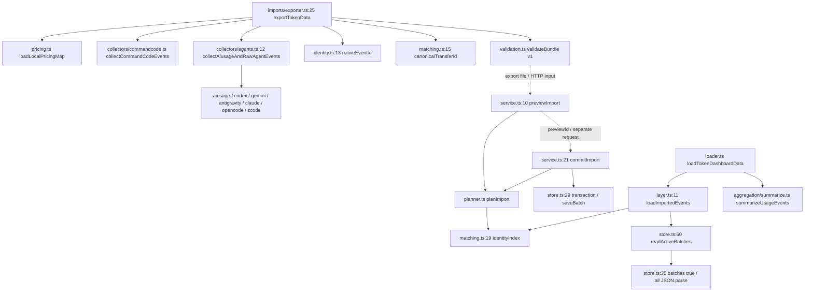

# Sync Agent Phase 0：基线、数据语义与性能决策

日期：2026-10-16（Asia/Singapore）。源码基线：`aef64f4`，分支 `codex/production-readiness`。

**阶段结论：Phase 0 调查、复现和测量已完成；准入验收未通过，Phase 1 暂停。**

阻断来自已复现的数据语义：Codex 修改计数会改变事件 ID；无原生 ID 的记录修正后可能被当成新增；旧批次的归属、回滚、计价优先级需要和自动修正共同定义。此时建立最终主键或回填生产历史会固化歧义。本轮只新增测试、合成 fixtures、基准工具和报告。

正式计划的实际路径是 `docs/plans/incept-sync-agent-implementation-plan.md`。请求中的带日期文件名不存在；实际文件包含 R1～R6、Phase 0～6 和准入门槛。本报告优先按这些修正评估，只读保留原调查报告和计划文件。

## 1. 完成内容与改动文件

开始时 `git status --short` 只有未跟踪的计划文件和 `docs/research/`。没有已跟踪文件的未提交修改。本轮保留这些文件，没有切分支、提交或迁移数据库。

新增文件：

- `packages/dashboard/src/__tests__/fixtures/sync-agent-phase0.ts`：七来源原生 JSONL/JSON/SQLite/Protobuf fixtures、索引桥接、固定统计入口。
- `packages/dashboard/src/__tests__/sync-agent-phase0.test.ts`：38 个特征与准入用例，覆盖旧事件晚到、修正、弱身份、轮转、重试、人工导入、回滚和多设备冲突。
- `packages/dashboard/src/__tests__/fixtures/sync-agent-phase0-benchmark.ts`：测量子进程入口。
- `packages/dashboard/tools/sync-agent-phase0-benchmark.mjs`：构建、分离 fixture 准备与测量、三次重复、匿名统计输出。
- `packages/dashboard/tsconfig.phase0.json`：单独检查本轮测试和基准的类型。
- `docs/research/sync-agent-phase0-benchmark.json`：最终独立基准的 39 次测量及环境元数据。
- 本报告 `docs/research/sync-agent-phase0-decisions.md`。

未修改运行时代码、Owner/TOTP、人工 Import、Docs、Music、Prisma、生产配置或 Windows 自启。接收端写入全部位于测试临时目录或 `.scratch/sync-agent-phase0/`；真实本机源只读采集，明确传入合成设备 ID，避免导出器创建身份文件。真实事件和警告原文只在子进程内存中处理，输出仅含计数与资源指标。

## 2. 源码事实与调查报告修正

| 核对项 | 当前事实与证据 | 本轮结论 |
|---|---|---|
| 版本 | 根 `package.json` 锁定 pnpm 10.30.3；实际 Node v24.21.0；Web 依赖 Next 16.4.0 | 直接使用现有本地二进制验证；Corepack 下载受 DNS 限制 |
| 前端周期 | `use-dashboard-window.ts:7` 为 `60_000`，有可见性暂停 | 当前是 60 秒；计划中 5～10 分钟属于后续 UI 阶段 |
| Refresh now | `next/usage-route.ts:13` 识别 `refresh=1`，Owner 会话 30 秒冷却；调用 `refreshDashboardSnapshot` | 当前只触发服务器自己的 loader/worker，未实现远程设备命令 |
| 导出副作用 | `imports/exporter.ts:13` 的 `deviceId(home)` 会写身份文件；`:25` 接受显式 deviceId | 导出器有文件读取和可选写入，并非纯函数；collector 编排为同步调用 |
| 事件 ID | `collectors/codex.ts:161` 包含 `total ?? last`；其余来源见下一节 | `canonicalTransferId` 不是修正稳定性的保证 |
| 字节上限 | `validation.ts:71` 限制 250000 事件；64 MiB 检查在 CLI 和 HTTP reader，`validateBundle` 本身没有字节检查 | 新协议必须独立限制完整请求体与记录数 |
| 批次存储 | `store.ts:23` WAL、busy_timeout=5000；`:29` BEGIN IMMEDIATE；`:35` 全读活跃 JSON | 当前没有有限重试循环，也没有事件明细表 |
| 导入查询频率 | loader 每次计算调用 `loadImportedEvents`；上层有内存/磁盘快照及 15 秒缓存 | “每次页面加载都必定解析全部批次”过于绝对；解析发生时仍无界读取 |
| 失效机制 | `runtime/refresh.ts:8` 看 DB/WAL mtime；`snapshot-store.ts:20` 为配置 scope | 当前没有事务 dataRevision；新存储需要明确的版本可见性 |
| Debian | `Dockerfile:1` 是 `node:24.21.0-bookworm-slim` | 确认的是镜像基础发行版。生产宿主机和运行容器 os-release 本轮未访问 |
| 部署边界 | compose 的 app 为 read_only、768m、数据库路径 `/data/dashboard/imports.db`；Caddy 映射 80/443 | 仅核对仓库声明；没有连接生产主机或数据库 |
| Caddy timeout | read_body 5m、write 6m、dial_timeout 5s、response_header_timeout 100s | 100s 是响应头等待配置；WSS 长连接生命周期需在 Gateway 阶段实测 |
| 请求体 | Caddy preview 专路 67108864 bytes，其余默认 1048576 bytes | 未来 sync 路由没有专用规则；本轮未改 |
| Gateway 资源 | 仓库没有已实现的 sync-gateway | 35 MB / 64 MB 仍是估算，留待 Phase 4 连接负载测试 |
| 原生 WebSocket 鉴权 | 本轮未选客户端、未实现 WSS | 自定义 Authorization 头需在 Phase 4 用隔离握手验证；长期凭据不放 URL |

正式计划修正保持：R1 扫描后比对身份与内容，不用事件时间减 15 分钟；R2 受控更新与明确冲突；R3 持久 outbox 留给 Agent 阶段；R4 使用异步 Job 与已提交回执；R5 保留 v1 人工导入并处理历史重合。本轮不进入这些后续阶段。

## 3. 关键调用关系与事件契约

以下路径均相对于 `packages/dashboard/src/`；行号对应本轮未修改的源码。



实线表示函数调用，虚线表示文件/请求传递。`commitImport` 在事务中重新取活跃批次并重做 plan，校验 reviewHash；同 checksum 和 mappings 的重试返回原回执。`readActiveBatches` 返回 rowid 降序，`loadImportedEvents` reverse 后按最早活跃批次处理，`seen` 以 canonical ID 为键。读取还建立 native、transferred 两个索引，并处理弱转强与 native 覆盖。

v1 样例：合成事件有意使用测试模型与设备，无会话正文。

```ts
{
  eventId: '<64 hex>', source: 'claudeCode', sessionId: 'phase0-claudeCode',
  timestampMs: 1792065600000, modelName: 'phase0-fixture-model',
  projectKey: '<project>:<path hash>', projectName: 'synthetic-project',
  workspacePath: 'D:/synthetic-project',
  inputTokens: 100, outputTokens: 20, cacheReadTokens: 10,
  cacheCreationTokens: 0, reasoningTokens: 0,
  // recordedCost 可选，Codex 禁止传入该字段。
}
```

`contentHash` 包含 source/session/time/model/五类计数。`recordHash` 再加 recordedCost，不包含项目归属、路径、标题、捕获价格、设备或采集器版本。导出 checksum 覆盖整个包，但每次 exportId/时间会变化，不能代替逐记录修订指纹。

| 来源 | 当前身份生成 | 修正/轮转语义 |
|---|---|---|
| Codex | hash(source, session, timestamp, total 或 last usage) | 计数修正改变 ID；当前 weak 检测通常将它视为强身份。归档拷贝有 session_meta 时保持一致 |
| CommandCode | hash(source, filename session, obj.id 或 line:index) | 原生 id 稳定；无 id 时插行改变身份。重命名 session 文件改变作用域 |
| Claude Code | hash(source, session, requestId, message.id) | 有 id 时计数/模型修正保留 ID；无 id 退化为计数哈希 |
| Gemini CLI | hash(source, session, message.id) | 缺 id 退化；缺时间还会采用文件 mtime |
| Antigravity | hash(source, filename session, response/provider/message 优先键) | 缺请求键退化；增加更高优先级键、会话文件改名均需对账 |
| OpenCode | hash(source, session, data.id 或 row.id) | 原生键不变时修正稳定；message/session_message 重合先去重 |
| ZCode | hash(source, session, row.id)，若有 id | 无 id 的旧 schema 退化；running 行不计入，completed 后重新读取 |
| AIUsage 兜底 | timestamp/source/model/counters/session 的哈希，再识别历史弱 ID | 模型或 Token 改变会失去原内容匹配；不能从已传 v1 包恢复原生请求锚点 |

exact 索引只使用 canonical ID，未加设备/source 复合命名空间。正常原生 hash 已混入 source，但外部 schema 没有验证 ID 推导过程；跨设备相同 ID 还会撞上项目归属冲突。v2 必须同时校验服务端设备归属与来源命名空间。

## 4. 冲突矩阵与暂停证据

完整自动化入口：`sync-agent-phase0.test.ts`。测试特征断言同时包含期望保留的行为和需要阻断的当前行为。

| 场景 | 已复现的当前结果 | 对 Phase 1 的约束 |
|---|---|---|
| 七来源重复扫描 | 相同 events、相同 ID，warnings=0 | 可以做未变更检测 |
| 七来源晚到八天前事件 | 下一次扫描包含旧事件；OpenCode/ZCode 用原生 DB 追加；另有 CommandCode 字面追加用例 | 扫描时间不能用事件时间截断 |
| Codex input 100→120 | ID 改变，preview added=1/conflicts=0；commit 后 input=220，正确替换值应为120 | **B1：阻断最终事件主键** |
| 其余六来源有原生 ID 的计数修正 | ID 不变，v1 preview conflict=1，拒绝 commit | 需要新协议修正权属及受控更新；保留 v1 冲突行为 |
| 七来源模型修正 | 有原生 ID 时 ID 不变，recordHash 改变，v1 拒绝 | 不能无条件覆盖历史 |
| Claude/Gemini/Antigravity/ZCode 缺 ID 后修正 | 新 canonical ID，preview 当作新增 | **B1：旧弱事件缺少稳定修订锚点** |
| 无 ID CommandCode 前插一行 | line index 导致身份改变 | 不能把物理行号作为最终主键 |
| Codex 归档拷贝/改名 | 有 session_meta 时只保留一份，ID 不变 | 该具体轮转行为可兼容，其他缺锚点路径另行处理 |
| AIUsage 与原生同一来源重合 | 当前采集只保留原生；旧人工弱记录可桥接为1份 | 桥接必须保留源、内容与项目证据 |
| 一个弱记录对应两个强请求 | preview conflicts=2，拒绝 | **B2：不能猜测旧批次归属或多对一合并** |
| recordedCost .2→.3 | 原生 ID 保留、fingerprint 变化；v1 冲突，旧费用仍为.2 | 新更新须验证同设备/同来源、记录前后值与审计 |
| 项目、标题变化 | 当前 recordHash 不变 | 新指纹需覆盖会影响展示与归属的完整字段 |
| captured input price 1→2 | 事件 recordHash 不变；无接收端本地定价时仍按最早活跃批次捕获价计费 | **B3：捕获价冻结与历史重新定价必须明确** |
| 同一 preview commit 重试100次 | 始终同一 v1 receipt，只有一个 batch、7事件 | 已验证 v1 重试；未来 v2 batchId 回执另测 |
| 重复全量人工 import | 统计不增；仍可保存额外全量 payload | 去重正确性不能代替压实性能 |
| 小快照只剩1事件 | 已有7事件仍在；回滚原批次后保留小快照支持的1条，再回滚清零 | **B4：缺失不自动删除；回滚依赖批次 provenance** |
| 相同 exact ID 来自另设备 | 未映射 external project 时产生 conflict | 不能简单把旧数据分设备重键后再双读 |
| native 与已导入重合 | 7来源均 duplicateLocal，最终只算一份 | 统一读取要保持当前 native 优先关系 |

Codex 具体差异：输入多100、总 Token 多130、费用多0.000145 USD；同一 session 数量仍为1。新旧两个版本的 input 合计220，目标更正值120。此用例通过表示问题已稳定复现，阶段准入仍失败。

## 5. 旧批次兼容与迁移方案

### 5.1 已确定的兼容契约

- v1 TransferBundle、Preview/Commit、敏感操作门禁和 rollback 保留原行为；v2 为独立协议。
- `batches`、receipt、映射与原始 payload 作为可回滚 provenance 保留，不删除旧数据。
- 缺文件、空扫描、部分采集失败不构成删除命令。删除只接受显式、限作用域的协议操作；本轮没有删除协议实现。
- 原统计以最早活跃批次的事件表示为基准；弱转强只允许现有可证实的一对一桥接。项目映射和批次状态会影响表示选择。
- cost 保留 recorded/calculated 差异；Codex 重算，CommandCode 保留 nominalCost 后按原有峰谷规则处理。模型别名/价格表需独立版本，不能只依赖旧 recordHash。

### 5.2 待确认的实施方案 A（推荐：完整会话对账）

对有原生稳定请求键的来源，用服务端设备归属、source、原生请求键建立受控事件版本。对 Codex 计数型和弱身份，增加完整 source/session 的采集结果与 completeness 证据，以会话 generation 对账；避免把计数变化当作追加。暂时无法证明完整性的会话保留上一版本并报告冲突。

这条路线保留七来源目标，但要在 Phase 0 补齐 collector 覆盖/失败信号和旧身份映射证明后再定最终 SQL。现有导出结构丢失部分锚点，不能仅改 store.ts 达成。特别是累计计数前缀恢复可能同时修正多个后续事件，应以完整会话结果验证。

旧人工数据通过显式的 adoption 清单认领设备/source/session，列明 batch、映射、旧 ID→新实体关系。弱身份或多设备重合的歧义需要 Owner 审阅；不从时间相近或成本相等推断认领。

### 5.3 可行方案 B（改变首期覆盖范围）

首期仅自动修正有稳定原生键且已证明一对一旧批次桥接的来源；Codex、弱身份及歧义历史保留人工导入，返回结构化 conflict。交付更小，但七来源自动同步要推迟。采用此路线需要先调整产品验收范围，本轮没有自行采用。

### 5.4 方案确定后的可重入迁移步骤

1. 对隔离副本记录活跃/回滚 batch、rowid 顺序、mappings 和配置 scope；建立 shadow projection。
2. 逐批回填不可变 observation 和 batch-membership；以旧 batch ID + 原事件身份/位置为迁移幂等键，保留 payload checksum 供复核。
3. 保留最早活跃表示、弱转强桥接、native 覆盖、捕获价及映射语义。不同 batch 的重复事件共享实体但保留独立 membership，回滚后重新选择可见表示。
4. projection 独立重放两次，与旧 loader 对同一 fixture 的 7d/30d/all、tokens、sessions、cost、模型/项目/峰谷汇总逐项对照；歧义记录隔离等待认领。
5. 全部通过后，读路径原子切换为统一 projection；迁移覆盖的旧批次不再额外拼接进聚合。新人工 Commit/Rollback 和 v2 变更在事务中维护 projection 与 revision。
6. 新批次的设备校验、冲突分类、受控 ON CONFLICT UPDATE、版本审计、receipt、dataRevision 在一个事务提交；相同 batchId 且相同 payload 返回原 receipt，相同 ID 不同 payload 拒绝。

这是待验证的迁移设计，未执行建表/回填。B1～B4 解决后须先完成这些隔离测试，再进入 Phase 1。

## 6. 基线统计与差异

统计时区沿用 `domain/window.ts` 的 Asia/Singapore。固定 now 为 `2026-10-16T12:00:00Z`，七来源各一会话、每条 input100/output20/cacheRead10，单价 input1/output2/cacheRead0.5 USD/M。

七原生来源直接聚合：input700/output140/cacheRead70/total910、sessions7、cost0.001015。导入同样记录且与 native 重合时不增加统计。

窗口测试给每个会话增加前一日、15天前、45天前三组独立 observation，重复人工导入相同历史后：

| 范围 | input | output | cacheRead | cacheCreate | reasoning | total | sessions | cost USD | 重复导入差异 |
|---|---:|---:|---:|---:|---:|---:|---:|---:|---|
| 7d | 700 | 140 | 70 | 0 | 0 | 910 | 7 | 0.001015 | 0 |
| 30d | 1400 | 280 | 140 | 0 | 0 | 1820 | 7 | 0.002030 | 0 |
| all | 2100 | 420 | 210 | 0 | 0 | 2730 | 7 | 0.003045 | 0 |

回滚重复批次仍为2730，回滚所有支持批次后为0。非零 cacheCreation/reasoning、CommandCode 峰谷、模型/项目明细保留现有完整 Dashboard 回归覆盖。本轮没有新读取实现，因此没有“迁移前后”生产差异数据；上表是后续 projection 必须复用的隔离基线。

## 7. 性能实测

原始数据见 `sync-agent-phase0-benchmark.json`。最终测量开始于本地 2026-10-16 19:42:45，Windows / Node v24.21.0 / 16 logical CPUs / 32581 MiB RAM。最终一轮在测试、lint、typecheck 结束后顺序运行。

每个测量在新进程中执行，fixture 准备在另一个进程完成；每规模三次，文件缓存已预热。wall/CPU 包括扫描、身份散列、v1 校验和 JSON 序列化；RSS 使用 resourceUsage 的进程生命周期峰值。独立 worker 按20ms请求间隔采样进程总 CPU，含监测开销；单逻辑核满载记100%，GC/worker 可使值超过100%。小于采样窗口的操作不解释 CPU 峰值，JSON 以 null 表示无样本。

### 7.1 七来源全扫描

| 规模 | 输出 bytes | wall 中位/最大 ms | CPU 中位 ms | CPU 采样峰值 % | RSS 最大 MiB |
|---|---:|---:|---:|---:|---:|
| 合成700事件 | 294466 | 70.67 / 76.41 | 95 | 273.65 | 78.82 |
| 合成7000事件 | 2940466 | 265.77 / 271.43 | 360 | 302.06 | 137.07 |
| 合成70000事件 | 29400466 | 1910.74 / 1949.93 | 2282 | 351.33 | 553.29 |
| 合成159600事件 | 67032466 | 4215.72 / 4218.21 | 4609 | 400.04 | 868.06 |
| 本机当前可读全历史15696事件 | 7091950 | 3696.76 / 4043.00 | 4439 | 309.73 | 540.77 |

159600事件的合成包距离64 MiB仅76398 bytes，是本轮最大包压力样本；真实数据字段长度不同，不能按此条数设置通用限额。250000条的 schema 上限仍需与实际 wire bytes 联合检查。

本机扫描三次均15696事件、4条采集警告；警告内容未输出或持久化。它测量当前可读历史的成本，完整性问题需在后续 collector 完成信号中处理。较早探索轮为15687事件，源日志在持续更新；统计 fixtures 与真实历史分开。

以中位值每300秒一次估算：本机 wall 占周期1.2323%、单核 CPU 平均1.4797%；159600事件样本为1.4052%与1.5363%。在本机保留五分钟全扫描作为第一版方案可行，网络只传差异；近64 MiB样本显示内存峰值需要受控。未来串行采集和工作时长监控仍要落实在 Agent 阶段。

### 7.2 旧批次增长

每批是同样700事件的快照，唯一事件始终700；只增加 batch 数。

| 活跃批次 | 解析事件表示数 | readActiveBatches wall 中位 ms / RSS最大MiB | loadImportedEvents wall 中位 ms / RSS最大MiB |
|---:|---:|---:|---:|
| 1 | 700 | 3.63 / 66.07 | 46.28 / 75.16 |
| 10 | 7000 | 10.29 / 71.11 | 188.11 / 94.51 |
| 100 | 70000 | 78.90 / 141.35 | 1585.69 / 302.74 |
| 288 | 201600 | 235.15 / 337.24 | 4721.62 / 430.38 |

readActiveBatches 是解析入口，loadImportedEvents 还包含建立索引、桥接和转换。即使去重后的700事件完全不增长，每次计算仍承担全部 B×E 旧表示的解析与索引开销。数据证明必须压实/投影到统一读取，不能每五分钟保存全量批次再靠内存去重。

以上为 Windows 测量；本轮没有模拟 Linux 2 vCPU/768 MiB 容器、网络上传或 Gateway，相关服务器容量门槛留到实现后的隔离环境验收。

## 8. 测试命令与结果

pnpm 的实际调用因 Corepack 需要下载 pnpm10.30.3，遇到 `ENOTFOUND registry.npmjs.org`。没有安装或修改锁文件，改用仓库已安装的本地二进制。

以下 PowerShell 命令按括号中的工作目录执行。

```powershell
# 仓库根：固定测试临时目录，传入后续测试进程。
$env:TEMP = 'D:/Desktop/code/code/Incept/.scratch/sync-agent-phase0/tmp'
$env:TMP = $env:TEMP
New-Item -ItemType Directory -Force -Path $env:TEMP | Out-Null

# packages/dashboard
node tools/build-runtime.mjs
./node_modules/.bin/vitest.cmd run
./node_modules/.bin/tsc.cmd --noEmit -p tsconfig.src.json
./node_modules/.bin/tsc.cmd --noEmit -p tsconfig.node.json
./node_modules/.bin/tsc.cmd --noEmit -p tsconfig.json
./node_modules/.bin/tsc.cmd --noEmit -p tsconfig.phase0.json

# apps/web
./node_modules/.bin/eslint.cmd .
./node_modules/.bin/tsc.cmd --noEmit -p tsconfig.json
./node_modules/.bin/vitest.cmd run src/server/auth

# 仓库根：默认只生成隔离数据；--local 额外只读扫描当前 home。
node packages/dashboard/tools/sync-agent-phase0-benchmark.mjs --local
node --check packages/dashboard/tools/sync-agent-phase0-benchmark.mjs
git -c core.fsmonitor=false diff --check
```

| 检查 | 结果与影响 |
|---|---|
| 变更前 Dashboard tests | 25文件、187测试通过；初次默认 TEMP 缓存出现 ENOENT，换到仓库 `.scratch` 后通过 |
| 变更后 Dashboard tests | 26文件、225测试通过，含新增38例、人工 Import/route/identity/rollback/peak pricing 全回归 |
| build-runtime | 通过；仅生成已忽略 dist worker |
| Dashboard src/node typecheck | 两项均通过 |
| 本轮 tsconfig.phase0 | 通过，包含新增测试、fixture 与基准 TS |
| Dashboard 完整 typecheck | 失败，36条旧测试/依赖声明诊断；涉及 testing-library 导出、Vitest Assertion.not、旧 mock 类型。另建临时 config 排除本轮新增文件后得到完全相同36条诊断，逐行比对无新增 |
| 仓库 lint（实际脚本为 web eslint） | exit0，0 error、8条既有 warning；dashboard 没有单独 lint script |
| Web typecheck | 失败；现有 workspace 多份生成 Prisma Client 类型冲突及测试类型诊断，未改动该部分 |
| Owner/Auth regression | 6文件通过、1文件跳过；22测试通过、28个真实 PostgreSQL 用例跳过。未配置 INCEPT_AUTH_TEST_DATABASE_URL，未连接生产库 |
| 基准 | 39次最终测量完成；原始数值已随报告保存 |
| 脚本语法与空白检查 | node --check、git diff --check 通过；另检查全部7个新增文件，无行尾空白 |

本轮 SQLite 集成证据来自真实 node:sqlite 隔离 DB；PostgreSQL 集成测试状态如上。全 monorepo 的 Music/Roadmap 测试未额外执行，根 typecheck 链在 Web 环节已失败。

## 9. 未解决问题、下一步与回滚

Phase 1 的下一步先解决 B1～B4：选择完整会话对账或收窄首期来源，明确历史 adoption、删除/回滚、费用冻结/重算规则；再补齐修订稳定性、旧批次 shadow projection 的可重入对照。之后才能确定最终主键、事务 upsert 和 dataRevision。原计划 Phase 1 第2～4项应以这些新证据为前置条件，而不是直接采用单列 event_id 主键；原调查报告保持只读。

后续 v2 必测：相同 batch100次、不同 payload 复用 batchId、同实体修正只保留当前版本、多设备越权、手工/自动并发、SQLite busy 有限重试、批次与回执原子性、revision 对缓存可见。Agent outbox、异步 Job、WSS、自动启动和生产验收仍按 Phase 2～6 顺序实施。

回滚本轮只需移除上述新增文件及本轮 `.scratch/sync-agent-phase0/` 测试产物，保留开始时已有的调查/计划；没有运行时行为、业务数据或生产配置需要回退。本轮停在 Phase 0 准入门槛，不开始 Phase 1 或 Phase 2～6。
